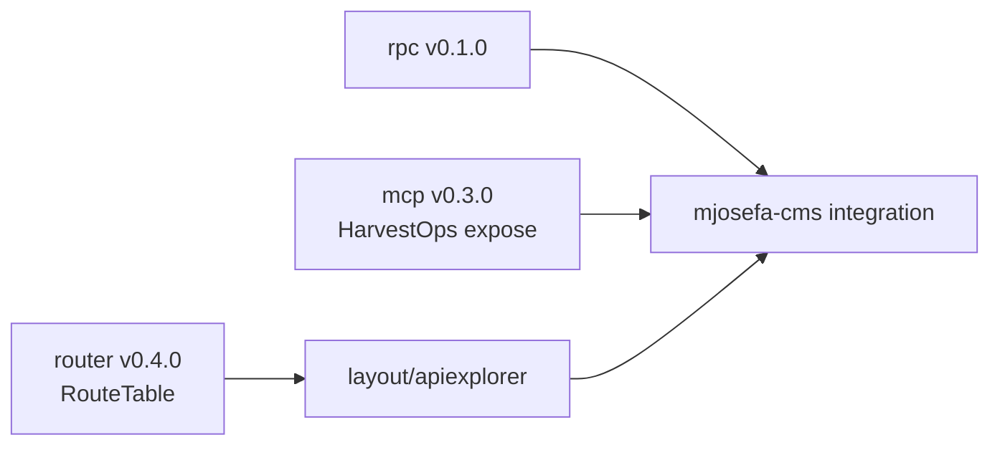

# Master plan — the API surface: operations over HTTP, agents see a list, one explorer

> **Status:** IN PROGRESS · 2026-10-09 · router v0.4.0, rpc v0.1.0, mcp v0.3.0, layout v0.3.39 shipped; mjosefa-cms integration (I) dispatched 2026-10-12

Index: [MASTER_PLANS.md](MASTER_PLANS.md).

**Relation to prior waves:** *extends* the router-adapter wave (`router.OperationRegistry`,
`router.Caller`, `MountIntrospection`); *changes* `mcp.HarvestOps` (breaking: closed by default);
*feeds* `veltylabs/mjosefa-cms/docs/OFFLINE_FIRST_MASTER_PLAN.md` (decision P6: `dbsync` pushes
each pending mutation to its normal `POST /api/<module>/<op>` with an `Idempotency-Key`).

## Why

1. **MCP was doing two jobs.** Apps harvested every operation into one `POST /mcp` and the
   browser called the server through it (`mcp.NewCaller`). In `mjosefa-cms` that announces
   **115 tools** (creates, deletes, admin) to any agent. MCP is now the agents' surface only.
2. **The API was invisible.** `/_routes` (`router.MountIntrospection`) reported one line,
   `POST /mcp`; the 115 operations, their permissions and arguments lived inside MCP's
   `tools/list`. As plain routes they appear in `/_routes` with no extra work.
3. **No way to look at it or try it.** An explorer screen reads `/_routes`.

Modules do not change: they declare operations once (`OperationRegistry`) and views call them
through `router.Caller`. Only bindings change.

## Decisions (2026-10-09, owner)

| # | Decision | Why |
|---|---|---|
| AS-1 | Operations over HTTP as **RPC**: `POST /api/<ModelName>/<op>`, JSON body and response, status codes from the handler. No REST verb mapping, no version segment | Connect/Twirp/tRPC style; operations are named commands. Client and server ship together (PWA update flow) |
| AS-2 | New repo **`webtyp/rpc`** with both ends: `rpc.Mount(router, prefix, modules...)` and `rpc.NewCaller(origin)` | One concern, both ends, like `mcp` and `sse`. Not in `router` (client needs `fetch`/`json`) |
| AS-3 | `rpc` requires `Content-Type: application/json` (415 otherwise) | `httpd` also decodes HTML forms; a cross-site form cannot send JSON without a preflight → closes CSRF for cookie-authenticated operations |
| AS-4 | **MCP closed by default**: `mcp.HarvestOps(expose []mcp.ToolName, modules...)` with names built by `mcp.ToolNameOf(module, op)` (`mcp.Tool` is the existing struct); the app lists its agent tools in **`config/mcp.go`** (beside `config/routes.go`). Empty list = no tools; unknown name = startup error | The app decides what its agent sees; modules stay agent-agnostic. D22 still holds (modifying tools wait for the person) |
| AS-5 | Browsers stop calling operations through MCP (`rpc.NewCaller` replaces `mcp.NewCaller` in apps) | One intent, one path |
| AS-6 | `dbsync` reuses the normal endpoints with `Idempotency-Key`; pull is `GET /api/dbsync/pull?cursor=` + the existing SSE poke | One way to execute an operation, online or replayed; RBAC identical by construction |
| AS-7 | Explorer = **`webtyp/layout/apiexplorer`**, a `platformd.UIModule`; minimum columns: method · path · access · permission · roles; try-it form; orphans first | A screen made of components is a layout; works in dev and production behind a permission |
| AS-8 | `/_routes` and the explorer require `api_explorer:r` (admin) in production; public only in development | The permission map is a map of what to attack |
| AS-9 | The decodable shape of `/_routes` (`router.RouteTable`) lives in `router`, next to its encoder | One wire format, one owner |
| AS-10 | OpenAPI export (`/_openapi.json`): **pending the owner's confirmation** of whether it is in this wave or the next | — |

**Why `/_routes` starts with `_`:** it marks a reserved, system namespace that can never collide
with an application route or module name (a module could be called `routes`). Same convention as
Elasticsearch/CouchDB (`/_cat`, `/_changes`, `/_all_dbs`) and this ecosystem's `/__webtyp/ca`.

## Phases

| # | Repo | Plan | Status |
|---|---|---|---|
| R | `webtyp/router` | `RouteTable`, `RouteRecord.Orphan()` | ✅ v0.4.0 (PR #9). Side effect: `sitec` still wrote fixtures to the old `routes/routes.go`; fixed in sitec v0.2.55 (collision error now names `routescan.DefaultFile`) |
| P | `webtyp/rpc` (new, `gonew`) | `Mount`, `NewCaller`, `Error`, 415 | ✅ v0.1.0 (PR #1 + local: 415 text constant, args encoding error reported). Tests live in a nested `tests/` module (like `auth/tests`) so consumers of rpc do not pull `server/httpd` |
| M | `webtyp/mcp` | `HarvestOps(expose, ...)`, `ToolName`, `ToolNameOf` | ✅ v0.3.0 (PR #31). `app` dependent update hit a flaky real-browser test (passes 3/3 locally with v0.3.0) |
| L | `webtyp/layout` | `layout/apiexplorer` | ✅ v0.3.39 (PR #42 + local round 2: revert of the deleting commit, `Activate()` fetches `/_routes`, texts in `lang.json`, `model.AccessPublic`, README + ARCHITECTURE) |
| I | `veltylabs/mjosefa-cms` (Spanish) | [docs/PLAN.md](https://github.com/veltylabs/mjosefa-cms/blob/main/docs/PLAN.md) (Spanish): `rpc.Mount` + `rpc.NewCaller`, `config/mcp.go` (empty = closed), `MountIntrospection` public in dev / `api_explorer:r` in prod, explorer in the module list, contract tests moved from MCP to rpc, local `replace` of `mcp` removed | 🚀 dispatched 2026-10-12 (Jules 9575879653258201030). Also unblocks the offline wave (PW1, I1 in `mjosefa-cms`) |

Known consumers of `mcp.HarvestOps` that update when they bump: `webtyp/view` (tests),
`webtyp/auth`, veltylabs modules (docs/tests), `veltylabs/mjosefa-cms`, `veltylabs/mjosefa-cote`.

## Log

| Date | Event |
|---|---|
| 2026-10-09 | router v0.4.0, rpc v0.1.0, mcp v0.3.0 shipped. Layout PR #42 was first misreported as "no code" because only the net diff was read; the code was in commit 1 and deleted by commit 2. Review procedure fixed in skills `agents-workflow` (review step 2 "evidence checks": commits one by one, planned files present, no unplanned deletions, no stray files, branch = PR head), `bug-fix-flow` (step 4) and `plan-authoring` (delivery check in every plan's acceptance criteria) |
| 2026-10-12 | Detected while publishing `staff_manager` v0.1.85: the dependent update of `mjosefa-cms` fails `vet` on the two old `mcp.HarvestOps` calls. Left for phase I (owner decision); recorded in the I row |
| 2026-10-12 | Phase I written and dispatched from the offline-first wave (it blocks PW1 and I1 there): MCP closed with an empty `config/mcp.go`, one `HarvestOps` for `authMod` + modules, `ServerConfig.Operations` mounted with `rpc.Mount` |
