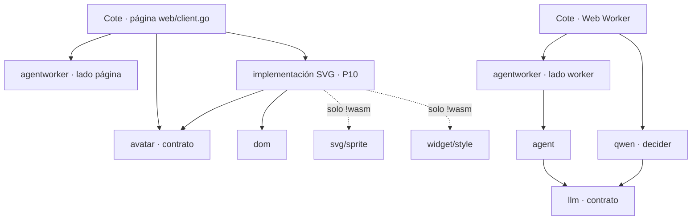
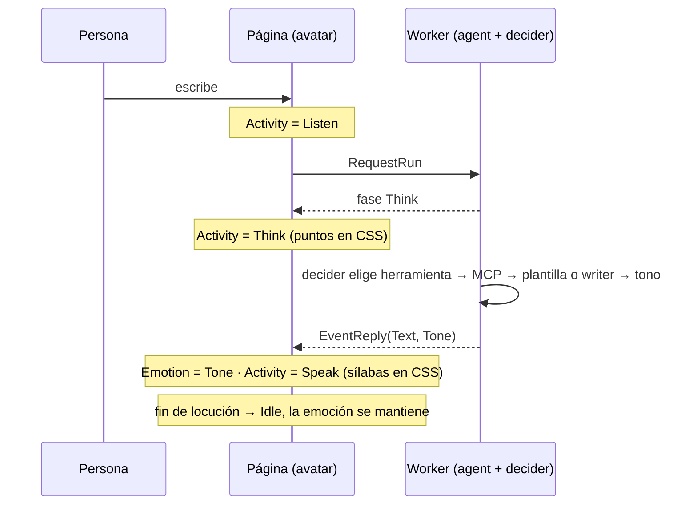

# Avatar en vivo (contrato + implementación SVG) — master plan
> **Status:** IN PROGRESS · 2026-10-20 · v0.1.0 medido: el "cuelgue" es del motor, no del framework. Esperando respuestas P10–P15 del usuario.

Registro de v0.1.0, prior art de la industria, medición y defectos encontrados:
[`avatar/docs/ARCHITECTURE.md`](../avatar/docs/ARCHITECTURE.md).

## Preguntas abiertas

**P10 — Nombre de la implementación SVG.** `webtyp/avatar` pasa a ser el contrato (D9); la implementación necesita un nombre compuesto. A) `svgavatar` (+ CLI `svgavatarc`). B) `puppet` (término de Adobe Character Animator). C) `inkavatar`. **Recomiendo A**: pasa el *novice-name test* (qué es + de qué está hecho) y sigue el patrón contrato/implementación del ecosistema (`files`→`opfs`, `llm`→`qwen`); `puppet` solo lo entiende quien conoce Adobe. Respuesta: avatar, por ahora dejemoslo asi..ningun otro nombre me gusta

**P11 — Herramienta de creación del personaje.** Hoy crear otro personaje no funciona (defecto 4) y un ID faltante en el SVG solo falla en ejecución (Cote además ignora el error de `AddLayers`). A) CLI `svgavatarc` (vía `go:generate`): valida el `.svg` contra la convención, lista lo que falta ("falta `mouth-sad`") y genera constantes Go tipadas con los `href` ya armados. B) Solo validar en `AddLayers` y dejar de ignorar su error. **Recomiendo A**: un ID faltante pasa a ser error de compilación (**api-harness**) y los `href` precalculados eliminan la concatenación por cuadro (defecto 6); mismo patrón que `ormc`/`langc`. Respuesta: A

**P12 — ¿Quién da la actividad (pensar, hablar, escuchar)?** Dijiste que emoción y comportamiento los da el decider; te corrijo la mitad. A) La **actividad** la da el código desde las fases reales del turno (escribe → `Listen`, decider corriendo → `Think`, llega la respuesta → `Speak`); el decider da solo la **emoción**. B) El decider da ambas. **Recomiendo A**: cada pregunta al decider cuesta 2.6–6.6 s (D25 del master de agentes) y podría decir `Think` cuando ya está escribiendo; la fase la sabe el código gratis y nunca miente. Inworld hace lo mismo: emoción viene del modelo, el estado de conversación lo maneja el cliente. Respuesta:

**P13 — Costo de la pregunta de emoción.** A) Las plantillas de Cote declaran su tono en código (gratis, respuestas conocidas); el decider pregunta el tono solo en turnos que usan el writer, con redacción medida antes en `agenteval` (D24/D30). B) Preguntar en todos los turnos. **Recomiendo A**: la mayoría de las respuestas de Cote son plantillas (`Templates()`); preguntar ahí suma segundos para un tono que el código ya conoce. Respuesta:

**P14 — ¿Dónde vive el tipo del tono?** A) `agent.Reply.Tone` (tipo propio de `agent`); la página de Cote lo traduce a `avatar.Emotion` con un `switch` de ~6 líneas, y `tts` v2 leerá el mismo `Tone` para la prosodia. B) `agent` importa el contrato `avatar` y devuelve `avatar.Emotion`. **Recomiendo A**: `agent` sigue sirviendo sin avatar y el contrato `avatar` no conoce al agente; además corren en hilos distintos (agente en el Web Worker, avatar en la página) y solo se hablan por mensajes de `agentworker` (`agentworker/protocol.go:43`). Respuesta:

**P15 — Detectar a tiempo una UI que "no responde".** Pediste logs en el framework. La medición mostró **cero tareas largas**: un log de bloqueos no habría visto este bug. A) Test de aceptación en la implementación: cada setter cambia el DOM antes de retornar (corre en navegador con `gotest`). B) Observador de *long tasks* en `webtyp/dom` en modo desarrollo, visible con `browser_get_console`. **Recomiendo A ahora** (habría atrapado este bug); B sirve para congelamientos reales y va en su propio plan de `dom` si lo querés. Respuesta:

## Decisiones por implementar

| # | Decisión | Dónde se implementa |
|---|---|---|
| D7 (P5) | Tres canales independientes: `Activity` (Idle, Greeting, Listen, Think, Speak, Fatigue), `Emotion` (Neutral, Happy, Sad, Astonished, Angry) y uno autónomo (parpadeo, respiración) que nunca se pausa. Dueño por capa: boca = visema de `Speak` > actividad > emoción; cejas/ojos = emoción, el parpadeo los pisa 150 ms; manos/extras = actividad | contrato `avatar` + implementación |
| D8 (P2, corregida) | Go nunca corre un bucle: cada setter escribe 1–2 atributos `data-*` en el mismo llamado. Parpadeo, sílabas, puntos de pensar y respiración son animaciones CSS (receta *flipbook* de N cuadros en `widget/style`). Solo 2 timers Go, creados una vez y reutilizados: fin de locución (duración según el texto) y bostezo 10–30 s. Sin `go`, sin `js.FuncOf` por cuadro | `widget` + implementación |
| D9 (P3, P6) | `webtyp/avatar` queda como **contrato** (tipos `Activity`, `Emotion`, `Viseme` e interfaz); la implementación SVG va a su propio repo (nombre en P10), separada en `catalog.go` (armado) y `engine.go` (en vivo) | `avatar` + repo nuevo |
| D10 (P7) | Slots con nombre `Shirt`, `Earrings`, `Glasses` en el catálogo, opcionales (vacío = no se dibuja), con orden de capas fijo | implementación |
| D11 (P9) | La emoción la da el decider; `agent` nunca importa el avatar: emite datos, `agentworker` los lleva a la página, la página anima | `agent`, `agentworker`, Cote |
| D12 (P8) | Aceptación: cualquier cambio de estado llega al DOM en < 16 ms (un cuadro); el script de medición del MCP es la prueba | implementación + Cote |
| D13 | Cero asignaciones en el camino caliente: `href` precalculados, sin concatenar strings ni crear funciones JS por cuadro | implementación |

## Fases

| Fase | Repo | Qué | Estado |
|---|---|---|---|
| 1 | `webtyp/svg` | `AddLayers` | cerrada v0.3.28 (verificada 2026-10-20) |
| 2 | `webtyp/widget` | recetas `Wave`, `Pulse`, `Pivot` | cerrada v0.6.42 |
| 3 | `webtyp/avatar` | motor v0.1.0 | cerrada v0.1.0; la reemplazan 5–6 |
| 4 | `webtyp/widget` | receta *flipbook* (N cuadros, período, `prefers-reduced-motion`) y parpadeo, solo CSS (D8) | lista para plan |
| 5 | `webtyp/avatar` | reducir a contrato (D7, D9) | espera P10 |
| 6 | repo nuevo (P10) | implementación SVG: D7–D10, D12, D13; corrige los 8 defectos de v0.1.0. Búsqueda en el ecosistema: se reutiliza `svg/sprite`, `widget/style`, `dom`; se extrae de `avatar` | espera P10, P11 |
| 7 | `agent`, `agentworker` | `Reply.Tone` y eventos de fase (`Think`, `Speak`) hacia la página | espera P12–P14 |
| 8 | `qwen`, `agenteval` | medir la pregunta de tono del decider | espera P13 |
| 9 | `mjosefa-cote` | migrar `web/client.go`, no ignorar el error de `AddLayers`, CSS por `widget/style`, borrar `docs/avatar/preview.html` | espera 6 |

### Dependencias (quién importa a quién)

`agent` no importa ni al avatar ni al contrato: el tono cruza como dato (P14).

### Un turno (mensajes en el tiempo)

## Bloqueos

- Ninguno fuera de las respuestas P10–P15.

## Relación con otras olas

- `AGENT_ECOSYSTEM` (`agent/docs/AGENT_ECOSYSTEM_MASTER_PLAN.md`): fases 7–8; Cote en `mjosefa-cms` sigue esperando las pruebas en el laboratorio.
- `UI_CONSISTENCY`: todo CSS desde `widget/style`, incluido el de `mjosefa-cote/web/client.go`.
- `BUILD_DESTINATIONS`: `svg.go` y `css.go` con `//go:build !wasm`.
