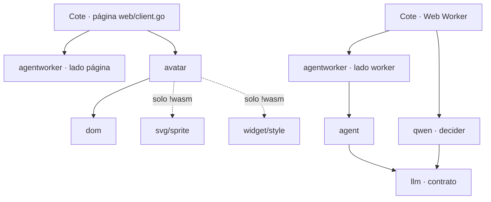
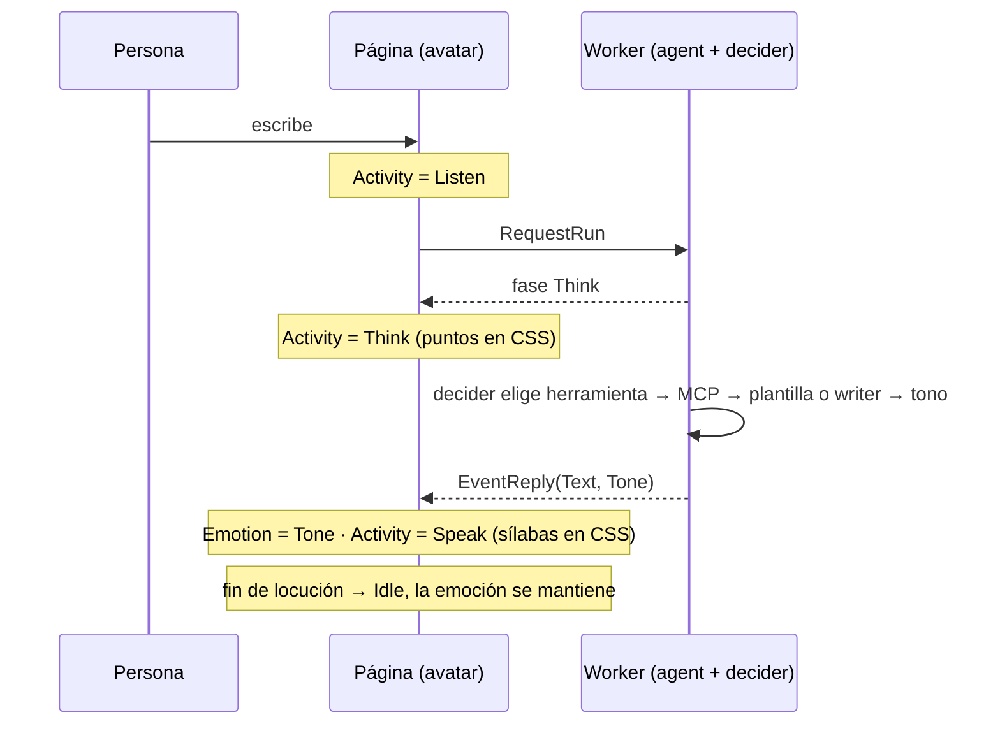

# Avatar en vivo (`webtyp/avatar`) — master plan
> **Status:** IN PROGRESS · 2026-10-20 · Arreglo de `svg` listo en local (falta verificación visual: reiniciar el daemon webtyp). Siguiente: plan de `widget` (fase 4) y medir el decider en la demo de Cote (fase 6).

Registro de v0.1.0, prior art de la industria, medición y defectos encontrados:
[`avatar/docs/ARCHITECTURE.md`](../avatar/docs/ARCHITECTURE.md).

## Preguntas abiertas

Ninguna. La fuente de la actividad (ex P12) se vuelve a preguntar con los números de la fase 6.

## Decisiones por implementar

| # | Decisión | Dónde se implementa |
|---|---|---|
| D7 (P5) | Tres canales independientes: `Activity` (Idle, Greeting, Listen, Think, Speak, Fatigue), `Emotion` (Neutral, Happy, Sad, Astonished, Angry) y uno autónomo (parpadeo, respiración) que nunca se pausa. Dueño por capa: boca = visema de `Speak` > actividad > emoción; cejas/ojos = emoción, el parpadeo los pisa 150 ms; manos/extras = actividad | `avatar` |
| D8 (P2, corregida) | Go nunca corre un bucle: cada setter escribe 1–2 atributos `data-*` en el mismo llamado. Parpadeo, sílabas, puntos de pensar y respiración son animaciones CSS (receta *flipbook* de N cuadros en `widget/style`). Solo 2 timers Go, creados una vez y reutilizados: fin de locución (duración según el texto) y bostezo 10–30 s. Sin `go`, sin `js.FuncOf` por cuadro | `widget` + `avatar` |
| D9 (P3, P6, P10) | El nombre queda `webtyp/avatar` (el usuario no quiere otro por ahora). Por eso no hay repo nuevo: los tipos de contrato (`Activity`, `Emotion`, `Viseme`) y la implementación SVG conviven en `avatar`, separados en `catalog.go` (armado) y `engine.go` (en vivo). Se parte en contrato + implementación solo cuando exista una segunda implementación | `avatar` |
| D10 (P7) | Slots con nombre `Shirt`, `Earrings`, `Glasses` en el catálogo, opcionales (vacío = no se dibuja), con orden de capas fijo | `avatar` |
| D11 (P9) | La emoción la da el decider; `agent` nunca importa el avatar: emite datos, `agentworker` los lleva a la página, la página anima | `agent`, `agentworker`, Cote |
| D12 (P8, P15) | Aceptación: cualquier cambio de estado llega al DOM antes de que el setter retorne (< 16 ms); test en navegador con `gotest` + el script de medición del MCP | `avatar` + Cote |
| D13 | Cero asignaciones en el camino caliente: `href` precalculados, sin concatenar strings ni crear funciones JS por cuadro | `avatar` |
| D14 (P11) | CLI `avatarc` (`cmd/avatarc`, vía `go:generate`): valida el `.svg` contra la convención, lista lo que falta para un personaje nuevo y genera constantes Go con los `href` ya armados (ID faltante = error de compilación) | `avatar` |
| D15 (P12) | Antes de decidir quién da la actividad, medir el decider en la demo de Cote. Ojo: decider-0.8b pesa más que el writer (≈ 529 MB vs ≈ 230 MB en int4); es más barato solo porque responde una letra, pero leer el prompt (prefill) domina su tiempo | `mjosefa-cote` |
| D16 (P13) | Las plantillas de Cote declaran su tono en código; el decider pregunta el tono solo en turnos del writer, con redacción medida antes en `agenteval` | Cote, `qwen`, `agenteval` |
| D17 (P14) | El tono es `agent.Reply.Tone` (tipo de `agent`); la página de Cote lo traduce a `avatar.Emotion` (~6 líneas); `tts` v2 leerá el mismo `Tone` | `agent`, Cote |

## Fases

| Fase | Repo | Qué | Estado |
|---|---|---|---|
| 1 | `webtyp/svg` | `AddLayers` | cerrada v0.3.28 |
| 1b | `webtyp/svg` | `AddLayers` emitía **vacíos** los grupos de Inkscape (salto de línea tras `<g`) y dejaba ocultos sus hijos (`display:none`): por eso no se veían manos ni nube. Test ampliado en `sprite/layers_test.go`; verificado contra `cote-base-v1.2.svg` | [Claude · 2026-10-20 21:15] local + `replace` en Cote; falta verificación visual y `gopush` |
| 2 | `webtyp/widget` | recetas `Wave`, `Pulse`, `Pivot` | cerrada v0.6.42 |
| 3 | `webtyp/avatar` | motor v0.1.0 | cerrada v0.1.0; la reemplaza la 5 |
| 4 | `webtyp/widget` | receta *flipbook* (N cuadros, período, `prefers-reduced-motion`) y parpadeo, solo CSS (D8) | lista para plan |
| 5 | `webtyp/avatar` | v0.2: D7–D10, D12–D14; corrige los defectos de v0.1.0. Búsqueda en el ecosistema: reutiliza `svg/sprite`, `widget/style`, `dom`; `avatarc` sigue el patrón de `ormc`/`langc` | espera 4 |
| 6 | `mjosefa-cote` | demo con Cote real en el Worker (`agentworker`) + `select` de mensajes de ejemplo para no escribir; registrar el tiempo de cada pregunta al decider (herramienta, tono) por tier. Es la fase 5 del master de agentes | lista para plan |
| 7 | `agent`, `agentworker` | `Reply.Tone` (D17) y eventos de fase hacia la página | espera 6 |
| 8 | `qwen`, `agenteval` | medir la pregunta de tono del decider (D16) | espera 6 |
| 9 | `mjosefa-cote` | migrar `web/client.go`, no ignorar el error de `AddLayers`, CSS por `widget/style`, borrar `docs/avatar/preview.html` | espera 5 |

### Dependencias (quién importa a quién)

`agent` no importa `avatar`: el tono cruza como dato (D17).

### Un turno (mensajes en el tiempo)

## Bloqueos

- 2026-10-20 · Verificación visual de 1b: el daemon webtyp no vuelve a extraer el sprite (`restart_development` solo se reengancha; tocar `svg.go` no dispara nada). Espera que el usuario reinicie el daemon.

## Relación con otras olas

- `AGENT_ECOSYSTEM` (`agent/docs/AGENT_ECOSYSTEM_MASTER_PLAN.md`): fases 6–8; Cote en `mjosefa-cms` sigue esperando las pruebas en el laboratorio.
- `UI_CONSISTENCY`: todo CSS desde `widget/style`, incluido el de `mjosefa-cote/web/client.go`.
- `BUILD_DESTINATIONS`: `svg.go` y `css.go` con `//go:build !wasm`.
