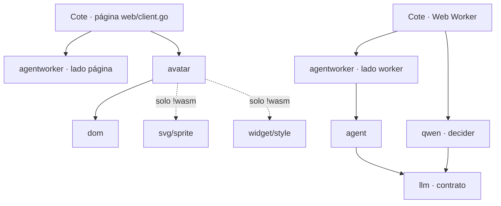
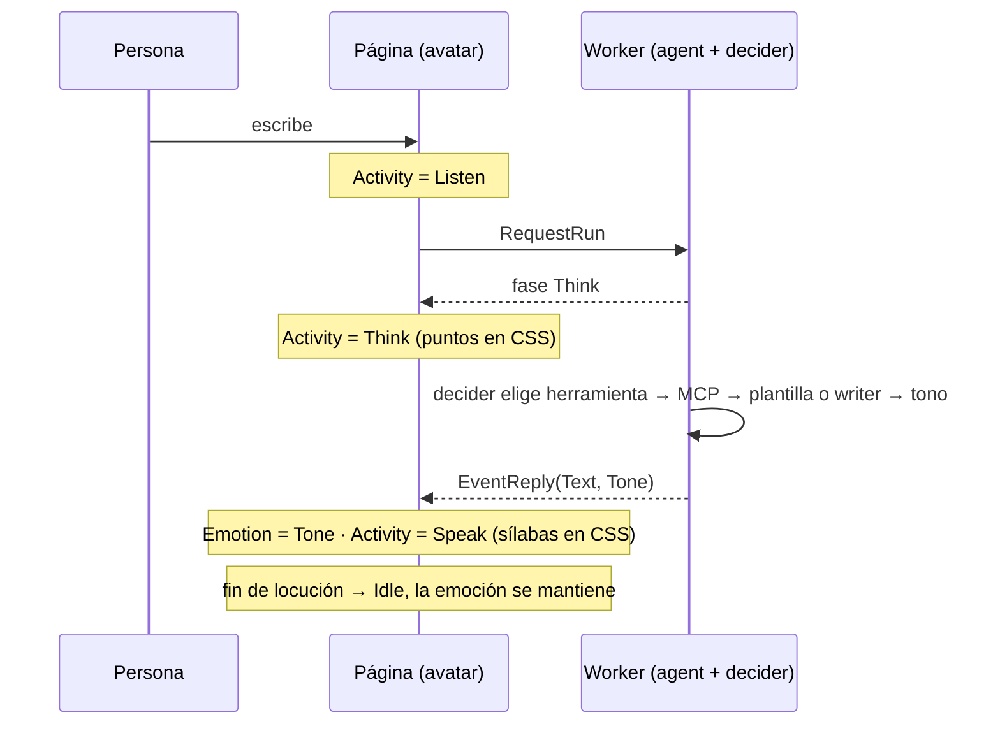

# Avatar en vivo (`webtyp/avatar`) — master plan
> **Status:** IN PROGRESS · 2026-10-20 · `agentworker` (fase 6a) cerrada v0.1.23; `widget` (fase 4) cerrada v0.6.44; `avatar` (fase 5) cerrada v0.2.0; `agenteval` (fase 6b) despachada a Jules (sesión 1984959015553858212).
> **Antigravity coordina la revisión (`codejob pull` + **plan-review**) y el despacho de las fases siguientes.**

Registro de v0.1.0, prior art de la industria, medición y defectos encontrados:
[`avatar/docs/ARCHITECTURE.md`](../avatar/docs/ARCHITECTURE.md).

## Preguntas abiertas

Ninguna. La fuente de la actividad (ex P12) se vuelve a preguntar con los números de la fase 6c.

## Decisiones por implementar

| # | Decisión | Dónde se implementa |
|---|---|---|
| D7 (P5) | Tres canales independientes: `Activity` (Idle, Greeting, Listen, Think, Speak, Fatigue), `Emotion` (Neutral, Happy, Sad, Astonished, Angry) y uno autónomo (parpadeo, respiración) que nunca se pausa. Dueño por capa: boca = visema de `Speak` > actividad > emoción; cejas/ojos = emoción, el parpadeo los pisa 150 ms; manos/extras = actividad | `avatar` |
| D8 (P2, corregida) | Go nunca corre un bucle: cada setter cambia el `href`/`display` de cada capa en el mismo llamado (`widget.State` es un conjunto cerrado de 8 estados genéricos, así que el CSS no selecciona "triste" ni "hablando"). Parpadeo, respiración, sílabas, manos, puntos de pensar, zzz y ondas son CSS (`Blink`, `Breathe`, `Frame` en `widget/style`). Timers Go solo en eventos raros: fin de `Speak` y pasos del bostezo (`time` no tiene `Reset`). Sin `go`, nada por cuadro | `widget` + `avatar` |
| D9 (P3, P6, P10) | El nombre queda `webtyp/avatar` (el usuario no quiere otro por ahora). Por eso no hay repo nuevo: los tipos de contrato (`Activity`, `Emotion`, `Viseme`) y la implementación SVG conviven en `avatar`, separados en `catalog.go` (armado) y `engine.go` (en vivo). Se parte en contrato + implementación solo cuando exista una segunda implementación | `avatar` |
| D10 (P7) | Slots con nombre `Shirt`, `Earrings`, `Glasses` en el catálogo, opcionales (vacío = no se dibuja), con orden de capas fijo | `avatar` |
| D11 (P9) | La emoción la da el decider; `agent` nunca importa el avatar: emite datos, `agentworker` los lleva a la página, la página anima | `agent`, `agentworker`, Cote |
| D12 (P8, P15) | Aceptación: cualquier cambio de estado llega al DOM antes de que el setter retorne (< 16 ms); test en navegador con `gotest` + el script de medición del MCP | `avatar` + Cote |
| D13 | Cero asignaciones en el camino caliente: `href` precalculados, sin concatenar strings ni crear funciones JS por cuadro | `avatar` |
| D14 (P11) | CLI `avatarc` (`cmd/avatarc`, vía `go:generate`): valida el `.svg` contra la convención, lista lo que falta para un personaje nuevo y genera constantes Go con los `href` ya armados (ID faltante = error de compilación) | `avatar` |
| D15 (P12) | Antes de decidir quién da la actividad, medir el decider en la demo de Cote. Ojo: decider-0.8b pesa más que el writer (≈ 529 MB vs ≈ 230 MB en int4); es más barato solo porque responde una letra, pero leer el prompt (prefill) domina su tiempo | `mjosefa-cote` |
| D16 (P13) | Las plantillas de Cote declaran su tono en código; el decider pregunta el tono solo en turnos del writer, con redacción medida antes en `agenteval` | Cote, `qwen`, `agenteval` |
| D17 (P14) | El tono es `agent.Reply.Tone` (tipo de `agent`); la página de Cote lo traduce a `avatar.Emotion` (~6 líneas); `tts` v2 leerá el mismo `Tone` | `agent`, Cote |
| D18 (D15) | `agentworker` construye el decider y la app no puede envolverlo: `agentworker` mide cada `Decide` y el turno, y `EventReply` lleva `DecideMs []int64` y `TurnMs` (como `timings` de llama.cpp). El panel del laboratorio muestra una línea por turno y ofrece mensajes de ejemplo | `agentworker`, `agenteval/ui` |
| D19 | Sin estado `Happy` en el SVG: `Happy` usa las variantes `greeting`. `Viseme` no se agrega hasta que exista TTS (v2) | `avatar` |
| D20 | Toda integración con modelos reales (agente + avatar + UI) corre en el laboratorio de `agenteval` y sus fallas van a `agenteval/docs/REAL_TESTS.md` (skill `testing`). `agenteval` es público y Cote privado: ni `replace` (solo existe en una máquina) ni repo nuevo (`agentlab` ya se creó y borró, D31). El dibujo de Cote se publica como personaje de referencia en `webtyp/avatar/reference` (el dueño lo aprobó); lo de Cote se prueba con sus escenarios `evals/` | `avatar`, `agenteval`, Cote |

## Fases

| Fase | Repo | Qué | Estado |
|---|---|---|---|
| 1 | `webtyp/svg` | `AddLayers` | cerrada v0.3.28 |
| 1b | `webtyp/svg` | `AddLayers` vaciaba los grupos de Inkscape y dejaba ocultos sus hijos (por eso no se veían manos ni nube) | cerrada v0.3.30 (verificada en vivo) |
| 2 | `webtyp/widget` | recetas `Wave`, `Pulse`, `Pivot` | cerrada v0.6.42 |
| 3 | `webtyp/avatar` | motor v0.1.0 | cerrada v0.1.0; la reemplaza la 5 |
| 4 | `webtyp/widget` | `Blink()`, `Breathe()`, `Frame(i, n, Cadence)` + movimiento reducido + validación "una animación por elemento" (`docs/PLAN.md`) | **cerrada** v0.6.44 |
| 5 | `webtyp/avatar` | v0.2.0: D7–D10, D12, D13, D19; corrige los defectos 1–7; subpaquete `reference` con `cote.svg` (ya copiado) y test que cruza motor y dibujo (D20) (`docs/PLAN.md` escrito) | **cerrada** v0.2.0 |
| 5b | `webtyp/avatar` | `cmd/avatarc` (D14): valida el `.svg`, lista lo que falta, genera constantes de `href` | plan tras cerrar la 5 |
| 6a | `webtyp/agentworker` | `EventReply.DecideMs`/`TurnMs` (D18) (`docs/PLAN.md`) | **cerrada** v0.1.23 |
| 6b | `webtyp/agenteval` | panel: mensajes de ejemplo, línea de tiempos y el avatar de referencia junto al chat (piensa mientras espera, habla la respuesta) (`docs/PLAN.md` escrito) | `[Antigravity · 2026-10-20 23:07]` **despachada** (sesión 1984959015553858212) |
| 6c | — (local) | correr el laboratorio con los 4 ejemplos por tier (plano/SIMD) y anotar tiempos y fallas en `agenteval/docs/REAL_TESTS.md`; con esos números se reabre P12 | tras cerrar la 6b |
| 6d | `mjosefa-cote` | solo escenarios `evals/`: revalidar su `docs/PLAN.md` (escrito para agenteval v0.3.0) contra v0.4.x. Sin página de laboratorio propia (D20) | plan tras la 6c |
| 7 | `agent`, `agentworker` | `Reply.Tone` (D17) y eventos de fase hacia la página | espera 6c |
| 8 | `qwen`, `agenteval` | medir la pregunta de tono del decider (D16) | espera 6c |
| 9 | `mjosefa-cote` | importar `avatar/reference` y borrar su copia (`svg.go`, `docs/avatar/img/cote-base-v1.2.svg`, `docs/avatar/preview.html`); su `web/client.go` de prueba se borra (el laboratorio lo reemplaza, D20) | espera 5 |

### Dependencias (quién importa a quién)

`agent` no importa `avatar`: el tono cruza como dato (D17).

### Un turno (mensajes en el tiempo)

## Bloqueos

- 2026-10-20 · `mjosefa-cote` tiene sin commitear la integración del avatar (`avatar.go`, `svg.go`, `web/client.go`, cambios al `.svg` y a `preview.html`): Jules no la ve hasta publicarla. Espera el OK del usuario.
- 2026-10-20 · Daemon webtyp: `restart_development` solo se reengancha y no vuelve a extraer el sprite cuando cambia una dependencia (hubo que reiniciarlo a mano). Defecto de `webtyp/app` sin trazar.

## Relación con otras olas

- `AGENT_ECOSYSTEM` (`agent/docs/AGENT_ECOSYSTEM_MASTER_PLAN.md`): fases 6a–8. D20 reemplaza el punto 5 de su «Start here» (Cote ya no tiene página de laboratorio propia); Cote en `mjosefa-cms` sigue esperando las pruebas en el laboratorio.
- `UI_CONSISTENCY`: todo CSS desde `widget/style`, incluido el de `mjosefa-cote/web/client.go`.
- `BUILD_DESTINATIONS`: `svg.go` y `css.go` con `//go:build !wasm`.
