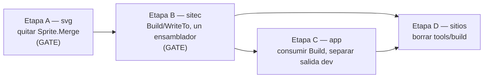

# Master plan — un solo ensamblador de sitio, y una salida que no puede ser parcial

> Orquestador. Cada etapa tiene su propio `docs/PLAN.md` autocontenido en su
> repositorio y se despacha con el flujo CodeJob (ver skill: agents-workflow).

## El defecto que origina esta ola

Arrancar el demonio de desarrollo sobre un proyecto **destruye el sitio
construido**, y lo hace en silencio. Medido en
`veltylabs/mjosefa-website/monjitas-chillan-v3`, mismo directorio, un minuto de
diferencia:

| Archivo | `go run ./tools/build` | tras arrancar el demonio |
|---|---|---|
| `style.css` | 21.467 B, con `@layer` | **10.965 B, sin `@layer`** |
| `client.wasm` | 98.907 B (TinyGo) | **2.000.826 B (Go)** |

Sin `@layer` no aplica ni una regla de componente. La página carga con 200 en
todo y sin un solo error de JavaScript, así que el fallo se diagnostica una y
otra vez como problema del servidor estático de turno. Lo que quede en
`web/public/` es lo que se commitea y lo que se sube.

## Por qué ocurre — tres causas, todas del harness

Ver la [skill `api-design`](https://github.com/webtyp/devskills/blob/main/skills/api-design/SKILL.md).

1. **El pegamento está escrito tres veces.** `sitec/cmd/sitec/main.go`,
   `tools/build/main.go` de cada sitio y `app/section-build.go` ensamblan el
   mismo pipeline (extract → wasm → route → images → flush), cada uno a su
   manera. El harness: *"The glue is written once, in the library that owns
   it."* Tres ensambladores derivan; el del demonio es el que escribe parcial.
2. **La salida es un efecto secundario, no un valor.** `FlushToDisk() error`
   escribe archivos. No existe ningún tipo que signifique "un sitio completo",
   así que **"incompleto" es representable** (principio 3) y falla en silencio
   (principio 6).
3. **Un directorio, dos dueños.** `web/public/` es caché en dev y entregable en
   release. Por el principio 8, un proceso de desarrollo no debería *poder*
   escribir el artefacto de release.

Y la razón de que nada lo atrapara: ninguna de estas librerías tiene el test
que el harness exige — *"An API is not published until a consumer-shaped test,
inside the library itself, proves it."* Los cinco defectos encontrados el mismo
día (retorno de `Merge` descartado, sprite vacío, `@layer` ausente, `PartNav`
sin clase, glifos del toggle sin regla) son **la misma especie**: salida válida,
200 en todo, contenido faltante.

## Grafo de dependencias

| Etapa | Repo | Tipo | Bloquea a | Plan |
|---|---|---|---|---|
| A | `tinywasm/svg` | **gate** | B | `svg/docs/PLAN.md` |
| B | `tinywasm/sitec` | **gate** | C, D | `sitec/docs/PLAN.md` |
| C | `tinywasm/app` | secuencial | D | `app/docs/PLAN.md` |
| D | sitios (`veltylabs/mjosefa-website`, …) | manual | — | sin plan; borrar `tools/build/` y llamar a `sitec.Build` |

A y B son gates: no empieces la siguiente hasta que la anterior esté publicada.
C y D no tienen ambigüedad de diseño una vez B existe.

## Criterio de cierre de la ola

Con las etapas A–C publicadas, esto debe ser cierto y estar cubierto por un
test dentro de la librería dueña:

1. Arrancar el demonio sobre un proyecto **no modifica** `web/public/`.
2. `sitec.Build` sobre un proyecto con una dependencia que aporta CSS e iconos
   devuelve un sitio cuyo CSS contiene los selectores de esa dependencia y cuya
   página contiene sus símbolos de sprite — o devuelve error. Nunca una salida
   parcial.
3. `merged.Icons.Merge(out.Icons)` no compila.
