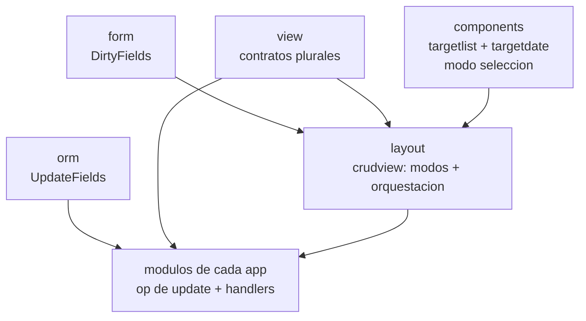

# Master Plan — Acciones masivas (selección múltiple: eliminar y editar)

> Orquestador. Cada librería afectada tiene su propio `docs/PLAN.md`
> autocontenido. Este documento sólo fija el **porqué**, el **contrato
> compartido** y el **grafo de dependencias**.
>
> Los planes se despachan con el flujo CodeJob. Ver skill: agents-workflow.

## 1. El problema

Hoy cada fila del listado lleva su propio botón `⋮` que despliega un menú con
una única opción, Eliminar. Eso tiene tres defectos:

1. **Ruido multiplicado.** N filas dibujan N botones idénticos para una acción
   que casi nunca se usa. En un listado de 20 dispositivos hay 20 `⋮`.
2. **Una sola acción, y sólo sobre uno.** No se puede borrar tres registros sin
   repetir el gesto tres veces, y no hay forma alguna de corregir un campo que
   quedó mal en varios registros a la vez.
3. **No hay sitio donde crezca.** Añadir Editar, Imprimir o Exportar significa
   engordar un menú que se repite en cada fila.

## 2. La forma nueva

El menú por fila desaparece. Las dos acciones — borrar y editar — pasan al pie,
**visibles directamente**, junto al botón `+`.

No hay un `⋮` que las esconda: un desplegable que revela dos botones no es
divulgación progresiva, es un badén. Esconderlas costaría un toque en cada
operación, un estado entero en la máquina (`modeMenu`) y la descubribilidad de
lo que la aplicación sabe hacer. El `⋮` vuelve el día que haya cuatro o más
acciones y dejen de caber en el pie — entonces sí será un menú, que es para lo
que sirven. Traerlo después cuesta un valor de enum y un botón.

```
MODO NORMAL          pie:  [      +      ][  🗑  ][  ✏  ]
                     fila: [ Pc Taller          192.168.122.30 ]
                           tap en la fila → carga el registro en el formulario

  ↓ pulsar 🗑 (o ✏)

MODO SELECCIÓN       pie:  [   ↺   ][ 🗑 3 ]
                     fila: [ ☑ Pc Taller        192.168.122.30 ]
                           tap en CUALQUIER punto de la fila → marca/desmarca
                           el check ocupa el hueco donde vivía el ⋮

  ↓ pulsar 🗑 3 → modal de confirmación, UNA vez para los 3
```

Decisiones ya tomadas y cerradas (no se reabren en los planes):

| Decisión | Resuelto |
|---|---|
| Qué confirma la operación | El mismo botón que abrió el modo, con contador (`🗑 3`). Deshabilitado en 0. Dispara el modal existente una sola vez para los N, con el mensaje `Eliminar 3 registros?` |
| Dónde viven las acciones | En el pie, visibles. Sin `⋮` que las esconda |
| `✏` sin `view.Updater` | No se pinta en absoluto |
| UI de la edición masiva | Se reusa el formulario actual. Se aplican SÓLO los campos que el usuario tocó. El auto-guardado queda suspendido mientras dure el modo |
| Tap en la fila, en modo selección | Alterna el check. No navega |
| Tap en la fila, en modo normal | Sigue cargando el registro en el formulario, como hoy. Los dos caminos conviven, cada uno en su modo |
| Transporte | Una sola interfaz por capacidad, **siempre plural**, y **transaccional de verdad** desde el día uno |
| Qué viaja por el cable en la edición masiva | **ids + delta**, nunca el registro completo |

## 3. Por qué ids + delta, y no el registro completo

Es la decisión de fondo del plan y conviene tenerla escrita, porque un agente
que no la conozca tenderá a "simplificar" mandando el registro entero.

1. **HTTP lo zanjó en 2010.** `PATCH` (RFC 5789) existe precisamente porque
   `PUT` con el cuerpo entero es incorrecto para una modificación parcial:
   obliga al cliente a tener y reenviar todo el estado actual.
2. **Es lo que hace la industria.** Jira Bulk Change, Salesforce
   Composite/sObjects, Gmail `batchModify`, Stripe (*"any parameters not
   provided will be left unchanged"*), Django admin actions, Rails
   `update_all`. La forma canónica en todas partes es *una sentencia, un
   delta, un conjunto de ids*.
3. **Evita el lost update, y el caso de uso lo hace probable.** La edición
   masiva se usa para limpiar datos, y la limpieza se hace mientras los demás
   siguen trabajando. El índice de `view` está tan fresco como el último
   `Reload()`. Si mandas el registro completo: tú corriges `date`, un colega
   corrige una errata en `diagnosis` y guarda, tú aplicas → tu registro rancio
   revierte su corrección en silencio. Con ids+delta es **estructuralmente
   imposible**: `diagnosis` no viaja, así que no se puede escribir.
4. **La atomicidad sale gratis.** Una sola sentencia
   `UPDATE t SET col=? WHERE id IN (?,?,?)` es atómica por definición. El
   camino de registros completos necesitaría N sentencias envueltas en
   `orm.DB.Tx`, y además obligaría a rellenar `XList.EncodeFields` en `ormc`,
   lo que **regenera todos los `*_orm.go` de todas las apps del ecosistema**.

### Lo que YA existe y no hay que construir

Verificado leyendo el código antes de escribir este plan:

- `storage.In(field, value)` existe (`storage/conditions.go:52`).
- El traductor SQL compartido ya compila `IN` a `IN (?, ?, ?)` con los args
  expandidos (`sqlt/translate.go:311`), y lo usan **sqlite y postgres**.
  Exige `[]any` (no `[]string`) y rechaza el slice vacío con
  `IN operator slice cannot be empty`.
- `orm.DB.Delete(m, cond, rest...)` ya acepta condiciones.
  → **El borrado masivo atómico funciona hoy sin tocar `orm`, `storage` ni
  `sqlt`.** Es literalmente
  `db.Delete(&M{}, storage.In("id", ids))`.
- `orm.DB.Tx(fn)` existe (`orm/tx.go:8`) — no hace falta para este plan, pero
  está ahí.
- `model.FieldWriter.Array(name, n)` y `model.ArrayWriter.String/Object` ya
  existen: se puede codificar `{ids:[…], fields:[…], record:{…}}` sin tocar
  `model` ni `ormc`.

### Lo único que falta en la capa de datos

`orm.DB.Update` construye `columns` a partir de **todo** el `Schema()`
(`orm/db.go:76-80`), o sea, tiene la semántica `PUT` incrustada: escribe todas
las columnas siempre. Hace falta una variante que escriba un **subconjunto**.
`storage.Query` ya lleva `Columns []string` y `Values`, y el compilador ya
maneja listas de columnas arbitrarias, así que es fontanería, no rediseño.
Eso es todo el plan de `orm`.

## 4. El contrato compartido

Estas firmas son el eje del plan. Las escribe `view`; las consumen `layout` y
los módulos de cada aplicación. **Ningún plan puede cambiarlas por su cuenta.**

```go
// Una sola interfaz por capacidad. Todas plurales desde el día uno: el caso de
// un solo registro es N=1, no un camino aparte. Se descubren por type
// assertion, exactamente como hoy.

type Saver interface {
    // Crea o reemplaza registros enteros. El alta con "+" y el guardado tras
    // editar una ficha en el formulario.
    Save(recs ...model.Model) error
}

type Updater interface {
    // Parchea SÓLO las columnas nombradas en fields, sobre todos los ids, en
    // una sola sentencia. rec aporta los valores (es el registro del
    // formulario, ya validado); fields dice qué columnas escribir.
    //
    // No es un mapa nombre→valor: los valores se quedan dentro del struct
    // tipado que genera ormc, que es justamente el punto de model.Model. Cero
    // reflexión, cero `any`.
    Update(ids []string, rec model.Model, fields []string) error
}

type Deleter interface {
    Delete(ids ...string) error
}
```

**Nota para quien implemente:** `fields` encaja exacto con
`form.DirtyFields() []string` (plan de `form`) y con el subconjunto de columnas
de `orm.DB.UpdateFields` (plan de `orm`). Los tres hablan de nombres de campo
del `Schema()`, en el mismo formato. No inventes una conversión.

### Editar UN registro vs. editar en lote — no confundir

`Updater` **no es** "editar" a secas. Editar un registro cargado en el
formulario ya funciona sin `Updater`: tap en la fila → carga en el formulario →
`crudview.autoSaveAction` persiste cada campo al confirmarlo, vía
`Saver.Save(registro completo)`. Eso es lo que dice el comentario de `Saver`
arriba ("el guardado tras editar una ficha").

`Updater` / el botón `✏` es **el modo lote**: marcar N filas y aplicar un
parche por columnas a todas de una vez. Es una capacidad aparte, no "la U de
CRUD que faltaba". El "N=1 no es un camino aparte" de este documento se refiere
a que `Saver`/`Deleter`/`Updater` son **variádicos/plurales** (una implementación
sirve para N=1 y N>1), **no** a cambiar `Save` por `Update` en la edición suelta
— eso contradiría el reparto de arriba y traería el lost-update a un caso donde
no aplica.

Cada afordancia del pie de `crudview` se pinta solo si su capacidad está
presente (type assertion en render): la creación (`+`) ↔ `Saver`, `🗑` ↔
`Deleter`, `✏` ↔ `Updater`. El botón toggle siempre existe porque también es el
`↺` que sale del modo selección; su estado `+` va **deshabilitado** cuando no
hay `Saver`. Una vista sin ninguna de las tres es una lista de solo lectura.

## 5. Grafo de dependencias



| Fase | Librería | Plan | Bloquea a | Puede ir en paralelo con |
|---|---|---|---|---|
| A | `orm` | `orm/docs/PLAN.md` | apps | form, view, components |
| A | `form` | `form/docs/PLAN.md` | layout | orm, view, components |
| A | `view` | `view/docs/PLAN.md` | layout, apps | orm, form, components |
| A | `components` | `components/docs/PLAN.md` | layout | orm, form, view |

| B | `layout` | `layout/docs/PLAN.md` | apps | — |
| C | apps (`app-demo`, consumidores) | — (trabajo local) | — | — |

Las cuatro de la fase A son **independientes entre sí** y pueden despacharse a
la vez. `layout` es la **puerta**: no arranca hasta que las cuatro estén
publicadas.

## 6. Lo que rompe (y hay que arreglar en fase C)

Cambiar `view.Saver` y `view.Deleter` a plural es **breaking**. Consumidores
identificados con `grep`:

```
layout/crudview/crudview.go
view/mock/renderer.go
view/conformance/conformance.go
crudp/handlers.go
app-demo/modules/medicalhistory/medicalhistory.go
auth/authority/users.go
auth/authority/credentials_lan.go
```

Los dos primeros los arreglan sus propios planes. `view/mock` y
`view/conformance` van dentro del plan de `view`. `crudp`, `auth/authority` y
los módulos de `app-demo` son fase C, trabajo local.

La firma variádica está elegida a propósito para que el daño sea mínimo:
`Delete(id)` sigue compilando tal cual en los sitios de llamada; sólo cambian
las **implementaciones**.

`crudview.ListView` y `crudview.Config.List` también cambian de forma — ver el
plan de `layout`.

### Fase C — lo que hicieron los `memCaller` de app-demo (referencia)

Al pasar el payload de singular a los structs plurales de `view`
(`saveArgs{records}`, `updateArgs{ids,fields,record}`, `deleteArgs{ids}`), un
`memCaller` **no puede asertar** el payload (`args.(*Device)`) — esos structs
son privados de `view`. Lee el cable con un walk del `model.FieldWriter`
(`readArgs` en `devices/store.go` y `medicalhistory/store.go`):

- `<m>_save` → recorre el array `records` (`Object` → `.(*Device)`/`.(*Visit)`,
  el módulo dueño del tipo) y hace el create-or-update de siempre.
  **Trampa:** el caso `save` se quedó asertando `*Device`/`*Visit` cuando el
  resto ya se había migrado — el guardado erraba en silencio hasta que se
  arregló aquí.
- `<m>_update` → arrays `ids` y `fields` + objeto `record`, luego
  `db.UpdateFields(record, fields, storage.In("id", ids))`.
- `<m>_delete` → array `ids`, luego `db.Delete(&M{}, storage.In("id", ids))`.

`medicalhistory` envuelve el presenter en `requirePatient` (embebe la interfaz
`view.Presenter`), así que `Update` **no se promociona** por embeber — hace
falta un forward explícito + `var _ view.Updater = requirePatient{}`, igual que
`Save`/`Delete`.

## 7. Reglas del ecosistema (aplican a TODOS los planes)

- **Idioma:** este repositorio es una librería pública. El código, los
  comentarios, los identificadores y los mensajes de error van **siempre en
  inglés**. Sólo la prosa de los `PLAN.md` va en español.
- **Nada de mapas en paquetes que compilan a WASM.** Un `map[...]` arrastra la
  maquinaria de hashing y el runtime de TinyGo al binario, que es justo lo que
  este ecosistema no puede permitirse. La forma sustituta:
  - conjunto → `[]string` (o el slice del tipo que sea)
  - clave→valor de cadenas → `[]fmt.KeyValue` de `github.com/tinywasm/fmt`
  - clave→valor de otro tipo → un slice de un par tipado propio, nunca un mapa

  Un mapa **sí** es legítimo en un fichero `//go:build !wasm` — todo
  `widget/style` los usa en su emisor de hojas de estilo, que nunca llega al
  navegador. La regla es sobre lo que se compila a WASM, no sobre el estilo.
- **Nada de stdlib en paquetes que compilan a WASM.** Usa
  `github.com/tinywasm/fmt` en lugar de `errors`, `strconv`, `strings`.
  `fmt.Sprintf`, `fmt.Err`, `fmt.Errf`, `fmt.Contains`, `fmt.Matches`.
  **`tinywasm/fmt` NO tiene `Itoa` ni `FormatInt`** — para intercalar un entero
  usa `fmt.Sprintf`.
- **Anti-footgun, y esta ya mordió una vez.** La regla de arriba tiene dos
  mitades y sólo una es "no uses stdlib":
  1. **No conviertas** los imports de stdlib que ya existan en un paquete
     backend (`storage`, `sqlt`, y los ficheros `//go:build !wasm` de
     cualquiera). Están bien donde están; no los "arregles".
  2. **Al escribir código nuevo, sigue el idioma que ese paquete ya usa** —
     no lo que su carpeta te sugiera. Míralo antes: `grep -rn "tinywasm/fmt"`
     en el paquete te lo dice en un segundo.

  El caso real: el plan de `orm` decía sólo la mitad 1, y el agente dedujo que
  `orm` "es backend, luego stdlib vale" y metió `errors.New` y `fmt.Errorf` en
  `db.go` — los **únicos** de todo el paquete, que construye sus errores con
  `fmt.Err`/`fmt.Errf` de `tinywasm/fmt` en `errors.go` y `validate.go`. Compiló,
  pasó los tests, y habría entrado stdlib en un paquete que no la usa.
- **Embebido por valor:** `dom.Element` se embebe por valor, nunca
  `*dom.Element`.
- **Separación SSR por extensión:** CSS/SVG/JS/HTML pesados van en ficheros con
  `//go:build !wasm` llamados exactamente `css.go`, `svg.go`, `js.go`,
  `html.go`. Nunca en `ssr.go`.
- **Sin `front.go`:** la interactividad WASM va en el fichero principal del
  componente vía `OnMount()`.
- **Módulos planos:** nada de subcarpetas dentro de un módulo.
- **Sin carpetas `internal/`.**
- **Tests:** `gotest` (nunca `go test`). Sólo librería estándar de testing —
  nada de `testify` ni `gomega`.

## 8. Alineación con el harness

La [skill `api-design`](https://github.com/webtyp/devskills/blob/main/skills/api-design/SKILL.md) gobierna esta ola. Los puntos donde
se aplicó explícitamente, para que un revisor los pueda comprobar:

| Regla del harness | Dónde se aplica |
|---|---|
| *The glue is written once, in the library that owns it* | El modo selección es la pieza `components/listselect`, ensamblada por `targetlist` y `targetdate`. **No** se escribe dos veces (precedente: `components/listgap`) |
| *One way to do each thing* | Sin `ClearChecked()` (redundante con `SetSelectMode(false)`). Sin `onCheckedChange` en la fábrica de `Config.List` (ya es método de `ListView`). Sin `BulkDeleter` junto a `Deleter`: una interfaz por capacidad |
| *Illegal states unrepresentable* | El modo es **un** enum cerrado, no tres booleanos que harían representable "menú y selección a la vez". Al quitar el `⋮` desaparece además `modeMenu` |
| *Minimal surface* | Se exporta sólo lo que el consumidor usa. `listselect` mantiene sin exportar lo que `crudview` no necesita |
| *Fail at compile time → loud diagnostic → never silent* | Los nombres de campo son inevitablemente dinámicos, así que se cae al segundo escalón: `Update` y `orm.UpdateFields` **rechazan con error** la lista vacía y el campo desconocido. Nunca un `UPDATE` que no toca nada |
| *A missing contract at a boundary is a defect in the library* | `form.DirtyFields()` se añade **en `form`**, no se recalcula en `crudview`. `orm.UpdateFields` se añade **en `orm`**, no se arma una `storage.Query` a mano desde arriba |
| *Never wrap a library to fix its behaviour* | Ningún plan envuelve nada. `view` cambia sus propias firmas; `orm` añade el suyo |
| *An API is not published until a consumer-shaped test, inside the library itself, proves it* | `view` amplía `view/conformance` al camino plural. `layout` prueba con `targetlist` **real** y `form` **real**, fingiendo sólo el `router.Caller`. `components` prueba con el componente real, sin doblar `listselect` |
| *No `internal/` folders* | Ninguno de los planes crea uno |

