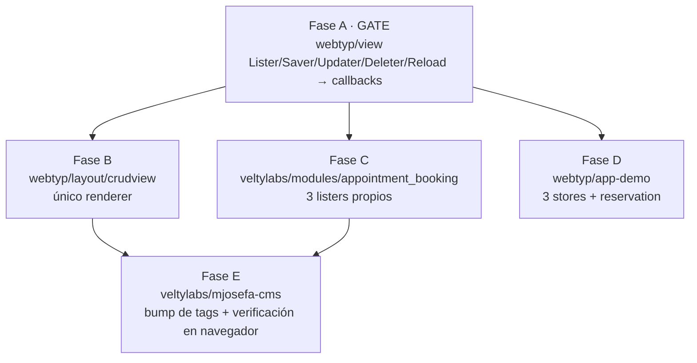

# Master Plan — `view` vuelve a callbacks: el puente síncrono sobre un transporte asíncrono no es implementable en wasm

> **Status:** PENDING · 2026-09-15 · `view` finge ser síncrono sobre un `Caller` asíncrono con canales bloqueantes; funciona en TinyGo y deadlockea en Go plano

> Índice de olas: [`MASTER_PLANS.md`](MASTER_PLANS.md). El plan ejecutable de la
> Fase A vive en `view/docs/PLAN.md`.

---

## 1. Qué pasó

`webtyp.com/view` expone cuatro operaciones como si fueran síncronas:

```go
Lister.List()  ([]model.Model, error)
Saver.Save(recs ...model.Model) error
Updater.Update(ids []string, rec model.Model, fields []string) error
Deleter.Delete(ids ...string) error
Presenter.Reload() error
```

Las cinco están implementadas igual, sobre un transporte que es asíncrono:

```go
ch := make(chan error, 1)
b.caller.Call(b.ops.List, nil, dec, func(err error) { ch <- err })
if err := <-ch; err != nil { ... }      // ← el bloqueo
```

**No siempre fue así.** El commit `d468f09` en `webtyp/view` (2026-07-15,
*"refactor: compile-time safety constructor, synchronous presenter methods, and
explicit form synchronization payload"*) cambió exactamente esto:

```go
-func (p *presenter) Reload(done func(error))
-func (p *presenter) Save(done func(error))
-func (p *presenter) Delete(id string, done func(error))
+func (p *presenter) Reload() error                  // ch := make(chan error,1) … <-ch
+func (p *presenter) Save(payload model.Model) error
+func (p *presenter) Delete(id string) error
```

El motivo declarado en el plan de ese refactor fue razonable: *"llamadas
interactivas completamente síncronas… aprovechan canales bloqueantes para
acoplarse sobre el `Caller` asíncrono, reduciendo drásticamente la posibilidad
de estados ilegales en la interfaz"*. La intención era harness-alineada
(principio 3, *illegal states unrepresentable*). El mecanismo es lo que no se
sostiene.

Y ya se propagó: `VIEW_PAYLOAD_SEAM_MASTER_PLAN.md` §310 usa el bloqueo como
**justificación** para seguir sincrónico — *"Async: no es obstáculo. `core.save`
ya bloquea en un canal … El `Backend` síncrono es la misma forma que ya se
expone hacia arriba."* Es literalmente lo que el harness advierte en *"A defect
compounds through every piece built on it"*: cada pieza nueva lo hereda o lo
codifica en su propio contrato.

## 2. Por qué no es implementable (medido, no argumentado)

Bloquearse en un canal que solo un callback JS posterior puede llenar, estando
ya dentro de un callback JS, **depende del runtime**. Mismo código, mismo
Chrome, sonda aislada (`Element.OnClick` → `caller.Call` → `<-ch`):

| Runtime | Modo de build en `webtyp/app` | Resultado |
|---|---|---|
| **TinyGo** `-target wasm` | `M` (`-opt=1`), `S` (`-opt=z`) | ✅ completa — *asyncify* desenrolla y rebobina la pila, incluso cruzando el callback JS |
| **Go plano** `GOOS=js` | `L` (por defecto) | ❌ `fatal error: all goroutines are asleep - deadlock!` · `exit code: 2` |

Go plano no puede desenrollar un frame de callback JS: aparca la goroutine, no
encuentra ninguna ejecutable, y da el programa por terminado. Como el shim solo
loguea códigos de salida distintos de cero en algunos caminos, **muere en
silencio**: sin pánico visible, sin traza, y cualquier respuesta posterior tira
el inútil `Go program has already exited`.

Un contrato que solo se sostiene en dos de los tres modos de build que el propio
framework ofrece no es un contrato. `veltylabs/mjosefa-cms` corre en modo `L`:
por eso su pantalla de Reserva Hora mataba la app entera al cargar.

**Alcance real hoy, en modo `L`:** toda escritura de toda pantalla `crudview`
está muerta — `autoSaveAction` (blur de campo → `Saver.Save`),
`deleteEntryAction` (clic → `Deleter.Delete`), y los `Reload()` desde esos mismos
handlers. No es un caso borde: es el camino principal de la aplicación.

## 3. La corrección

Volver a callbacks — que es lo que la capa de abajo ya exige. `router.Caller`
lo documenta en su propia interfaz:

```go
// done reports the outcome; result/err arrive asynchronously (works for wasm
// fetch and for in-process test doubles alike).
Call(op string, args model.Encodable, into model.Decodable, done func(err error))
```

`view` envolvió un contrato explícitamente asíncrono para fingir que no lo era.
La corrección es dejar de fingirlo, no bajar el problema a otra librería.

### Design gate

**1 · Prior art.** Ningún framework de UI bloquea el hilo esperando I/O:

| Framework | Cómo entrega datos | Bloqueo síncrono |
|---|---|---|
| React | `useEffect` + `setState` | no existe en la API |
| Elm | `Cmd` → mensaje a `update` | no es expresable |
| Flutter | `Future` + `setState`/`FutureBuilder` | imposible por tipos |

Los tres coinciden: **el efecto se pide, el resultado vuelve como
callback/mensaje y actualiza estado.** Hoy nos diferenciamos de los tres
justamente en lo que se rompe. Volvemos a la forma común.

**2 · Novice-name test.** `lister.List(func(rows, err) { … })` se lee como la
frase *"pedime la lista y cuando llegue, llamame"*. La versión actual,
`rows, err := lister.List()`, se lee como *"esto vuelve ya"* — y miente.

**3 · Complexity ledger.**

| | Δ |
|---|---|
| Conceptos | **−1** (desaparece el puente sync-sobre-async; `view` deja de usar canales) |
| Archivos | **0** en `view` (se editan los existentes) |
| Líneas en call-sites | **+~20** en `crudview` (el callback anida), **−~25** en `view` (se van 5 bloques de canal) |
| Formas de hacerlo | **2 → 1** (hoy: callback en `Caller`, bloqueo en `view`) |

La última fila no queda positiva.

**4 · Dónde vive.** En `view`, que es quien posee "cómo se pide un registro a
la aplicación". No en `dom`: `dom` no sabe de transportes y su contrato
(*`Init()` corre una vez, antes del primer `Render()`*) es correcto — lo que lo
viola es un componente que bloquea.

**5 · Qué borra.** Los cinco `ch := make(chan error, 1)` de `caller_lister.go` y
`presenter.go`. Y, si se cierra el PR #27 de `dom` (ver §5), las ~90 líneas de
diferimiento a microtask que solo existían para tolerar este bloqueo.

### Firma propuesta (decisión abierta)

Recomendada — `done` al final, como **todo** lo asíncrono del ecosistema
(`Caller.Call`, `fetch…Send`, y el propio `Reload(done func(error))` anterior a
`d468f09`):

```go
type Lister  interface { List(done func(rows []model.Model, err error)) }
type Saver   interface { Save(recs []model.Model, done func(error)) }
type Updater interface { Update(ids []string, rec model.Model, fields []string, done func(error)) }
type Deleter interface { Delete(ids []string, done func(error)) }
// Presenter
Reload(done func(error))
```

Costo honesto: `Save`/`Delete` **pierden el variádico** (un parámetro variádico
debe ir último, y ahí va `done`), contra la justificación que `view.go` declara
hoy — *"Variadic, not single: the one-record case is N=1"*. La semántica plural
se conserva: se pasa un slice.

Alternativa, si se prefiere conservar el variádico: `Save(done func(error), recs
...model.Model)`. Queda consistente en pluralidad pero rompe la posición de
`done` respecto del resto del ecosistema. **Recomiendo la primera** (principio
4, *one way to do each thing*); la elección es del autor y debe quedar fijada
antes de despachar la Fase A.

### Cómo se lee, del lado del consumidor

La forma que reemplaza al bloqueo es la que el framework ya usa en todas partes:
callback para pedir, signal para pintar.

```go
func (v *MiVista) Init(dom.Ctx) {
    v.filas = dom.NewNodes()             // 1. el hueco, vacío

    v.lister.List(func(rows []model.Model, err error) {
        if err != nil { return }         // 2. pedís; no esperás
        v.filas.Set(render(rows))        // 3. al llegar, lo ponés → la UI se repinta sola
    })
}
```

Sin canales, sin goroutines, sin workers. Un dev sin experiencia lo lee de
corrido.

### Lo que NO es la solución

Un Service Worker / Web Worker. `webtyp/js` ya tiene la capa tipada
(`ServiceWorkerHandler`, `WebWorkerHandler`, `Message`), pero un worker es otro
hilo y `postMessage` es asíncrono: no devuelve una llamada síncrona. Lo único
que bloquearía de verdad es `SharedArrayBuffer` + `Atomics.wait`, que no existe
en `webtyp/js`, exige cabeceras COOP/COEP y **congelaría el hilo de UI**. Más
complejo y peor. Los workers son para offline, caché, push y trabajo en segundo
plano.

## 4. Fases



| Fase | Repo | Alcance medido | Gate |
|---|---|---|---|
| **A** | `webtyp/view` | `lister.go`, `view.go` (Saver/Updater/Deleter/Presenter), `caller_lister.go` (8 wrappers), `presenter.go` (core), `conformance/`, `mock/`, `tests/`, `README.md` | bloquea a todas |
| **B** | `webtyp/layout/crudview` | `crudview.go` (`Init`→`Reload`, `saveAction`, `autoSaveAction`, `deleteEntryAction`, `bulkDeleteAction`, bulk update), `crud.go` | espera tag de A |
| **C** | `veltylabs/modules/appointment_booking` | `lister.go`: `reservationLister`, `reservationFormStore`, `employeeServiceConfigLister` | espera tag de A |
| **D** | `webtyp/app-demo` | `modules/medicalhistory/store.go`, `modules/devices/store.go`, `modules/reservation/reservation.go` | espera tag de A |
| **E** | `veltylabs/mjosefa-cms` | bump de tags; verificar en navegador real que guardar/borrar/recargar ya no matan la app | espera B y C |

**No cambian** (lo verifiqué): `staff_manager`, `item_catalog`, `device_manager`,
`patient_directory`, `business_calendar`, `clinical_encounter`, `editorial` y
`webtyp/auth` — todos solo declaran `view.Ops{...}` y llaman `view.New(...)`,
nunca tocan los métodos bloqueantes. `webtyp/widget` solo menciona
`view.Presenter` en un comentario. `work_schedule` y `modulesOLD/business_hours`
están descartados/legados: se anotan, no bloquean la ola.

## 5. Qué hacer con el PR #27 de `dom`

**Cerrarlo sin mergear.** Ese PR difiere el montaje reactivo a un microtask para
que un `Init()` bloqueante no quede anidado en el callback que lo disparó.
Funciona y está probado, pero:

- **`dom` no tiene el defecto.** Su contrato (*`Init()` una vez, antes del primer
  `Render()`*) es correcto; quien lo viola es un componente que bloquea.
  Arreglarlo ahí es corregir en la pieza equivocada.
- **Cubre la mitad.** Cierra el camino de montaje; clic → guardar/borrar sigue
  muriendo igual (medido con el PR ya aplicado). Como contención no alcanza:
  convierte *"se cae al cargar"* en *"se cae al primer guardado"*.
- **Cuesta.** ~90 líneas en el camino más caliente del framework, y el montaje
  reactivo deja de ser síncrono — un cambio de contrato observable que ya rompió
  `TestBindChildren` en la primera versión.
- **Enseña lo contrario.** Hace que bloquear *parezca* válido en un camino y
  fatal en otro. Es exactamente el fallo silencioso que el harness existe para
  eliminar.

Con la Fase A aplicada, nada bloquea y el PR deja de aportar.

**Lo único que vale la pena rescatar** es una línea de documentación en
`dom/docs/BINDING_MODEL.md`, junto al contrato de `Init()`: *`Init()` no debe
bloquear esperando una respuesta de transporte; pedí con callback y actualizá un
signal.* Es documentar un contrato que ya existe, sin maquinaria.
