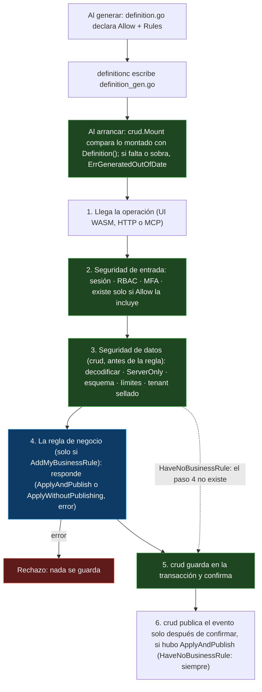

# CRUD por declaración — diseño vigente
> Documento permanente. Describe cómo se declara un módulo y qué hace `crud` con esa declaración. Diagrama del transporte: [diagrams/TRANSPORT_CRUD_ARCHITECTURE.md](diagrams/TRANSPORT_CRUD_ARCHITECTURE.md). Decisiones entregadas de olas anteriores: [CRUD_CONTRACT_DESIGN.md](CRUD_CONTRACT_DESIGN.md).

## 1. Por qué

Antes, un módulo declaraba `Allow: Create|Read|Update` y aun así escribía a mano el montaje (`ops.go`). La seguridad ya vivía en `crud.StoredEntity` (RBAC sellado, esquema validado una vez, `ServerOnly`, tenant sellado por el `Store`) y no cambia. Lo que fallaba en el montaje a mano: declarar `Allow` y olvidar montar; olvidar un gancho (la unicidad desaparece y compila); 16 copias que divergen. Ahora el módulo se declara una vez y lo demás se genera o se rechaza.

## 2. Cómo se declara

```go
// definition.go — lo único que declaras
var Definition = model.ModuleDefinition{Name: "patient_directory", Entities: []model.Definition{PatientModel}}
var PatientModel = model.Definition{
	Name:  "patient",
	Allow: model.Create | model.Read | model.Update,
	Rules: model.Rules{Create: model.AddMyBusinessRule, Read: model.HaveNoBusinessRule, Update: model.AddMyBusinessRule},
	MFA:   model.Update, // acciones permitidas que además piden segundo factor (subconjunto de Allow)
	Fields: …,
}
```

- **`Allow`** dice qué acciones existen (cerrado por defecto). **`Rules`** obliga a decidir, por cada acción permitida, si hay una regla de negocio propia (`AddMyBusinessRule`) o bastan las comprobaciones de `crud` (`HaveNoBusinessRule`). Una acción permitida sin declarar es un error al generar; no hay atajo que declare las cuatro de una vez, a propósito: añadir `| model.Delete` a `Allow` no compila hasta decidir su regla.
- **`definitionc`** lee `definition.go` y genera **un solo archivo**, `definition_gen.go`: el esquema de cada entidad y, en el `Module`, `ModelName()`, `Definition()` y `MountOperations()`. Nunca se escribe `ops.go` ni un segundo archivo generado.
- Por cada acción `AddMyBusinessRule`, `definitionc` crea **una vez** `rule_<entidad>_<acción>.go` (la lectura de una tabla es `rule_<entidad>_search.go`; la de un modelo sin tabla o `Wire`, `rule_<entidad>_read.go`). Si lo borras con la regla declarada se recrea; un archivo de regla sin declarar es un error.
- El almacén de cada tabla es un método escrito a mano: `func (m *Module) Store<Entidad>() crud.Store`, una línea, igual con uno o varios almacenes.

```go
// rule_patient_create.go — lo único que escribes
func (p *Patient) Create(a crud.CurrentUser, tx crud.Tx, m *Module) (crud.RuleAnswer, error) {
	if err := m.checkDocument(p); err != nil { return 0, err }
	if err := m.sameDocument(tx, p); err != nil { return 0, err }
	return crud.ApplyAndPublish, nil // guarda y avisa; crud.ApplyWithoutPublishing guarda sin avisar
}
```
Las reglas de actualizar, borrar, buscar y leer tienen la misma forma (`Update(a, tx, old, fields, m)`, `Delete(a, tx, m)`, `Search(a, text, m)`, `Read(a, args, m)`). La regla consulta con `tx`, nunca con `m.db`: dentro de la transacción, dos creaciones simultáneas con el mismo documento no pasan ambas la unicidad.

**El esqueleto no compila hasta completarlo.** Lo creado trae el comentario «COMPLETA TU REGLA DE NEGOCIO AQUÍ» y las variables de salida declaradas sin usar (`declared and not used`, `missing return`), así que un agente que lo olvidó ve el error en ese archivo. Devolver las variables vacías tampoco pasa: `crud.RuleAnswer` no tiene valor cero válido y `crud` lo rechaza (`ErrNoAnswer`). Las acciones `HaveNoBusinessRule` no generan archivo.

## 3. Qué hace `crud` con una escritura


Verde = framework, no se puede omitir · azul = lo único que escribes. La regla corre después de la seguridad, nunca en lugar de ella. El tema del evento se genera de la definición (`<módulo>.<entidad>.created|updated|deleted`) y el cuerpo es `*crud.Change`; ningún módulo escribe un tema ni publica a mano.

## 4. Decisiones que fijan esta forma

| Tema | Decisión |
|---|---|
| Nombres | Cada nombre dice qué hace (verbo) o qué es (sustantivo concreto), de 2 a 3 palabras: `AddMyBusinessRule`, `HaveNoBusinessRule`, `ApplyAndPublish`, `ApplyWithoutPublishing`, `RuleAnswer`, `CurrentUser`, `Entities`, `router.Operation` |
| Sin interfaces de verbo | No hay `Creator/Reader/Updater/Deleter` en `crud`: la uniformidad está en los nombres de las reglas y en el `MountOperations` generado |
| Persistencia | `Tx`, `Query`, `Store`, `Transactional` y las firmas de las reglas viven en `crud` (el consumidor es dueño del puerto); `orm` lo implementa. `crud.Caller` es `crud.CurrentUser` porque chocaba con `router.Caller` |
| Quién juzga la declaración | `model` solo guarda datos (`RuleMode`, `Rules`, `Definition.Rules/MFA`, `ModuleDefinition`); la librería `definitioncheck` rechaza una declaración incoherente y la llaman `definitionc` (al generar) y `crud` (al montar) |
| Nombre `crud` | Se queda: ejecuta las cuatro acciones. Las llamadas a servicios externos irán en otra librería que `crud` solo llama por una interfaz |
| Cable | REST estándar: la acción sale del método HTTP, `POST\|GET\|PATCH\|DELETE /api/<módulo>/<entidad>`; MCP usa `<módulo>.<entidad>.create\|read\|update\|delete`; dentro del proceso viaja `router.Operation{Module, Entity, Action}` |
| Librerías isomórficas | Ninguna librería importa `httpd`; el consumidor lo inyecta. `appkit` separa lo compartido, lo `!browser` y lo `browser` |

## 5. Efectos externos (decidido el modelo; falta el detalle de implementación)

Cobrar, enviar un recibo o esperar a un proveedor no deben reescribirse en cada módulo. Lo decidido: **el manejador solo decide qué efecto quiere; `crud` guarda la intención en la misma transacción que el registro** y se ocupa de cuándo, cuántas veces y con qué clave (el id del registro, como clave de idempotencia).
- Los efectos se declaran dentro de la entidad que los tiene, con modo y límites escritos (sin valores escondidos): `WaitForReply` (espera con tiempo máximo), `RetryInBackground` (responde ya y se reintenta) y `WaitForConfirmation` (queda `pending` hasta que el proveedor confirma).
- El archivo `effect_<entidad>_<efecto>.go` lo crea `definitionc` una vez, con el mismo esqueleto que no compila hasta completarlo.
- Un webhook o el retorno del cliente **nunca es una ruta pública de `crud`**: el adaptador del proveedor, montado por la app, autentica al proveedor y llama a `crud.Confirm`; la regla `Confirm` del manejador vuelve a preguntar al proveedor y nunca confía en lo que trae la petición.
- Un registro cuyo efecto agota los reintentos pasa a `failed` con su error y no se borra.
- La orquestación vive en una librería de efectos aparte; `outbox` no sirve tal cual porque escribe fuera de la transacción de `crud`. Quedan por fijar la forma exacta de `ApplyAndPublish(efectos...)`, el modelo de intención y los nombres de los tipos.
