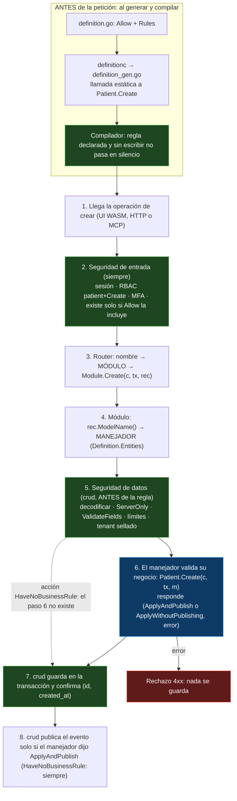
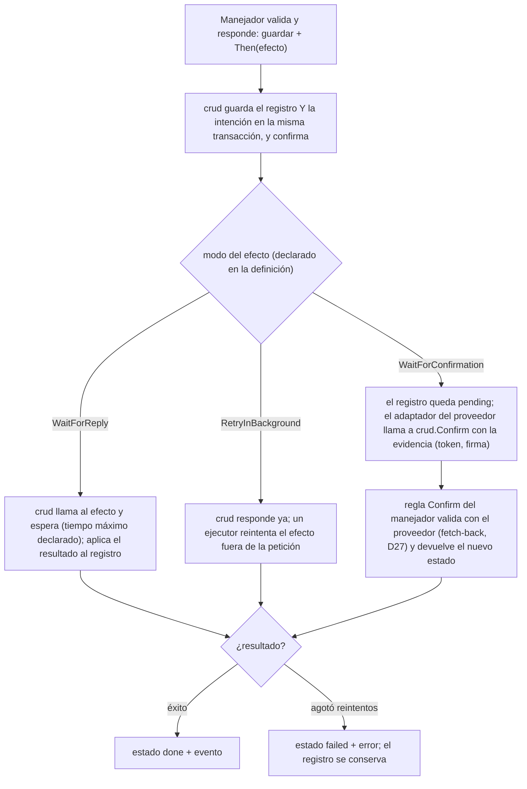

# CRUD por declaración — decisiones y preguntas abiertas
> **Status:** PENDING · 2026-11-08 · plan de `model` escrito (`model/docs/PLAN.md`); espera P36 (reescrita más simple); luego se escriben `crud`, `definitionc` y A6.10 · Master: [ARCHITECTURE_MASTER_PLAN.md](ARCHITECTURE_MASTER_PLAN.md) · Diagrama actual: [diagrams/TRANSPORT_CRUD_ARCHITECTURE.md](diagrams/TRANSPORT_CRUD_ARCHITECTURE.md)

## 1. Por qué

`patient_directory` declara `PatientModel{Allow: Create|Read|Update}` y aun así escribe a mano el montaje (`ops.go`). La seguridad ya vive en `crud.Table` y no se toca (RBAC sellado, esquema validado una vez, `ServerOnly`, tenant sellado por el `Store`). Lo que sí falla en el montaje a mano: (1) declarar `Allow` y olvidar montar; (2) olvidar pasar un hook (la unicidad desaparece y compila); (3) 16 copias que divergen.

## 2. Decidido (en el master: D28–D31)

| Pregunta | Respuesta | Resultado |
|---|---|---|
| P21 | A | Cuatro verbos estrechos `Creator`/`Reader`/`Updater`/`Deleter`, iguales en módulo y manejador; devuelven `(crud.RuleAnswer, error)` (P25); `crud` valida siempre, una vez, antes del manejador |
| P22 | A | `definition.go` declara `model.ModuleDefinition{Name, Entities}`; `definitionc` genera `definition_gen.go` y el `MountOperations`; desaparecen `ops.go` y `model_crud.go` |
| P23 | A | Cada acción de `Allow` se declara en `Definition.Rules` como `model.AddMyBusinessRule` (el manejador valida su negocio; `definitionc` crea una vez el esqueleto) o `model.HaveNoBusinessRule` (almacenamiento estándar, sin fichero); una acción permitida sin declarar es error al generar |
| P26 | A | Un fichero por regla: `rule_<entidad>_<acción>.go` (creado una vez por `definitionc`; si lo borras con la regla declarada se recrea; sin declarar, error al generar) |
| P27 | A | La regla recibe el módulo tipado: `func (p *Patient) Create(c crud.Caller, tx crud.Tx, m *Module) (crud.RuleAnswer, error)` |
| P24 | A | La base de datos entra por el constructor del módulo (`orm.TenantStore`, como hoy). `crud.Store` es solo el contrato con que `crud` guarda sin importar `orm`. La regla consulta con `tx`, que es esa misma base de datos dentro de la transacción: con `m.db` correría fuera de ella y dos creaciones simultáneas con el mismo RUT pasarían ambas la comprobación |
| P25 | tu flujo | 1) `crud` valida; 2) el manejador valida su negocio y responde «puede guardar» y si se publica: `(crud.ApplyAndPublish\|crud.ApplyWithoutPublishing, error)`; 3) `crud` guarda, confirma y publica si se le pidió. Una acción `HaveNoBusinessRule` guarda y publica siempre. Sin tema escrito a mano: lo genera la definición |
| P31 | `definitionc` | El nombre se queda (`v0.1.39`) |
| P28 | B → ajustada | `app` ya regenera al guardar `definition.go` y crea también los ficheros de regla y de efecto que falten; sin `app`, `crud.Mount` falla al arrancar con `ErrGeneratedOutOfDate: ejecuta definitionc`; el esqueleto **no compila** hasta completarlo (ver esqueleto en la sección 3); `crud.ErrRuleNotWritten` se borra |
| P33 | B | No hay interfaces `Creator`/`Reader`/`Updater`/`Deleter` en `crud`: la uniformidad está en los nombres de las reglas (`Create`/`Update`/`Delete`) y el `MountOperations` generado las conecta con `crud.Table` |
| P34 | A | Regla de lectura de tablas: `Search(c, text, m) ([]storage.Condition, error)` en `rule_<entidad>_search.go` (`Rules.Read: AddMyBusinessRule`); `crud` sigue haciendo id, página, tope y clínica; un modelo de cable (`Wire: true`) produce las filas, como `Registry.Read` |
| P35 | B | `Tx`, `Query`, `Store`, `Transactional` y las firmas de la regla se quedan en `crud` (el consumidor es dueño del puerto y `orm` lo implementa); `crud.Caller` se renombra `crud.CurrentUser` porque choca con `router.Caller` |
| P32 | A por etapas | `crud` orquesta los efectos externos (`crud.Then`, modos `WaitForReply`/`RetryInBackground`/`WaitForConfirmation`, `crud.Confirm` para webhooks) sobre una costura `crud.Effects` que implementa `outbox`; núcleo primero (A6.9, A6.10), efectos después (A6.11) |
| P29 | A | REST estándar: la acción sale del método HTTP, `POST\|GET\|PATCH\|DELETE /api/<módulo>/<entidad>`; se borran los sufijos `_c\|_r\|_u\|_d` |
| P30 | B | `ormc` → `definitionc` (`v0.1.39`), entrada `definition.go`, salida `definition_gen.go`: hecho (fase R1) |

Hecho de P22/P30: solo los nombres de fichero y de la herramienta. Falta (fase A6.9): `ModuleDefinition`, el montaje y los verbos generados.

```go
// definition.go — lo único que declaras: cada acción permitida dice si hay negocio que validar
var Definition = model.ModuleDefinition{Name: "patient_directory", Entities: []model.Definition{PatientModel}}
var PatientModel = model.Definition{Name: "patient", Allow: model.Create | model.Read | model.Update,
	Rules: model.Rules{Create: model.AddMyBusinessRule, Read: model.AddMyBusinessRule, Update: model.AddMyBusinessRule}, Fields: …}
// una entidad simple: Rules{Create: model.HaveNoBusinessRule, Read: model.HaveNoBusinessRule, Update: model.HaveNoBusinessRule} → sin ficheros que escribir

// rule_patient_create.go — lo único que escribes (esqueleto creado una vez por definitionc)
func (p *Patient) Create(c crud.Caller, tx crud.Tx, m *Module) (crud.RuleAnswer, error) {
	if err := m.checkDocument(p); err != nil { return 0, err }
	if err := m.sameDocument(tx, p); err != nil { return 0, err }
	return crud.ApplyAndPublish, nil   // «puede guardar y avisa a los demás»; crud.ApplyWithoutPublishing = guarda sin avisar
}
```


Verde = framework, no se puede omitir · azul = lo único que escribes. La regla corre después de la seguridad (5), nunca en lugar de ella.

## 3. Efectos externos y confirmaciones (P32, cerrada: A por etapas)

No quedan preguntas abiertas.

**Por qué `crud` y no cada manejador.** Tienes razón en que no debe repetirse en cada manejador. Lo que hoy escribiría cada uno de los 5 módulos que llaman afuera (`payment_manager`, `network_manager`, `appointment_booking`, `alert_manager`, `clinical_encounter`) es lo mismo: guardar `pending`, llamar, reintentar, usar el id como clave de idempotencia, pasar a `done`/`failed`, recuperarse si el proceso cae. Mi propuesta anterior (una regla `Committed` escrita por módulo) lo duplicaba y además tenía una ventana de pérdida: si el proceso cae entre confirmar y llamar, la llamada no queda anotada en ningún lado. Tu idea la cierra: **el manejador solo decide qué efecto quiere; `crud` guarda la intención en la misma transacción que el registro y se ocupa de cuándo, cuántas veces y con qué clave.**


```go
// definition.go — el efecto se declara: nombre y modo, sin valores escondidos
Effects: model.Effects{PaymentCharge: model.WaitForReply, PaymentReceipt: model.RetryInBackground, PaymentSettle: model.WaitForConfirmation},
// rule_payment_create.go — el manejador solo DECIDE (ilustrativo: la firma exacta va en el plan)
func (p *Payment) Create(c crud.Caller, tx crud.Tx, m *Module) (crud.RuleAnswer, error) {
	p.Status = StatusPending
	return crud.ApplyAndPublish.Then(PaymentCharge, PaymentReceipt), nil
}
// effect_payment_charge.go — QUÉ llamar; crud decide cuándo, cuántas veces y con qué clave (el id del registro)
func (p *Payment) Charge(c crud.Caller, m *Module, key crud.Key) (crud.Applied, error) {
	url, err := m.gateway.Create(p.Id, p.Amount, key)
	p.PayURL = url
	return crud.Apply(Payment_.PayURL), err   // campos que crud persiste
}
// adaptador del proveedor (lo monta la app, D27) — NO es una operación pública de crud
func (a *Adapter) Return(w http.ResponseWriter, r *http.Request) { a.confirm(payments, id, crud.Evidence{Token: token}) }
```
**Webhook sin abrir un agujero:** el adaptador del proveedor autentica al proveedor y llama a `crud.Confirm`, una entrada de Go (no una ruta HTTP pública, no una tabla de `crud`); la regla `Confirm` del manejador vuelve a preguntar al proveedor, nunca confía en lo que trae la petición. Un cobro Webpay usa dos modos: `Wait` para crear la transacción (hace falta el token y la URL ya) y `Confirmation` para la confirmación al volver el cliente.

**Dónde vive, sin que `crud` crezca sin límite** (**api-design** 4: una responsabilidad por librería): `crud` define solo la costura (contrato `crud.Effects`: guardar intención dentro de la transacción y ejecutarla) y la implementa `outbox`, que ya es una cola durable con reintentos y rechazo (`outbox/README.md`); hoy corre en el navegador y en pruebas sobre `*orm.DB`, y su README dice que el backend crea su tabla con `migrate.Migrate`, pero **no verifiqué** que `Deliver` sirva con un ejecutor del lado servidor: sería una extensión de `outbox`, no una librería nueva. `idempotency` es del otro lado (respuestas a peticiones repetidas que llegan); para llamadas salientes la clave es el id del registro. `events` no es durable, por eso no sirve para esto.

**Pros:** la lógica se escribe una vez (reintentos, clave, estados, recuperación) en vez de 5; se cierra la ventana de pérdida; el manejador queda en «decidir» y pierde código; la seguridad del webhook queda en un solo lugar. **Contras:** es la pieza más grande de toda la propuesta (un pequeño motor de flujos en el camino crítico); los tiempos máximos y reintentos hay que declararlos (no valores por omisión escondidos); aparece un tercer tipo de fichero (`effect_*.go`) pero solo en los 5 módulos que llaman afuera; `appkit` debe arrancar el ejecutor; la prueba es más compleja.
**Etapas:** los 13 módulos sin llamadas externas se despachan con el núcleo (A6.9, A6.10); los 5 que llaman afuera esperan A6.11 (sus planes D25 se reescriben de todos modos).

**Esqueleto que genera `definitionc`** (una vez; los ficheros `rule_*` y `effect_*` nunca se reescriben). Declara las variables de salida y las deja sin usar: si el agente olvida completarlo, el compilador marca el fichero y el comentario está al lado.
```go
// rule_patient_create.go
func (p *Patient) Create(c crud.Caller, tx crud.Tx, m *Module) (crud.RuleAnswer, error) {
	// COMPLETA TU REGLA DE NEGOCIO AQUÍ (crear paciente) y termina con: return decision, rejected
	var decision crud.RuleAnswer // lo que decides: crud.ApplyAndPublish, crud.ApplyWithoutPublishing, con o sin crud.Then(efecto)
	var rejected error       // el rechazo de tu regla; nil si todo está bien
}
// effect_payment_charge.go
func (p *Payment) Charge(c crud.Caller, m *Module, key crud.Key) (crud.Applied, error) {
	// COMPLETA LA LLAMADA EXTERNA AQUÍ (cobrar): usa key como clave de idempotencia y termina con: return applied, failure
	var applied crud.Applied // campos que crud debe guardar: crud.Apply(Payment_.PayURL)
	var failure error        // el error de la llamada; nil si salió bien
}
```
El compilador (verificado con un fichero de prueba) responde: `declared and not used: decision`, `declared and not used: rejected`, `missing return`. Si alguien «lo arregla» devolviendo las variables vacías, `crud` rechaza el resultado cero (un `crud.RuleAnswer` vacío no es válido, D35), así que tampoco pasa en silencio. **Costo:** mientras haya un esqueleto sin completar el módulo no compila ni se prueba (tampoco las otras entidades); es el empujón buscado, y como `app` lo crea al guardar `definition.go`, se ve de inmediato. Las acciones `HaveNoBusinessRule` no generan fichero.
## 4. Qué cambia

| Pieza | Cambio |
|---|---|
| A6.1 `model` | `ModuleDefinition` y `Rules` (versión nueva sobre `v0.2.15`) |
| A6.2 `crud` | verbos `Creator/Reader/Updater/Deleter`, `ErrRuleNotWritten`, `ErrGeneratedOutOfDate`; `Table` queda como motor; `crud.RuleAnswer`, publicación tras confirmar (P25) |
| A6.9 `definitionc` | genera `MountOperations`, verbos y `rule_*.go` (P26, P28) |
| A6.10 (P29) | `router`, `rpc`, `mcp`, `view`, `dbsync`, `httpd`, explorador de API, clientes WASM: ruta y nombre salen de (entidad, acción); se reabren A1/A2/A6.5/A6.7 |
| A4.1 / A4.2 (16 módulos) | no se despachan hasta publicar lo anterior; cada plan renombra ficheros y borra `ops.go` |

## 5. Preguntas abiertas (aparecieron al escribir el plan de `crud`)

**P36 — ¿Cómo se entera la app de que olvidaste correr `definitionc`?** Un módulo tiene dos listas de sus entidades: la que escribes (`definition.go`, `Entities`) y el código generado (`definition_gen.go`) que de verdad registra las operaciones de cada una.
```go
// definition.go (escrito por ti): agregas Appointment a la lista...
var Definition = model.ModuleDefinition{Name: "agenda", Entities: []model.Definition{PatientModel, AppointmentModel}}
// ...pero no corres definitionc: definition_gen.go sigue registrando solo Patient.
```
Hoy la app arranca normal y `Appointment` simplemente no tiene operaciones: el error aparece cuando alguien pulsa un botón, no al arrancar. (Con el demonio `app` esto casi no ocurre porque regenera al guardar; pasa en CI o si editas con otro programa.)
- **A — sí (recomendado):** `crud.Module` gana un método más, `Definition()`, que **genera `definitionc`** (tú no lo escribes). Al arrancar, `crud` compara esa lista con lo registrado y, si no coinciden, la app no arranca: «`agenda`: `appointment` está en `definition.go` pero no en el código generado; ejecuta `definitionc`». Costo: una interfaz publicada con un método más (sus dobles de prueba también lo implementan).
- **B — no:** `crud` solo revisa las tablas que sí se registraron (si una regla declarada no coincide). Una entidad que nunca se registró pasa sin aviso.
**Recomiendo A**: es el único caso en que olvidar regenerar sigue pasando en silencio, y es justo el tipo de olvido que quieres evitar.
Respuesta:
