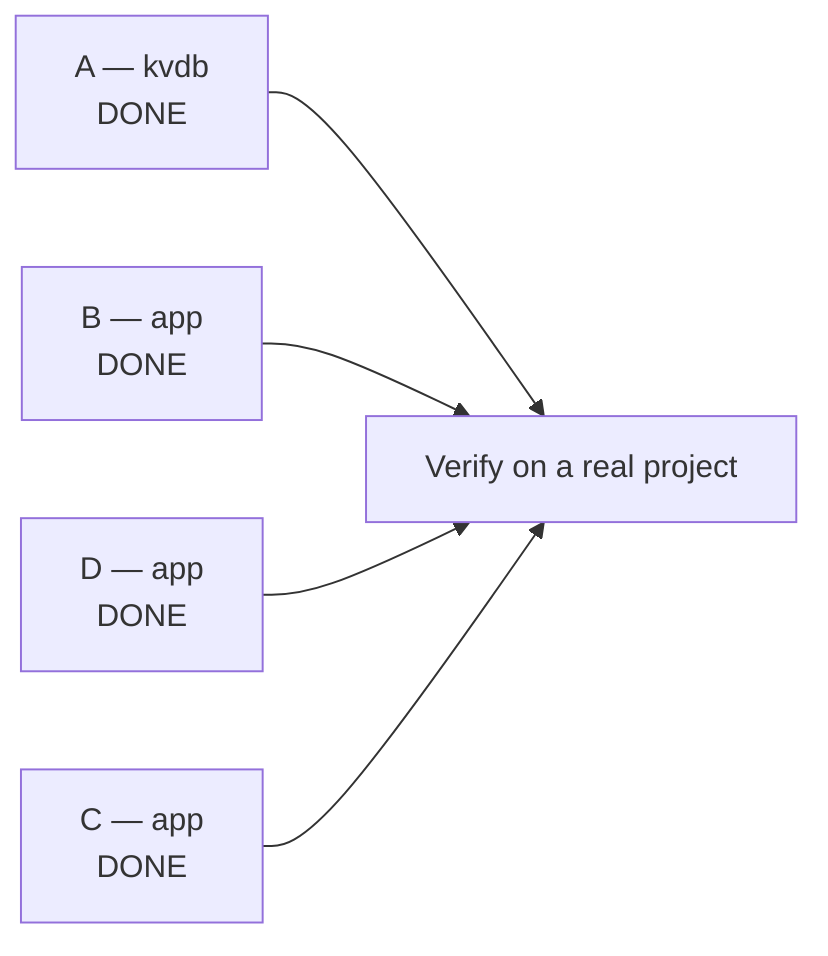

# Master plan — a project's `.env` must survive the dev daemon

**Orchestrator.** All four defects below are fixed and published. What remains
is verifying on a real project.

## The problem, stated once

A WebTyp project's `.env` is the single source of its configuration. Four
defects let the dev toolchain corrupt it, hide it, write framework bookkeeping
into it, or fail to explain its absence. Together they cost a working project
its database connection and produced a startup log in which the loudest line
(`ERR_CONNECTION_REFUSED`, from the browser) was three steps removed from the
cause (a missing `DATABASE_URL`).

Evidence, from one debugging session on `veltylabs/mjosefa-cms`:

- `.env` was reduced to `dev_mode=true` and `WEBTYP_LAST_UPDATE_CHECK=...` —
  exactly the keys the framework writes — twice within an hour. `DATABASE_URL`
  and five browser settings were destroyed.
- `app-demo/.env` accumulated browser geometry written while a *different*
  project was the active one.
- The framework logged `Project ready` under a server that had exited with
  status 1 thirty seconds earlier.

## The four defects

| # | Defect | Repo | Status |
|---|---|---|---|
| A | A rewrite driven by a failed or empty pre-read replaced the file with only the keys the writing process touched | `webtyp/kvdb` | **DONE** — `7adfc76`, `safe_read.go` |
| B | `FileStore.SetFile` truncated before writing; the daemon served every project from one project's `.env` | `webtyp/app` | **DONE** — `writeFileAtomic` (`store.go`), `projectStores` (`daemon_stores.go`) |
| D | The self-update blocked startup, then restarted the daemon unasked, throttled by machine state kept in a project's `.env` | `webtyp/app` | **DONE** — `CheckAndInstall` + `UpdateOffer` (`update_section.go`) |
| C | The boot wait ignores a child process that already exited, and a browser is opened at a port known not to answer | `webtyp/app` | **DONE** (2026-09-29, `app v0.6.80`) — "Project ready" only when the port answers, otherwise `ServerNotListeningReport` + degraded; the browser opens only after the port answers (`showBrowserWhenServerAnswers`, `daemon.go`). Not done, on purpose: stopping the 5 s wait early when the child exits — the diagnostic is already right, it only arrives up to 5 s later. The server-side `PLAN.md` this row pointed to was never written. |

### How they related

A and B were two halves of the same data-loss bug: B created the truncate
window, A turned reading inside that window into a destroyed file. Both are now
closed — `kvdb` refuses to rewrite from a read it cannot trust, and
`FileStore.SetFile` writes a temp file and renames it, so no reader ever
observes a truncated `.env` in the first place. Fixing only one would have been
worse than useless: with the window open but `kvdb` hardened, silent corruption
would simply have become silently dropped settings.

D is what made them fire as often as they did. The framework wrote exactly two
keys into a project's `.env`, and one of them — the update-check timestamp — had
no business being there. It is gone, along with the throttle it served, the
synchronous check that needed throttling, and the unasked-for daemon restart.

An earlier draft of this plan proposed a fifth item: splitting `webtyp/update`'s
shared 60-second HTTP timeout so the release lookup could not stall startup for
a minute. **That item was dropped.** It existed only because the check ran
synchronously on the startup path; once it is a background goroutine, nothing
waits on it and a bounded timeout buys nothing worth a new exported function.

## What is left

**Only the verification is left.**

## `webtyp/app`'s own plan is a refactor, not a bug fix

`app/docs/PLAN.md` is a five-stage package split with `STATUS: running`. The
bugs above were fixed **in the code, directly**. That plan deliberately carries
none of them, so it stays what it is for: reorganising the library.

What its stage files do carry is a short list of "do not undo this" notes,
because the refactor moves the very files the fixes live in:

- `PLAN_STAGE_3_DAEMON.md` — `projectStores` moves into `projectRunner`, which
  then becomes the daemon's `Flusher`. `daemon_stores.go` stays in the root
  package.
- `PLAN_STAGE_4_SELFUPDATE.md` — no throttle, no `Store` and no `Daemon`
  interface may be reintroduced; `update_section.go` stays in the root.

## Already shipped — context, not work

These landed before this wave and are the reason the failure became *visible*
rather than silent. Do not re-plan them:

- `webtyp/gorun` — `Config.EnvFile` forwards the project's `.env` into the child
  process's environment, so a server whose working directory is `web/` still
  sees the root `.env`.
- `webtyp/env` — `Require` names the path it checked:
  `DATABASE_URL is not set (checked the process environment and .env in <dir>)`.
- `webtyp/app` — the boot diagnostics: a failed stage is distinguishable from a
  slow one, `Project ready` is logged only once the port answers, and a server
  that never listens produces a three-line report naming the port, the file to
  edit and whose output to read.

## Done when

On a project whose `.env` holds a database connection string:

1. ✅ Starting, restarting and stopping the daemon leaves the `.env`
   byte-identical apart from the keys the framework legitimately owns
   (`dev_mode`, `browser_*`, `viewport_*`). `WEBTYP_LAST_UPDATE_CHECK` is not on
   that list any more: nothing persists it anywhere.
2. ✅ Switching the daemon between two projects writes each project's browser
   settings into its own file.
3. ✅ `webtyp dev` on a machine with no network reaches its first log line as
   fast as it does online: the release check never sits on the startup path.
   When an update does land, the developer is offered *Restart now* /
   *Restart later*, and nothing restarts until they pick.
4. ⬜ A server main that genuinely cannot start — for example `DATABASE_URL`
   pointing at an unreachable host, so the process exits non-zero — produces a
   log whose last lines name the port, the file to edit and whose output to
   read, with **no** `ERR_CONNECTION_REFUSED` line after them and no 30-second
   gap. *(Blocked on C.)*

   Note the scenario deliberately is *not* "delete `DATABASE_URL`": in
   `veltylabs/mjosefa-cms` an absent connection string is now a supported,
   degraded mode — the server serves the UI without a database and says so —
   precisely so that a `.env` emptied by defect A could not take the project
   down. Testing the diagnostics needs a failure that is still a failure.
