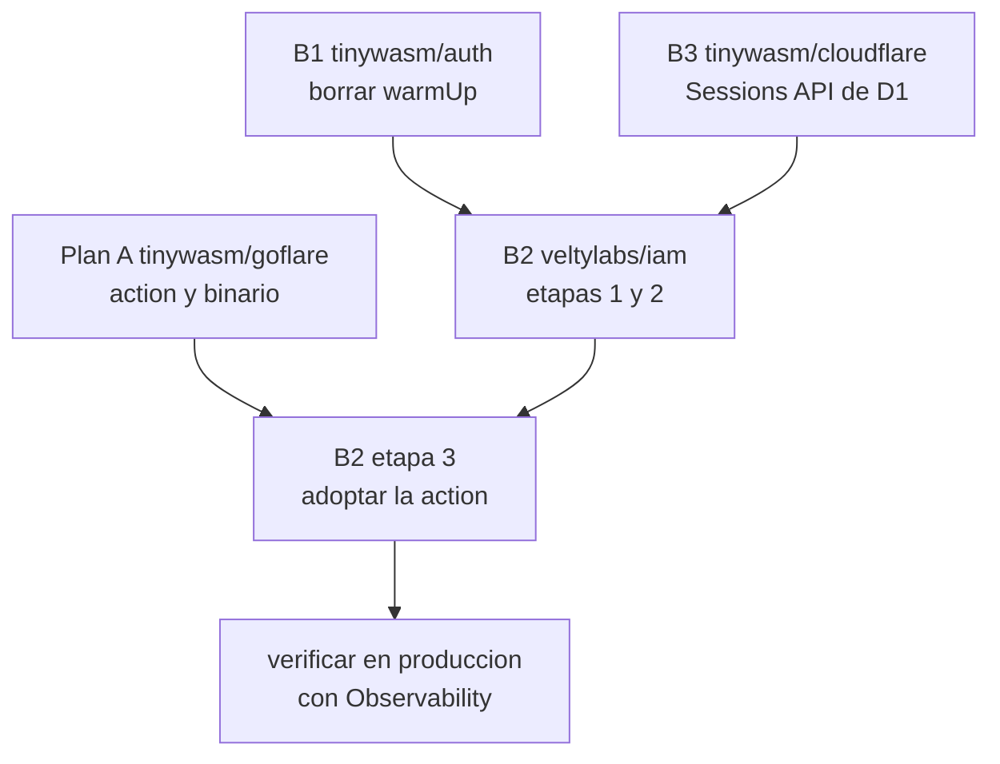

# Master plan — latencia del edge por debajo de 100 ms

Orquestador multi-repo. Cada repo afectado tiene su propio `docs/PLAN.md`
autocontenido; este archivo define el grafo de dependencias y, sobre todo, **qué
mueve la aguja y qué no**.

## La medición que ordena todo lo demás

`iam.velty.cl/api/health` responde entre 163 y 363 ms. La sospecha inicial era
el tamaño del binario. **No lo es.**

```
D1 velty-iam-db → running_in_region: ENAM       read_replication: disabled
consulta de prueba desde MCP → served_by_colo: ATL, sql_duration_ms: 1.05
```

El Worker corre en el PoP más cercano al visitante (Santiago). La base vive en
Norteamérica Este. `/api/health` ejecuta `db.RawConn().Exec("SELECT 1")`.

**El SQL cuesta 1 ms. Los otros ~160 ms son el viaje Santiago ↔ Virginia.**
Ningún cambio en Go mueve esa cifra.

Reordenado por impacto real:

| Palanca | Efecto | Dónde |
|---|---|---|
| Que el health check no consulte D1 | 163 ms → **<10 ms** | `veltylabs/iam` |
| ~~Réplicas de lectura de D1~~ | **medido 2026-08-26: cero efecto para este tráfico.** No hay región D1 en Sudamérica | descartado — ver abajo |
| Borrar `warmUp` | quita un escaneo de tabla por isolate frío (la diferencia entre 163 y 349 ms) | `tinywasm/auth` |
| bcrypt fuera del camino caliente | ~50-100 ms de **CPU** por `POST /api/token`, contra un límite de 10 ms de CPU en el plan Free | `veltylabs/iam` |
| Adelgazar el binario | 10-30 ms, **solo en arranques en frío** | `veltylabs/iam` |

## Lo que se investigó y resultó ser falso

**"Probablemente se colaron stdlib o librerías ajenas al ecosistema."** No se
coló nada. Corriendo la guarda de imports contra el grafo real del edge de iam:
**cero** paquetes `github.com/tinywasm/*` o `github.com/veltylabs/*` importan
directamente stdlib prohibida. Los 87 paquetes de stdlib presentes se alcanzan
íntegramente a través de un solo import deliberado y documentado,
`tinywasm/crypto/hmac` → `crypto/sha256`, que es la excepción explícita del
[AGENTS.md de tinywasm/crypto](https://github.com/tinywasm/crypto/blob/main/AGENTS.md).
La disciplina del ecosistema está intacta. **No refactorices `crypto`.**

Lo que sí encontró la medición fue peso muerto en **iam**, no en las librerías:

| Cambio | crudo | gzip |
|---|---|---|
| hoy | 600.380 B | 212.539 B |
| borrar `config/login.go` (**cero llamadores**) | 586.388 B (−13.992) | 206.885 B |
| además, bcrypt fuera del edge | 570.517 B (−29.863 total) | 198.971 B |

**−5,0 % en total.** Real, pero modesto, y sin ningún efecto sobre los 163 ms.
Se hace porque el arranque en frío lo agradece y porque borrar código muerto no
se discute — no porque resuelva el problema del título.

## Lo que hoy está vacío, y por qué importa

```sql
SELECT COUNT(*) FROM project;  -- 0
SELECT COUNT(*) FROM session;  -- 0
SELECT COUNT(*) FROM "user";   -- 0
```

Dos consecuencias:

1. **No hay datos que migrar.** Cualquier cambio de formato de hash o de esquema
   es gratis ahora y caro dentro de un mes.
2. `warmUp` hoy escanea una tabla vacía, así que los 349 ms de arranque en frío
   son puro viaje de red. **Con sesiones reales empeora linealmente**, porque
   `warmUp` no tiene límite: carga todas las sesiones activas en cada isolate.

## Grafo de dependencias



| Fase | Repo | Puerta | Puede correr en paralelo con |
|---|---|---|---|
| B1 | `tinywasm/auth` | ninguna | B3, Plan A |
| B3 | `tinywasm/cloudflare` | ninguna | B1, Plan A |
| B2 etapas 1-2 | `veltylabs/iam` | B1 y B3 publicados | — |
| B2 etapa 3 | `veltylabs/iam` | **Plan A publicado** | — |

B1 y B3 son **puertas**: iam consume ambas librerías y necesita las versiones
publicadas antes de empezar.

## El paso de infraestructura queda CANCELADO — medido, no opinado

**No actives `read_replication: auto` en `velty-iam-db`. No serviría de nada.**

Medido el 2026-08-26 con dos bases D1 desechables, réplicas activas, y un Worker
alcanzado en el colo **EZE**. Las bases eran idénticas salvo por dónde vive la
primaria:

| Primaria | Bookmark | `served_by_region` | `served_by_primary` | Wall |
|---|---|---|---|---|
| ENAM | `first-unconstrained` | ENAM (EWR) | `true` | ~150 ms |
| ENAM | bookmark encadenado | ENAM (EWR) | `true` | ~150 ms |
| APAC | `first-unconstrained` (1ª petición) | APAC (HKG) | `true` | 368 ms |
| APAC | `first-unconstrained` (caliente) | ENAM (ATL) | **`false`** | ~165 ms |
| APAC | bookmark encadenado | ENAM (ATL) | **`false`** | ~165 ms |
| APAC | `first-primary` | APAC (HKG) | `true` | ~355 ms |

`sql_duration_ms` fue 0,1-0,8 ms en **todas** las filas, lo que confirma el
diagnóstico de arriba: el SQL no cuesta nada, el viaje lo cuesta todo.

Las dos lecturas de la tabla:

- **El mecanismo funciona.** Con la primaria en APAC, una réplica en ENAM sirvió
  las lecturas y partió la latencia por la mitad (355 → 165 ms), mientras
  `first-primary` seguía yendo a Hong Kong al precio completo. La Sessions API
  hace exactamente lo que promete.
- **Pero con la primaria en ENAM no hay nada que ganar.** 38 de 38 peticiones
  servidas por la primaria. D1 solo coloca réplicas en **ENAM, WNAM, WEUR,
  EEUR, APAC y OC**: no hay región sudamericana, así que para tráfico desde
  EZE/SCL la réplica más cercana está justo donde ya vive la primaria.

## La alternativa que tampoco existe

Este plan proponía **recrear la base con un `primary_location_hint`
sudamericano**. **Ese valor no existe.** D1 solo acepta `wnam`, `enam`, `weur`,
`eeur`, `apac` y `oc` — la misma lista de seis regiones de arriba. Mover la
primaria a Sudamérica no es una alternativa descartada por costo: no es una
opción del producto.

## Entonces, ¿qué queda?

Los ~150 ms son la ida y vuelta EZE ↔ ENAM y **ninguna opción de configuración
de D1 los baja**. La única palanca que queda es **hacer menos viajes por
petición**:

- que el health check no consulte la base (ya está en B2 etapa 1, y sigue siendo
  la palanca de mayor impacto del plan);
- borrar `warmUp` (B1, ya hecho);
- para las rutas que sí leen: batchear las consultas de una petición en vez de
  encadenarlas. La horquilla 163-363 ms sugiere que algunas peticiones hacen dos
  o tres consultas secuenciales; a ~150 ms cada una, ahí está el rango completo.

`d1.NewEdgeSession` se conserva de todos modos: está bien construido, no estorba
a quien no lo use, y entra solo el día que la primaria se mueva o Cloudflare
abra una región sudamericana. Pero **no es la solución a este problema**.

## Criterio de cierre

No se cierra ninguna fase por "el código compila". Se cierra midiendo, con
Workers Observability, sobre el Worker desplegado:

| Ruta | Objetivo | Hoy |
|---|---|---|
| `/api/health` | **< 20 ms** de `wallTimeMs` | 163-363 ms |
| `/api/health/db` | sin objetivo; documenta lo que mida | no existe |
| una ruta que lea D1 | mejor que hoy, cifra medida | ~163 ms |

> ⚠️ Workers Observability **se desactiva en cada `goflare deploy`**: los
> metadatos del despliegue no la declaran. Hay que volver a activarla antes de
> cada medición:
> `PATCH /accounts/{id}/workers/scripts/iam/settings` con
> `{"observability":{"enabled":true,"head_sampling_rate":1}}`.

**Si un número no se mueve, repórtalo en vez de cerrar la fase.**

## Estado

- [x] B1 — `tinywasm/auth`: borrar `warmUp` (PR #2, en review)
- [x] B3 — `tinywasm/cloudflare`: Sessions API de D1 (PR #2)
- [~] infra — ~~activar `read_replication: auto` en `velty-iam-db`~~ **cancelado:
  medido, cero efecto para tráfico sudamericano**
- [ ] B2 etapa 1 — `veltylabs/iam`: separar el health check
- [ ] B2 etapa 2 — `veltylabs/iam`: adelgazar el edge
- [ ] B2 etapa 3 — `veltylabs/iam`: adoptar la action (bloqueada por el Plan A)
- [ ] verificación en producción
