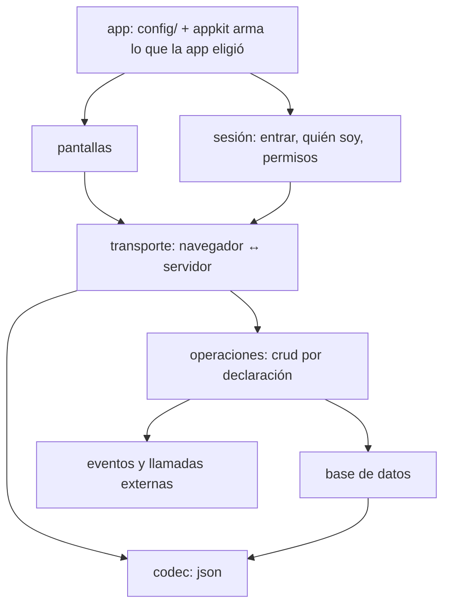

# Mapa del framework — master plan
> **Status:** PENDING · 2026-11-18 · espera P6 del dueño (forma de la skill índice); sin automatización · bloquea D75 de [ARCHITECTURE](ARCHITECTURE_MASTER_PLAN.md) (inicio de sesión), que espera la skill de su componente

Problema que se ve: un agente llega sin saber qué piezas forman una app ni qué skill explica cada una. Entonces supone, pone código en la pieza equivocada y el dueño tiene que revisarlo todo. Caso real (2026-11-18): el modo de entrada `trusted_ip` quedó dentro de `appkit` (D68), y ninguna skill dice qué repos forman el componente «sesión».
Reglas: **devskills** (una skill = un dominio, ≤50 líneas es lo ideal, más de 150 se rechaza).

## Preguntas abiertas

**P6 — Forma de la skill índice `framework-map`: ¿diagrama o solo texto, y cuál es el último eslabón del zoom?**
A) Un diagrama mermaid de los componentes de una app (≤12 cajas), con una tabla debajo: componente → skill. Cada skill de componente repite el patrón a su escala (su diagrama chico con sus repos y la única responsabilidad de cada uno), y el último eslabón es el **código** del repo (`go doc`, el fuente), no su README.
B) Solo texto: una lista componente → skill.
C) Como A, pero las skills también copian las firmas y el uso de cada repo, para no tener que leer el repo.
¿Cuál evita el acoplamiento y es más mantenible? A, por tres motivos:
- **El diagrama sirve también a un agente.** Un LLM no «ve» el dibujo: lee el mermaid como texto, y ese texto es una lista de aristas `A --> B` que dice la dirección de cada dependencia sin ambigüedad. En prosa esa dirección se pierde o se adivina. El mismo bloque le sirve al humano, renderizado.
- **Cada nivel guarda lo que cambia poco.** El índice dice qué componentes hay; la skill de componente dice qué repo hace qué y en qué orden dependen. Eso cambia cuando nace, se divide o muere un repo, algo raro y que se corrige en el mismo turno (**devskills**).
- **El último eslabón es el código, porque el código no envejece.** Lo que cambia seguido (firmas, campos, errores) vive solo en el código. Copiarlo en las skills (C) crea una segunda versión que envejece igual que los README de hoy, y las haría pasar de 150 líneas. Un README desactualizado es un defecto de ese repo que se arregla allí, no un motivo para mover su contenido a las skills.

**Recomiendo A.** Borrador del índice:

| Componente | Repos | Skill |
|---|---|---|
| app | `appkit`, la carpeta `config/` de cada app | **project-layout**, **app-modules**, **module-layout** |
| pantallas | `view`, `layout`, `form`, `components`, `dom`, `widget` | **dom-elements**, **components**, **form-codegen**, **widget-styling**, **ui-consistency** |
| sesión | `auth`, `rbac`, `access`, `user` | falta: **session** (nueva) |
| transporte | `router`, `rpc`, `mcp`, `server`, `fetch`, `sse` | falta: **transport** (nueva) |
| operaciones | `crud`, `model`, `definitionc` | **form-codegen** (en parte); falta: **operations** (nueva) |
| base de datos | `orm`, `ddl`, `storage`, `sqlt`, `sqlite`, `postgres`, `indexdb`, `dbsync` | falta: **database** (nueva) |
| codec | `json` | falta: **codec** (nueva) |
| eventos | `events`, `outbox`, `externalcalls` | falta: **events** (nueva) |
| textos, compilación, despliegue | `lang` · `sitec`, `app`, `devflow` · `goflare`, `cloudflare` | **translations**, **langc** · **wasm**, **isomorphic-libraries**, **webtyp-app** · **app-rest-edge**, **secrets** |

Respuesta:

## Decisiones por implementar

| # | Decisión | Dónde se implementa |
|---|---|---|
| D1 (dueño, 2026-11-18) | `appkit` es el único lugar donde una app configura, pero no implementa ninguna pieza: arma lo que la app eligió. Lo que hoy implementa por su cuenta (el modo `trusted_ip`) sale a la pieza dueña | ARCHITECTURE D75 |
| D2 (dueño, 2026-11-18) | Una sola skill índice, `framework-map`, que enlaza solo las skills de los componentes globales de una app (transporte, sesión, codec, base de datos…). Skills chicas. **Nada se automatiza** por ahora: sin generador ni gates (reemplaza P1–P5, rechazadas) | `devskills` |

## Fases

Cada fase termina con la revisión (🔵) del dueño antes de la siguiente.

| Fase | Repo | Qué | Estado |
|---|---|---|---|
| M1 | `devskills` | La skill `framework-map` con la forma que decida P6 | 🔴 espera P6 |
| M2 | `devskills` | Las skills de componente que faltan, una por vez, empezando por **session** (desbloquea D75). Cada una leída del código, no de memoria | 🔴 |

## Bloqueos

- 2026-11-18 · Todo espera P6.

## Relación con otras olas

- ARCHITECTURE: D75 (el inicio de sesión como una pieza) espera la skill **session** (M2).
