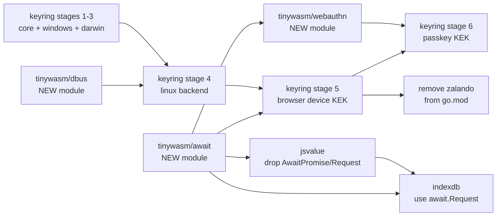

# Master Plan — A dependency-free `tinywasm/keyring` with a browser backend

> Orchestrator for a change that spans **six** repositories: three new modules
> (`dbus`, `webauthn`, `await`) and three existing ones that adopt the third
> (`keyring`, `jsvalue`, `indexdb`). Each repository has its own self-contained
> `docs/PLAN.md`; this file only defines **what depends on what** and **what
> must not be dispatched in parallel**.
>
> This master plan is not itself dispatched to an agent. The maintainer runs it.

## Goal

`github.com/tinywasm/keyring` becomes the ecosystem's single answer to "where do
I keep a secret", on **four** environments — Linux, macOS, Windows and the
**browser** — with:

- **zero third-party dependencies** in `go.mod` (only `tinywasm/*`),
- a **browser backend** whose key material cannot be exfiltrated by XSS,
- **no growth** of the WASM binary from code that only serves native OSes.

## Why the current shape fails

```
tinywasm/keyring
└── github.com/zalando/go-keyring v0.2.6
    ├── github.com/godbus/dbus/v5      (Linux — Secret Service)
    ├── github.com/danieljoos/wincred  (Windows)
    │   └── golang.org/x/sys
    └── al.essio.dev/pkg/shellescape   (macOS)
```

Four external modules, and **none of them compiles to WASM**. `go-keyring` was
written for backend processes: it has no browser story at all, and its
`fallbackServiceProvider` answers `unsupported platform: js` — which is exactly
the platform this ecosystem exists to serve.

## The size argument, stated correctly

This is the trap to avoid. `linux/`, `darwin/` and `windows/` are excluded from
the WASM build by build tags, so **their stdlib imports cost the browser binary
nothing**. Replacing `os/exec`, `net` or `syscall` in those folders with
`tinywasm/*` equivalents would be pure churn — and, per the measured lesson in
`tinywasm/base64` (importing `tinywasm/fmt` there cost **74 KB more** than the
stdlib), potentially a regression.

The rule that actually matters:

> Only the **root package** and **`browser/`** reach the WASM binary. Those two,
> and only those two, are held to the zero-stdlib / zero-dependency standard.

Every plan in this wave restates this rule inline, because a literal-minded
agent applying "no stdlib in tinywasm" repo-wide would gut the native backends.

## Target architecture

```
keyring/
├── keyring.go            public API — zero imports, zero backends
├── errors.go             typed error constants — zero imports
├── provider.go           Provider interface + Fallback + Ensurer
├── auto/     OPTIONAL: chooses a backend for the build target
├── linux/    Secret Service over D-Bus  → tinywasm/dbus
├── darwin/   /usr/bin/security          → stdlib only
├── windows/  advapi32.dll via syscall   → stdlib only
├── browser/  WebCrypto + IndexedDB      → syscall/js
└── tests/
```

**The core imports no backend; the caller injects one.**

```go
kr := keyring.OpenKeyring("my-app", browser.New())  // a browser app, explicit
kr := auto.OpenKeyring("my-app")                    // a CLI: "whatever this machine has"
```

`init()`-based registration was rejected for the reason already recorded in
`deploy/docs/PLAN.md`: a package that registers its own backends depends on them
instead of the reverse, and every consumer then links every backend. It would
also have made `keyring` — a module whose point is to be small in a browser —
import a package that opens Unix sockets.

What guarantees the WASM build never links `os/exec`, `net` or `syscall` is
therefore the **import graph**, not build tags: a browser binary imports
`keyring` and `keyring/browser`, so `linux/`, `darwin/` and `windows/` are never
compiled into it. Build tags survive in exactly three packages, and only where
the compiler leaves no choice: `windows/` (`syscall.NewLazyDLL` exists nowhere
else), `browser/` (`syscall/js` exists only under `GOOS=js`), and `auto/`, whose
only job is to choose.

### Browser key hierarchy (envelope encryption)

```
secret ──AES-GCM──> DEK  (the only key that touches data)
                     ↑ wrapped independently by N KEKs:
                     ├── device   non-extractable AES-KW CryptoKey in IndexedDB   [stage 5]
                     ├── passkey  WebAuthn PRF → HKDF → AES-KW                    [stage 6]
                     └── recovery PBKDF2(passphrase)                              [designed, NOT built]
```

Each KEK stores its **own wrapped copy** of the same DEK. Adding or revoking an
unlock method rewraps one small blob and re-encrypts nothing. The storage format
must support N wrapped copies **from stage 5**, even though only one exists then
— that is the decision that would be expensive to reverse later.

## A second thread: the JS-async pattern was about to be duplicated a 4th and 5th time

While designing the browser and passkey stages, the plan initially called for
copying a ~35-line "block a goroutine on a JS event" helper into
`keyring/browser` and, separately, into `webauthn` — on the reasoning that
importing `tinywasm/jsvalue` (which already has this code, as `AwaitPromise` /
`AwaitRequest`) pulls in `tinywasm/fmt` and `tinywasm/model`, too much weight
for a size-sensitive package.

That reasoning about `jsvalue` was correct. The conclusion — copy it — was not.
**`tinywasm/indexdb` already imports `jsvalue` and still keeps its own third
copy of the same pattern** (`tx.go`'s two-listener wait), so the duplication
this plan was about to add was a fourth and fifth instance of something
already duplicated once, live, in production code. The fix is the one the rest
of this ecosystem uses for exactly this shape of problem: extract to a new,
genuinely zero-dependency module, per `feedback-medir-antes-de-sustituir-stdlib`
— a dependency only pays for itself when it has none of its own.

`github.com/tinywasm/await` is that extraction: `Promise`, `Event`, `Request`,
`syscall/js` only. `keyring/browser` and `webauthn` import it instead of
copying. `jsvalue` sheds `AwaitPromise`/`AwaitRequest` and becomes a pure
codec. `indexdb` drops its call sites into `jsvalue.AwaitRequest` in favour of
`await.Request` — its *other* duplicate, the cursor-iteration loop in `tx.go`,
is a genuinely different (multi-fire) pattern and stays untouched; see
`https://github.com/tinywasm/indexdb/blob/main/docs/PLAN.md` for why.

`goflare` (`r2/bucket.go`, `d1/adapter.go`) also calls `jsvalue.AwaitPromise`
and is **out of scope for this wave** — noted as a one-line follow-up
(`jsvalue.AwaitPromise(x)` → `await.Promise(x)`) in
`https://github.com/tinywasm/jsvalue/blob/main/docs/PLAN.md`, not dispatched
here.

## Repository graph



| Phase | Repo | Plan | Blocks | Can run in parallel with |
|---|---|---|---|---|
| 1 | `tinywasm/dbus` | `docs/PLAN.md` (new module) | keyring stage 4 | keyring stages 1–3, `await` |
| 1 | `tinywasm/await` | `docs/PLAN.md` (new module) | keyring stage 5, `webauthn`, `jsvalue`, `indexdb` | `dbus`, keyring stages 1–3 |
| 2 | `tinywasm/keyring` | `docs/PLAN.md` stages 1–3 | stage 4 | `dbus`, `await` |
| 2 | `tinywasm/jsvalue` | `docs/PLAN.md` | `indexdb` | `dbus`, keyring stages 1–4 |
| 3 | `tinywasm/keyring` | stage 4 | stage 5 | `jsvalue` |
| 3 | `tinywasm/indexdb` | `docs/PLAN.md` | — | keyring stage 4 |
| 4 | `tinywasm/keyring` | stage 5 | — **release point** | `tinywasm/webauthn` |
| 5 | `tinywasm/webauthn` | `docs/PLAN.md` (new module) | keyring stage 6 | keyring stage 5 |
| 6 | `tinywasm/keyring` | stage 6 | — | — |

**Gate:** phase 4 is the release point. After it, `keyring` has zero third-party
dependencies and works on four platforms. Stage 6 (passkey) is deliberately
severable: if `tinywasm/webauthn` stalls, keyring still ships complete.
`jsvalue` and `indexdb` are independent of the keyring release — they can land
before, after, or never relative to it, gated only on `await`.

## The three new modules — created

`dbus`, `await` and `webauthn` exist as public `tinywasm` org repositories with
their plans already at `<repo>/docs/PLAN.md` (2026-08-16, via `gonew`). `jsvalue`
and `indexdb` already existed; their plans are at `jsvalue/docs/PLAN.md` and
`indexdb/docs/PLAN.md`.

Dispatch order follows the graph above: `dbus` and `await` have no
prerequisite and can go first; `webauthn` waits on `await`'s release (pin its
`go.mod` to a real tag before dispatch, not a commit hash); `keyring` stage 1
has no prerequisite either. Up to three unblocked repos can run at once —
`codejob` in each repo's own directory starts its loop independently.

## This is a breaking change, on purpose

No compatibility layer with `zalando/go-keyring` is written. No legacy read
paths, no dual-format decoding, no migration shims — that is code that exists
only to serve the past and rots there.

The one consequence to state plainly and then accept: **secrets already stored
by the current implementation may become unreadable**, so anyone running
`devflow` re-authenticates once (`gh auth login`, re-entering the Jules API
key). That is a one-off cost paid by a handful of developers, and it is cheaper
than carrying dead decoding branches forever.

Where a format detail happens to match the old one — the Secret Service
attribute keys, the `<service>:<username>` credential target — it is because
that is the natural way to write it, **not** because compatibility is being
preserved. No plan may add a line of code whose only justification is reading an
old record.

## Port the proven code — do not reinvent it

`zalando/go-keyring` is **MIT-licensed** and its three native backends are
battle-tested against real Keychains, Credential Managers and Secret Service
daemons. Reimplementing them from a specification would introduce bugs that
someone else already found and fixed.

**Every native backend is a port, not a rewrite.** Each stage file appends the
original source verbatim and names exactly which dependency to replace with
what. The agent copies the logic and swaps the dependency — nothing else.

| Stage | Ported from | Replace |
|---|---|---|
| 2 — Windows | `keyring_windows.go` | `wincred` → `syscall` + `advapi32.dll` |
| 3 — macOS | `keyring_darwin.go` | `shellescape` → a local `quote` |
| 4 — Linux | `keyring_unix.go`, `secret_service/secret_service.go` | `godbus` → `tinywasm/dbus` |

**Only `browser/` (stage 5) is new code.** It has no upstream, because
`go-keyring` has no browser backend at all — that absence is the reason this
wave exists.

### Licensing when copying

- `zalando/go-keyring` is MIT, and this repository is MIT. Compatible.
- **`keyring_darwin.go` is not zalando's own code**: it carries a *"Copyright
  2013 Google Inc. — Apache License, Version 2.0"* header. Also compatible, but
  the header must be **kept verbatim** at the top of the ported file.
- `godbus/dbus` is BSD-2-Clause; anything derived from it keeps its copyright
  notice too.

Add a `NOTICE` file at the repository root listing all three, with the file each
one covers. This is the whole licensing obligation — it is small, and skipping
it is not an option.

## Public API — what moves

Injection changes the constructors: they take a provider. Everything a consumer
*does* with a `Keyring` is untouched, and the `auto` package preserves today's
exact signatures so the 12 existing call sites in `devflow` and `app` migrate by
changing **one import line**:

```go
import keyring "github.com/tinywasm/keyring/auto"   // the whole migration
```

```go
// changed
keyring.NewKeyring(service string, p Provider) (*Keyring, error)
keyring.OpenKeyring(service string, p Provider) *Keyring
keyring.New(p Provider) *KeyManager

// removed — mutable package-level state, replaced by constructor injection
keyring.SetProvider(p Provider)
keyring.GetProvider() Provider

// unchanged
(*Keyring).Set / Get / Delete / SetLog
```

`git` needs no change at all: `*Keyring` still satisfies its `SecretStore`
interface. Those repositories are **out of scope** for this wave; the keyring PR
reports the import change rather than making it.

The browser backend keeps these **synchronous** signatures by blocking the
calling goroutine on JS promises and IndexedDB requests through
`github.com/tinywasm/await` (`Promise`, `Request`) — see the section above.

## Definition of done

```bash
# 1. no third-party dependency survives
grep -rn "zalando\|godbus\|wincred\|shellescape\|golang.org/x/sys" keyring/  # → empty
cat keyring/go.mod                                                          # → only tinywasm/dbus, tinywasm/await

# 1b. the JS-async pattern is not duplicated anywhere it used to be
grep -rn "AwaitPromise\|AwaitRequest" jsvalue/ indexdb/                     # → empty

# 2. four platforms build
GOOS=linux   go build ./...
GOOS=darwin  go build ./...
GOOS=windows go build ./...
GOOS=js GOARCH=wasm go build ./...
tinygo build -o /tmp/kr.wasm -target wasm ./testdata/wasmprobe

# 3. the browser binary carries no native code
go tool nm /tmp/kr.wasm | grep -c "os/exec\|net\."                          # → 0

# 4. every consumer still compiles untouched
cd ../devflow && go build ./... && cd ../app && go build ./...
```
