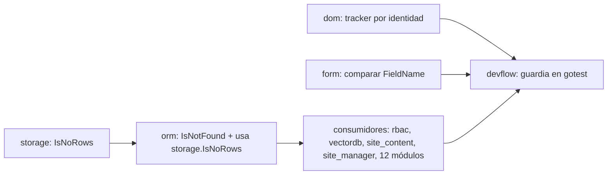

# Master Plan — Cero reflexión en el binario wasm

> **Status:** IN PROGRESS · 2026-10-08 · olas 1–2 ✅; olas 1–3 ✅ (incluida 3c, bug de feriados); ola 4 (guardia) en preparación: escaneo completo del workspace; guardia (ola 4) espera
> Doctrina: skill `api-design` · Índice: [MASTER_PLANS.md](MASTER_PLANS.md)

**Relación con olas anteriores.** Extiende
[`CLIENT_PAYLOAD_STAGING_MASTER_PLAN.md`](../app-releases/docs/CLIENT_PAYLOAD_STAGING_MASTER_PLAN.md)
§9 (Fase 0b), donde se midió que `internal/reflectlite` viaja en el login (6,8 KB) y en la app
(9,0 KB). Independiente de la ola del login de mjosefa-cms
([SOURCE_SELECTION_ROADMAP.md](SOURCE_SELECTION_ROADMAP.md), L1–L3), salvo que comparte `dom` y `form`.

## 1. El problema

Regla del dueño: **el código que compila a wasm no usa reflexión, nunca.** Nadie importa `reflect`,
y aun así `internal/reflectlite` está en todos los binarios. La causa es una sola: en TinyGo,
**cualquier `==`, `!=` o `switch` entre valores de interfaz** compila a

```go
// tinygo/src/runtime/interface.go:29
func interfaceEqual(x, y interface{}) bool {
	return reflectValueEqual(reflectlite.ValueOf(x), reflectlite.ValueOf(y))
}
```

y eso incluye el idioma más común de Go: `err == ErrNotFound` (`error` es una interfaz). Con un solo
sitio alcanzable entra reflectlite entero.

## 2. Evidencia (medida 2026-10-08, TinyGo 0.41.1)

- Nombres de función del binario de mjosefa-cms: la única entrada a reflectlite es
  `runtime.reflectValueEqual`. No hay `errors.Is/As`, `sort.Slice` ni mapas con clave interfaz.
- `twiggy paths` sobre el login: `reflectValueEqual` ← `(*webtyp.com/dom.tracker).add`
  (`dom/signal.go:173`, `sig == s`), que corre en cada `Get()` de una señal.
- Experimento en una copia de `dom` (sin tocar el repo): comparando por identidad, reflectlite
  desaparece del login (0 símbolos) y el binario baja 232.253 → 220.741 B raw, 82,0 → 77,1 KB gzip.
- Escáner con `go/types` sobre el grafo del cliente de mjosefa-cms (`GOOS=js GOARCH=wasm`):
  **127 comparaciones entre interfaces**. En webtyp: `dom/signal.go:173`, `form/form.go:402`,
  `orm/qb.go:124`. El resto, en módulos `veltylabs`, casi todas `err == orm.ErrNotFound`,
  `err == ErrX` local y `switch err`.

## 3. Decisiones

1. **Errores centinela: una función de consulta por tipo, nunca `==`.** Cada paquete que exporta un
   centinela le da un tipo concreto **no exportado** y exporta `IsX(err error) bool`, implementada
   con una aserción de tipo (`_, ok := err.(xErr)`). La aserción compara el código de tipo: TinyGo
   no usa reflexión ahí. El centinela exportado (`ErrX`) se conserva para quien lo **devuelve**;
   quien lo **compara** usa `IsX`.
   - Antecedentes: `os.IsNotExist(err)` (biblioteca estándar, antes de `errors.Is`),
     `status.Code(err)` de gRPC, `apierrors.IsNotFound(err)` de Kubernetes. `database/sql` usa
     `err == sql.ErrNoRows` / `errors.Is`: exactamente lo que aquí no se puede.
   - Balance: +1 función por centinela; formas de comparar: `==` queda prohibido en wasm por el
     guardia (decisión 3), así que queda una sola.
1b. **Centinelas propios de un paquete que nadie compara desde afuera** (los de cada módulo
   `veltylabs`, típicamente en `ops.go` para traducir errores a códigos): mismo mecanismo de
   aserción, sin API nueva. Comparten un tipo `domainError string` no exportado; el código afirma una
   vez (`e, ok := err.(domainError)`) y compara el valor concreto con `switch`. Un `IsX` exportado
   solo existe si otro paquete compara ese centinela. Inventario del 2026-10-08: solo
   `rbac.ErrRoleNotFound` y `rbac.ErrDuplicateRoleCode` se comparan desde afuera
   (`mjosefa-cms/config/auth.go:189`, `iam/modules/admin/handler.go:195,221`).
2. **Comparaciones internas entre interfaces** (`dom`, `form`): se reemplazan por identidad de un
   puntero concreto o por comparación de un campo string. Sin API nueva.
3. **Guardia en `gotest`** (`webtyp/devflow`): en cada directorio donde `gotest` corre los tests wasm,
   un análisis con `go/types` (`GOOS=js GOARCH=wasm`) falla si encuentra `==`/`!=`/`switch` entre
   interfaces (operandos no nil), import de `reflect`, o llamadas a `errors.Is`, `errors.As`,
   `sort.Slice`, `sort.SliceStable`. Es lo único que impide que el próximo `err == X` vuelva a traer
   los 9 KB sin que nadie lo note. **Se despacha al final**: activo antes, rompería `gotest` (y las
   cascadas de `gopush`) en todos los repos aún sin migrar.

## 4. Olas y dependencias


| Ola | Repo | Plan | Depende de | Estado |
|---|---|---|---|---|
| 1 | webtyp/dom | (publicado) | — | ✅ v0.13.23 · PR #28, sin correcciones (test de tamaño TinyGo verificado: rojo con el código viejo) |
| 1 | webtyp/form | (publicado) | — | ✅ v0.4.30 · PR #25, sin correcciones |
| 1 | webtyp/storage | (publicado) | — | ✅ v0.1.3 · PR #5 + revisión: quitado `commit_msg.txt`, README/AGENTS enseñan `IsNoRows` |
| 2 | webtyp/orm | (publicado) | storage v0.1.3 ✅ | ✅ v0.12.8 · PR #58 + revisión: AGENTS.md enseña IsNoRows/IsNotFound y prohíbe envolver el centinela |
| 3 | webtyp/rbac (+ `IsRoleNotFound`, `IsDuplicateRoleCode`) | (publicado) | orm v0.12.8 ✅ | ✅ v0.0.15 · PR #3 + revisión: quitado un `IsNotFound` exportado que nadie usaba; docs de los `IsX` |
| 3 | webtyp/vectordb, veltylabs/site_content, business_calendar, staff_manager, work_schedule | (publicados) | orm v0.12.8 ✅ | ✅ vectordb v0.2.7 · site_content v0.2.15 (test movido a `tests/`) · business_calendar v0.4.42 · staff_manager v0.1.66 (`go mod tidy`: Jules metió 18 indirectas al instalar gotest) · work_schedule v0.1.7 |
| 3 | clinical_encounter, editorial, patient_directory | (publicados) | orm v0.12.8 ✅ | ✅ clinical_encounter v0.1.71 · editorial v0.0.7 (test raíz justificado: usa `mapErrorStatus`) · patient_directory v0.0.50 |
| 3 | chat_room, item_catalog, device_manager | (publicados) | orm v0.12.8 ✅ | ✅ chat_room v0.2.43 · item_catalog v0.3.58 · device_manager v0.2.9 (test raíz justificado) |
| 3 | appointment_booking | (publicado) | orm v0.12.8 ✅ | ✅ v0.1.44 · PR #17 + `seed.go` vuelve a `fmt.Err` |
| 3c | veltylabs/business_calendar (+ `GetWeekdayBounds`, `ErrInvalidWeekday`) | (publicado) | — | ✅ v0.4.45 · PR #5 + comentarios de doc |
| 3c | veltylabs/appointment_booking (`SaveDayBlocks` contra horario semanal) | (publicado) | business_calendar v0.4.45 ✅ | ✅ v0.1.44 · PR #18 (Jules preguntó por `Clamp`: recorta, solo falla si no queda nada; test corregido). Revisado después del merge: `codejob` sin argumentos lo publicó al consultar el estado |
| 3 | site_manager | (publicado) | orm v0.12.8 ✅ | ✅ v0.4.3 · PR #6 |
| 3 | network_manager | (publicado) | network v0.1.2 ✅ | ✅ v0.1.10 · segunda ronda mía: `IsPlanStale/IsConflicts` en vez de comparar textos; Jules había revertido el frontmatter de codejob (restaurado) |
| 3 | webtyp/network (+ `IsPlanStale`, `IsConflicts`) — arreglo de raíz | (publicado) | — | ✅ v0.1.2 |
| 3 | webtyp/auth (+ `IsNotFound`, `IsInvalidRUT`, `IsRUTTaken`) | (publicado) | orm v0.12.8 ✅ | ✅ v0.0.68 · PR #6 + revisión: `tests/go.mod` había bajado versiones (events v0.0.6 aún no estaba en sumdb) → restaurado; test a `tests/` |
| 3 | veltylabs/modules/room_layout | (publicado, ejecutado en sesión) | orm v0.12.8 ✅ | ✅ v0.3.2 · la sesión de Jules falló; 16 centinelas → `domainError`, `mapErrorStatus` con `switch`, test que fija códigos y textos |
| 3b | veltylabs/mjosefa-cms, veltylabs/iam | hecho en sesión | rbac v0.0.15 ✅ | ✅ mjosefa-cms v0.0.22 · iam v0.0.22 (publicado en la rama `security-hardening`, que va 98 commits delante de `main`) |
| 4 | webtyp/devflow | `devflow/docs/PLAN_NOREFLECT_GUARD.md` (estacionado; pasa a `PLAN.md` al despacharlo) | olas 1–3 publicadas | 📝 escrito, no despachar antes |

Módulos de la ola 3 (comparaciones de centinelas, sin tests): appointment_booking 13,
business_calendar 11, chat_room 15, clinical_encounter 3, device_manager 10, editorial 8,
item_catalog 19, network_manager 5, patient_directory 6, room_layout 1 (+15 otras comparaciones
entre interfaces del escáner), staff_manager 6, work_schedule 1. Máximo 15 planes en curso.

## 5. Criterio de éxito

1. `tinygo build` del cliente de mjosefa-cms con `-size=full`: **0 bytes en `internal/reflectlite`**.
2. El guardia de `gotest` activo y verde en todos los repos de las olas 1–3.

## 6. Bitácora

- 2026-10-08 — diagnóstico y medición (§2). Planes de ola 1, 2 y 4 escritos. Ola 1 despachada (dom, form, storage). Revisión cada 10 min.
- 2026-10-08 — revisión 1: `form` PR #25 correcto → v0.4.30. `dom` y `storage` aún trabajando.
- 2026-10-08 — revisión 2: `dom` PR #28 correcto → v0.13.23 (reflectlite fuera del login). `storage` PR #5 → v0.1.3 con correcciones de docs. Ola 2 despachada (`orm`).
  Cascada de storage: `sqlt` falla por causas previas y ajenas a esta ola (falta `go mod tidy`; conformance `null_scans_as_zero` y una columna `note` extra en DDL). Anotado, no bloquea.
- 2026-10-08 — ola 3 escrita: 16 planes con inventario exacto (sitios de producción, centinelas propios y tests). `AGENTS.md` creado en `rbac` y `vectordb` (no existía). El plan viejo de `rbac` (`AllowedActions`, nunca despachado) quedó en `rbac/docs/PLAN_ALLOWED_ACTIONS.md`, fuera de la cola. Refinamiento 1b agregado.
- 2026-10-08 — revisión 3: `orm` PR #58 → v0.12.8 (corrección en AGENTS.md: la línea "wrap sql.ErrNoRows" contradecía `IsNoRows`). `AGENTS.md` de `rbac` y `vectordb` commiteado y subido antes del despacho (codejob solo agrega `docs/PLAN.md`). Ola 3 despachada: rbac, vectordb, site_content, appointment_booking, business_calendar, chat_room, clinical_encounter, device_manager, editorial, item_catalog, network_manager, patient_directory, staff_manager, work_schedule (14 sesiones).
- 2026-10-08 — revisión 4: 5 PR de la ola 3 publicados (escáner 0, `gotest` verde en todos). Correcciones: `staff_manager` go.mod, `site_content` test a `tests/`. `room_layout` sigue con su PR #3 propio en `review`.
- 2026-10-08 — revisión 5: publicados rbac, clinical_encounter, editorial, patient_directory. `network_manager` frenado: comparaba textos de error porque `webtyp/network` no tenía detector → plan de raíz en `network` despachado. Al escanear `iam` apareció `webtyp/auth` (`authority` compara `auth.ErrNotFound` y hace `switch err`) → plan + `AGENTS.md` despachados. Ola 3b hecha en sesión, sin commitear.
- 2026-10-08 — revisión 6: publicados chat_room, item_catalog, device_manager, network (raíz) y network_manager. Por orden del dueño, nada queda sin commitear: publicados también los repos con cambios ajenos (mjosefa-cms, iam, site_manager, sitetheme, html, goflare, sqlt, user, events, cloudflare, devflow, update, agenteval, devskills, retrieval, phoneme, app-releases). De paso: `devflow` v0.4.126 corrige `gotest` en repos solo de documentación (`IsWasmOnlyModule`).
- 2026-10-08 — `auth`: Jules preguntó si convertir los centinelas a `const domainError` rompe la i18n de `fmt.Err`. Verificado: `fmt.Err` traduce al construir (`tr()` en `fmt/error.go:47`) y solo si `webtyp/lang` ya registró `fmt.SetTranslator`; `auth` no importa `lang` y se inicializa antes (orden de ruta), así que sus centinelas nunca se traducían. La traducción por usuario va al mostrar el error. `webtyp/fmt` solo usa `reflect` en `*.back.go` (`!wasm`). Respondido con `codejob --reply`.
- 2026-10-08 — `room_layout`: sesión de Jules fallida → ejecutado en sesión (plan → `LAST_PLAN_EXECUTED.md`), publicado v0.3.2. `appointment_booking`: Jules terminó sin PR, pedido con `--reply`.
- 2026-10-09 — `appointment_booking`: PR #17 correcto, mergeado; no publica porque falla `TestSeed_LoadPopulatesServicesAndReservations`. Causa real (no del test): `SaveDayBlocks` valida la plantilla semanal contra la próxima ocurrencia del día con `GetDayBounds`, que aplica feriados → la semana antes del 2026-10-12 (feriado, lunes) no se podía guardar el horario de los lunes. Opción A aprobada: `business_calendar.GetWeekdayBounds` + `BoundsReader` local (3c).
- 2026-10-09 — ola 3 cerrada. `appointment_booking` v0.1.44 publica el PR #17 (sin reflexión) y el #18 (plantilla semanal contra `GetWeekdayBounds`); el test del seed ya no depende de la fecha. Aparte, fuera de alcance: `Clamp` acepta un bloque que empieza antes de la apertura y se guarda sin recortar (decisión de diseño pendiente). Antes de despachar el guardia: escaneo de todo el workspace para medir qué repos fallarían.
