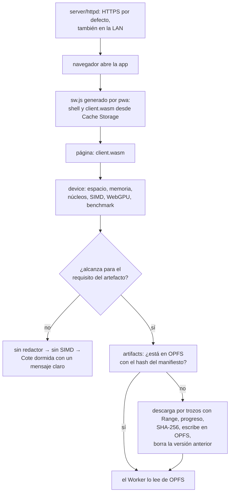
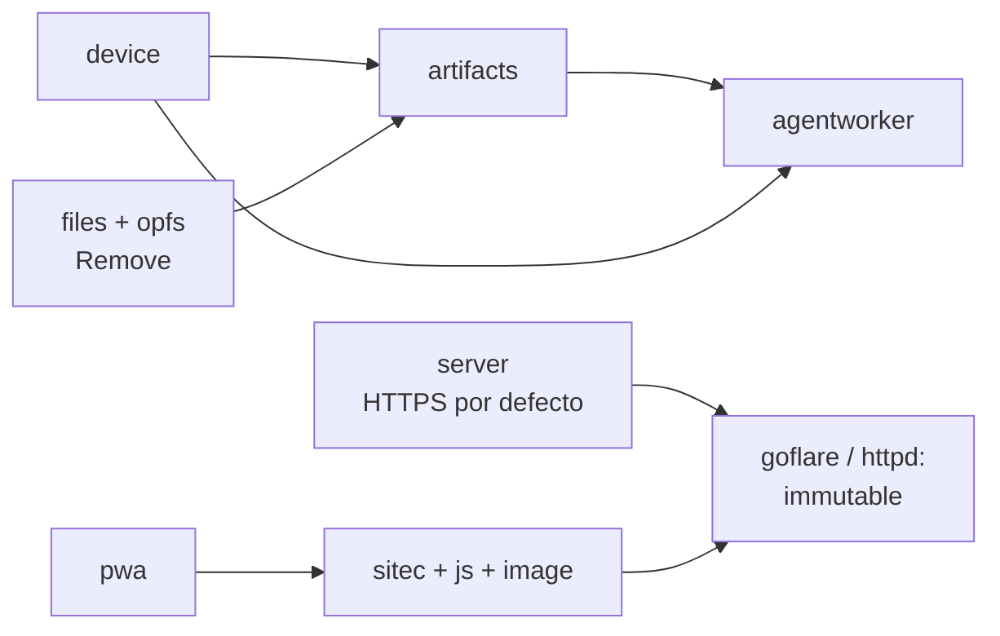

# Master plan — la aplicación como PWA: capacidades del dispositivo, caché de assets y artefactos pesados
> **Status:** IN PROGRESS · 2026-10-05 · decisiones cerradas (D-PWA-1 a 19); fases 1–4 publicadas; fase 5: laboratorio en `agenteval` v0.4.0; 5b (desarrollo sin descarga repetida): `devbrowser` v0.6.1, `sitec` v0.2.44 y `app` v0.6.113 publicados; fase 6 (`mjosefa-cms`) sin plan

**Relación con otras olas:** *extiende* la ola del agente
([agent/docs/AGENT_ECOSYSTEM_MASTER_PLAN.md](https://github.com/webtyp/agent/blob/main/docs/AGENT_ECOSYSTEM_MASTER_PLAN.md)):
toma de ella los artefactos pesados (pesos de modelos, caché de decisiones) y los niveles de
rendimiento D25 (WASM plano, SIMD, WebGPU). Cambia dos superficies publicadas: `weights.Load`
desaparece (D-PWA-7) y `js.ServiceWorker` desaparece (D-PWA-4). *Cambia* el comportamiento por
defecto de `webtyp/server/httpd`: sin configuración sirve HTTPS (D-PWA-13).

## Qué es esto y por qué existe

Una aplicación webtyp es una página que descarga Go compilado a WebAssembly. Hasta ahora eso era
liviano: un `client.wasm`, CSS, JS de arranque, íconos. Con el agente en el navegador (**Cote**, en
`veltylabs/mjosefa-cms`; el repo del asistente es `veltylabs/mjosefa-cote`) la aplicación también
descarga **artefactos pesados**:

| Artefacto | Tamaño | Cuánto cambia |
|---|---|---|
| shell: HTML, CSS, JS de arranque, íconos | KB | en cada despliegue |
| `client.wasm` (y los binarios de Workers) | 1–10 MB | en cada despliegue |
| pesos de decider-0.8b (int8 / 4 bits) | 812 / ≈ 470 MB | rara vez (una versión nueva del modelo) |
| pesos de LFM2.5-350M | 400 / ≈ 230 MB | rara vez |
| caché de decisiones (`qwen.SaveDecisionCache`) | ≈ 19 MB | cuando cambian las tools o el modelo |
| embeddings (bekko), índices | decenas de MB | rara vez |

Eso convierte a la aplicación, en los hechos, en una **PWA** (Progressive Web App: una página que
se instala, funciona sin red y guarda sus propios datos). Faltan cuatro cosas que hoy nadie hace:

1. **Saber qué puede el dispositivo**: espacio libre, memoria, núcleos, SIMD, WebGPU, y si el
   procesador alcanza. Hoy nadie lo pregunta antes de descargar 700 MB.
2. **Controlar la caché de los assets del framework**: qué se guarda, con qué versión, cuándo se
   reemplaza. Hoy lo decide el navegador con los encabezados HTTP.
3. **Descargar y mantener los artefactos pesados**: una sola vez, con progreso, verificados, sin
   duplicar memoria, y borrando las versiones viejas.
4. **Servir siempre por HTTPS, también en la LAN.** Service worker, OPFS y `persist()` solo existen
   en un *contexto seguro* (HTTPS o `localhost`). Abierta como `http://192.168.1.20:8080`, la
   aplicación no tiene service worker ni OPFS y Cote no puede guardar sus modelos.

Te topas con este documento cuando un usuario dice "la página se puso lenta / no carga / se llenó
el disco", o cuando vas a agregar un artefacto nuevo a una aplicación.

## Qué existe hoy (verificado el 2026-10-01)

- **`server/httpd`** sirve HTTPS en desarrollo por defecto (`Https: true` en el handler de
  desarrollo): una autoridad propia (`~/.webtyp/httpd/certs/ca.crt`, 10 años) firma un certificado
  de hoja con `localhost`, `127.0.0.1`, `::1` **y todas las IPv4 de la LAN**; la autoridad se instala
  en el sistema con `github.com/smallstep/truststore` y se ofrece a otros equipos en `/__webtyp/ca`.
  Pero **`httpd.Config` con `TLS` en cero sirve HTTP plano**: así arranca `mjosefa-cms` en
  producción (`config/server.go`), y su guía de despliegue dice que en la red local "no hace falta".
- **`sitec`** compila la superficie estática (CSS, JS, sprite SVG, fuentes, shell HTML, íconos y
  `client.wasm`) con nombres fijos (`style.css`, `script.js`, `icons.svg`). Los únicos hashes que
  calcula son MD5 de los `.go` fuente, para su caché de extracción: no hay hash de los archivos de
  salida. No genera service worker ni `manifest.webmanifest`.
- **`image/favicon`** deriva `icon-32.png`, `icon-192.png` y `apple-touch-icon.png` de un logo de al
  menos 256 px, declarado por el proyecto con `Favicon()`. Falta el de 512 px que exige una PWA
  instalable.
- **`js`** declara `ServiceWorkerHandler` y `js.ServiceWorker(handler)` (archivo `sw.js`), pero
  **nadie lo usa** (solo un comentario en `goflare-demo`), y carga todo `/client.wasm` dentro del
  service worker. `js.PageBootstrap()` tiene `/client.wasm` escrito a fuego.
- **`files`** es el contrato de archivos completos (`Reader`, `Writer`, `Appender`); **`opfs`**
  (v0.1.0) lo implementa en el navegador en trozos de 8 MiB. **Ninguno sabe borrar un archivo.**
- **`fetch`** devuelve el cuerpo completo de cada respuesta (sin streaming); acepta encabezados
  (`Range`), así que una descarga por trozos es una petición por trozo.
- **`weights.Load`** descarga un artefacto y lo guarda en **IndexedDB** (tabla `weights_cache`),
  contra la decisión D10 de la ola del agente. **Nadie la llama.**
- **`goflare`** despliega a Cloudflare (Worker con assets estáticos; acepta un bucket R2).

## Lo que el navegador permite saber (y lo que no)

| Pregunta | API | Límite |
|---|---|---|
| ¿Cuánto espacio queda? | `navigator.storage.estimate()` → `quota`, `usage` | es la cuota del sitio, no el disco; aproximada |
| ¿Se borrará mi caché? | `navigator.storage.persist()` / `persisted()` | Chrome decide solo (sitio instalado o muy usado) |
| ¿Cuánta RAM hay? | `navigator.deviceMemory` | solo Chrome/Edge; redondeado y con tope de 8 GB; **no hay RAM libre** |
| ¿Cuántos núcleos? | `navigator.hardwareConcurrency` | lógicos, no dice la velocidad |
| ¿SIMD? | `WebAssembly.validate(módulo SIMD mínimo)` | exacto |
| ¿WebGPU? | `navigator.gpu?.requestAdapter()` | exacto; dice el adaptador, no su velocidad |
| ¿El procesador alcanza? | **ninguna API**: hay que medir | un microbenchmark (p. ej. 200 ms de `nn.MatVecQ8Block32`) da tokens por segundo reales |

Conclusión: la memoria y la velocidad no se pueden *preguntar*, se **miden**.

## Cómo queda

| Pieza | Responsabilidad | Repo | Cuándo corre |
|---|---|---|---|
| **HTTPS por defecto** | el valor cero de `httpd.Config` sirve TLS con la autoridad local | `webtyp/server` | servidor |
| **`device`** | qué puede este navegador: `Profile`, `Tier`, `Bench`, `Requirement` | `webtyp/device` (nuevo) | navegador |
| **`pwa`** | `New`: manifiesto, etiquetas `<head>` y script de registro; `App.ServiceWorker(shell)`: `sw.js` del shell ya con hash; `pwa/update`: señal "versión nueva" | `webtyp/pwa` | build + navegador (`pwa/update`) |
| **`sitec`** | nombres con hash de contenido; llama a `pwa` si el proyecto declara `PWA()` | `webtyp/sitec` | build |
| **`artifacts`** | manifiesto de artefactos pesados, descarga reanudable, SHA-256, OPFS, borrado | `webtyp/artifacts` (nuevo) | navegador |

### Dos cachés distintas, a propósito

- **Shell → Cache Storage** (la caché de los service workers): archivos chicos, nombres con hash
  de contenido, reemplazo en cada despliegue. Es para lo que existe.
- **Artefactos pesados → OPFS** (`opfs`): cientos de MB, leídos en trozos sin duplicar memoria;
  Cache Storage devuelve un `Response` entero y obligaría a copiarlo todo.

## Decisiones (todas cerradas, 2026-10-01)

**D-PWA-1 — Un repositorio nuevo `webtyp/device`** sabe qué puede el dispositivo: espacio,
memoria, núcleos, SIMD, WebGPU y benchmark. Lo consultan varios (el Worker del agente para elegir
nivel, la app para decidir si descarga, la UI para explicar), y `js` ya es la API general del
framework. `device` no importa `nn`: `Bench` mide la función que le pasen, así el kernel lo elige
quien lo va a correr.

**D-PWA-2 — Si el equipo no alcanza, se baja de nivel y luego se duerme.** Primero sin redactor (las
respuestas salen de plantillas o datos; ahorra ≈ 230 MB), luego sin SIMD; si aún no alcanza,
**Cote queda dormida** con un mensaje claro que dice qué faltó (espacio, nivel o velocidad). Pedir
a otro equipo de la red queda descartado: contradice que el servidor de la clínica no corre el
modelo.

**D-PWA-3 — Decide el benchmark.** Cada artefacto declara un `device.Requirement` (espacio libre,
nivel mínimo, ejecuciones por segundo del kernel). `deviceMemory` solo produce una **advertencia**:
Firefox y Safari no lo tienen y Chrome lo redondea con tope de 8 GB.

**D-PWA-4 — El service worker del shell es un `sw.js` corto generado por `pwa`**, no un binario
Go: un service worker que necesita descargar un wasm antes de poder servir el wasm se muerde la
cola, y la lógica es fija (precache + versión). **`js.ServiceWorker` y `js.ServiceWorkerHandler`
se borran**: nadie los usa y producirían un segundo `sw.js` con el mismo nombre (una intención, un
camino).

**D-PWA-5 — Nombres con hash de contenido + manifiesto de precache**, el camino de Workbox (Vite
PWA, `next-pwa`), Angular (`ngsw.json`) y SvelteKit (`$service-worker`):
- `sitec` escribe `style.<hash>.css`, `script.<hash>.js` y `client.<hash>.wasm`; `<hash>` son los primeros 8 caracteres hexadecimales del SHA-256 del
  contenido. `index.html`, `sw.js` y `manifest.webmanifest` conservan su nombre (el navegador los
  busca por nombre). El sprite de íconos **no es un archivo**: vive solo dentro del HTML, la única
  forma en que CSS y el DOM pueden manipular sus `<symbol>` (decisión del usuario, 2026-10-01;
  `icons.svg` se eliminó en `sitec` v0.2.38).
- `sw.js` lleva la lista de precache (URL + revisión) y la **versión de la aplicación**, que es el
  hash de esa lista. Solo se descarga lo que cambió; nunca queda HTML nuevo con wasm viejo.
- Un archivo con hash en el nombre se sirve con `Cache-Control: public, max-age=31536000,
  immutable`; `index.html`, `sw.js` y `manifest.webmanifest` con `no-cache`.

**D-PWA-6 — `artifacts` solo lee URLs del manifiesto**, relativas al mismo origen por defecto.
Dónde se suben (el mismo servidor en la LAN, R2, lo que venga) lo decide el despliegue de cada
proyecto. Cada artefacto lleva su SHA-256; la descarga va por trozos con `Range` y se reanuda.

**D-PWA-7 — Una sola forma de guardar un artefacto.** `weights.Load`, `LoadConfig`,
`QuotaEstimator`, `CacheKey` y `Evict` se borran junto con la dependencia de `storage` y de
`fetch` en `weights`. `artifacts` descarga y guarda en OPFS; `weights.Open` abre los bytes.

**D-PWA-8 — Las actualizaciones bajan en segundo plano y se aplican cuando el usuario lo elige.**
- **Shell:** el `sw.js` nuevo se instala y precarga en segundo plano y queda **en espera** (sin
  `skipWaiting` automático, sin `clients.claim`). La página recibe la señal "versión nueva lista"
  (`pwa/update.OnReady`); la interfaz ofrece recargar y nunca recarga sola en medio de un trabajo.
  Al aceptar (`update.Apply`), el service worker en espera toma el control y la página se recarga.
- **Modelos:** id + versión. El nuevo se descarga y verifica en segundo plano mientras se usa el
  anterior; se usa al reiniciar; el anterior se borra solo después. Si no caben dos versiones
  completas, no se descarga y se avisa.

**D-PWA-9 — `persist()` justo antes de la primera descarga pesada** (cuando el funcionario
despierta a Cote con un clic: es un gesto del usuario y en Firefox el aviso llega con contexto), y
de nuevo después de instalar la PWA. Si `persisted()` sigue en falso, la interfaz dice "este equipo
podría borrar los modelos si se llena el disco". Nunca al cargar la página.

**D-PWA-10 — Un directorio de OPFS por módulo** (`opfs.Open("cote")`). El almacenamiento es por
origen; Cote es un módulo de `mjosefa-cms`, no otra aplicación, así que basta con que borrar los
modelos viejos de un módulo no toque los archivos de otro.

**D-PWA-11 — `webtyp/pwa` es una librería aparte; `sitec` la llama cuando el proyecto declara
`PWA() pwa.Config`**, igual que hoy llama a `image/favicon` cuando declara `Favicon()`. `sitec` no
aprende qué es una PWA: le pasa a `pwa` la lista de assets con su hash y recibe bytes. Un proyecto
sin `PWA()` no genera service worker. Los íconos del manifiesto salen de `Favicon()` (192 y 512 px):
declarar `PWA()` sin `Favicon()` es un error de build. Prior art: Workbox es una librería que los
bundlers llaman desde un plugin; Angular separa `@angular/service-worker` del compilador.

**D-PWA-12 — Los modelos del laboratorio corren en el navegador**: el laboratorio de agentes
vive en `webtyp/agenteval` (`ui/`, `lab/`, `web/client.go`, `web/workers/agent`, `cmd/lab`;
2026-10-05; el repo aparte `veltylabs/agentlab` se creó y se borró). `go run ./cmd/lab` hace el
build de release en `web/public` y lo sirve por HTTPS: el único camino donde existen
`/artifacts.json`, `/artifacts/` y los binarios de los Workers. `ui/` es un panel de chat sobre
`bubblethread` y `composebar` (no `chatview`, que es chat entre personas) y sirve para cualquier
agente en `agentworker`: Cote lo monta con su propio Worker.

**D-PWA-13 — HTTPS siempre, también en la LAN.** El valor cero de `httpd.TLSConfig` sirve TLS con
la **autoridad local** que hoy solo se usa en desarrollo (la misma cadena: autoridad de 10 años +
hoja con `localhost`, el nombre del equipo y todas sus IPv4). HTTP plano solo con
`PlainHTTP: true`, explícito, para cuando un proxy que termina TLS está delante. Consecuencias:
- `DevTLS` desaparece (ahora es el caso por defecto); `DevCA`/`DevCertFiles`/`DevCertSPKI` pasan a
  `LocalCA`/`LocalCertFiles`/`LocalCertSPKI`, porque ya no son solo de desarrollo.
- `httpd` monta `/__webtyp/ca` él mismo cuando sirve la autoridad local: cada PC de la clínica la
  instala una vez desde el servidor (en Windows, doble clic → "Entidades de certificación raíz de
  confianza").
- La hoja se renueva sola al vencer, sin reiniciar el proceso.
- El directorio de certificados no cambia (`~/.webtyp/httpd/certs`): los equipos que ya confían en
  la autoridad siguen confiando.
- `mjosefa-cms` no cambia código: al actualizar `server` su `config/server.go` (que no fija `TLS`)
  pasa a HTTPS. Su guía de despliegue en Windows se corrige (la red local también va por HTTPS, y
  el TLS de Go no depende del sistema operativo).
- Descartado: certificados públicos con DNS-01 (exigen un dominio y salida a internet desde la
  clínica) y un proxy inverso delante (otra pieza que instalar y mantener en Windows Server 2012).

**D-PWA-14 — Una sola regla de nombres y cabeceras, en `pwa`** (2026-10-01).
`pwa.HashedName` escribe los nombres con hash, `pwa.IsHashedName` los reconoce y
`pwa.CacheControl(path)` decide la cabecera: `immutable` para un nombre con hash, `no-store` bajo
`pwa.ArtifactsDir` (`/artifacts/`), `no-cache` para el resto. `sitec` (que escribe),
`server/httpd` (LAN) y `goflare` (Cloudflare, vía `_headers`) leen la misma regla.

**D-PWA-15 — El proyecto declara sus artefactos con `ArtifactSources() []artifacts.Source`**, en el
paquete raíz, como `Favicon()` y `PWA()`. `sitec` mide cada archivo (tamaño y SHA-256, por streaming:
`artifacts.BuildManifest`), escribe `/artifacts.json` y coloca los archivos bajo `/artifacts/` con un
enlace duro (o copia por streaming); nunca los carga en memoria ni los precachea. El manifiesto sí va
en el shell. En desarrollo, las descargas se prueban tras un `Build` de release.
El nombre no es `Artifacts()`: `sitec` reconoce a los productores **solo por el nombre**
(`sitec/docs/ARCHITECTURE.md` §3.1) y `min.Handler` y `sitec.Output` ya declaran un `Artifacts()`
(2026-10-02). Un productor nuevo necesita un nombre que nadie declare en el ecosistema.

**D-PWA-16 — Artefactos en Cloudflare: todavía no.** Los assets de Workers aceptan 25 MiB por
archivo; servir `/artifacts/` desde R2 se construye cuando un proyecto alojado en Cloudflare lo
necesite. Hasta entonces `goflare` rechaza `/artifacts/` con un mensaje claro. La clínica despliega en
su LAN, donde `server/httpd` los sirve con `Range` y `no-store`.

**D-PWA-17 — `agentworker`: el agente completo vive en el Worker.** Modelos desde OPFS, memoria,
herramientas MCP y el `agent.Config` de la aplicación, en un binario de Worker que escribe la propia
aplicación (`agentworker.Serve(Setup)`). La página solo pide `persist()` (no existe en Workers),
elige el binario por nivel (SIMD o plano) y recibe eventos tipados (progreso, listo, dormido,
respuesta, fallo). Un Worker avisa progreso fuera de su respuesta con `js.PostToPage` (js v0.1.1).
La caché de decisiones se guarda una vez por arranque (D27). Todo fallo llega a la página como
`EventFailed`: el error de una petición vuelve como error de `js.ServeWorker` y la página lo traduce;
los fallos no fatales (guardar la caché, `Prune`) viajan con `js.PostToPage`. La unidad de `min_rate` del manifiesto
son ejecuciones por segundo del kernel de `agentworker` (`nn.MatVecQ8Block32`, 3584×1024).

**D-PWA-18 — Workers por convención: `web/workers/<name>/main.go`.** `sitec` compila cada uno dos
veces en release (plano y SIMD, TinyGo `-opt=2`; D16) y emite `<name>.worker.js` y
`<name>.simd.worker.js`; en desarrollo, una sola compilación con Go y ambos scripts apuntan a ella.

**D-PWA-19 — En desarrollo, sin descarga repetida y sin build aparte** (2026-10-05, decisión del
dueño). El proyecto declara sus modelos tipados (`ArtifactSources()`, como `RootCSS()`) y sus Workers
por convención; `webtyp dev` hace el resto: el `Compiler` de `sitec` escribe `/artifacts.json` y
`sitec/serve` entrega los archivos **desde donde están** (Range, `no-store`, sin copiarlos a
`web/public`); el demonio compila los Workers con TinyGo SIMD; y el navegador de desarrollo usa un
**perfil persistente por proyecto**, así la copia a OPFS ocurre una vez por versión de modelo, por el
mismo camino que en producción. Descartado: leer los modelos sin OPFS en desarrollo (no probaría el
camino real).

## Fases y planes

| Fase | Repo | Plan | Estado |
|---|---|---|---|
| 1 | `server` | HTTPS por defecto (D-PWA-13) | ✅ v0.2.67 (PR #22); consumidores ajustados: `app` v0.6.89, `devbrowser` v0.5.26; `goflare` con el test corregido sin publicar (árbol con cambios ajenos) |
| 1 | `device` | `Profile`, `Tier`, `Bench`, `Requirement` | ✅ v0.1.0 (PR #1) |
| 1 | `pwa` | `New` (manifiesto, etiquetas, registro) + `App.ServiceWorker(shell)`; `pwa/update` | ✅ v0.1.0 (PR #1 + corrección local: API en dos pasos, `OnReady` escucha antes de volver) |
| 1 | `weights` | borrar `Load` y la caché en IndexedDB (D-PWA-7) | ✅ v0.3.0 |
| 1 | `files` | `Remover`, `Store` | ✅ v0.0.4 |
| 1 | `opfs` | `RemoveFile` | ✅ v0.1.2 |
| 1 | `image` | `icon-512.png` (solo con logo ≥ 512, sin ampliar) | ✅ v0.1.11 |
| 2 | `js` | `PageBootstrap(wasmURL)`; borrar `ServiceWorker` | ✅ v0.1.0 (local); `sitec` v0.2.36 y `app` actualizados |
| 2 | `sitec` | nombres con hash en release + `PWA()`; sin `icons.svg` | ✅ v0.2.37 (PR #26 + corrección: solo el binario de la página lleva hash, el del edge Worker no) y v0.2.38 (sprite solo en el HTML) |
| 2 | `artifacts` | repo nuevo: `Manifest`, `Store.Ensure/Read/Prune` | ✅ v0.1.0 (PR #1) |
| 3 | `pwa` | `HashedName`, `IsHashedName`, `CacheControl`, `ArtifactsDir` (D-PWA-14) | ✅ v0.1.1 (local) |
| 3 | `server/httpd` | `Cache-Control` de `PublicDir` según `pwa.CacheControl` | ✅ v0.2.68 (local) |
| 3 | `sitec` | usa `pwa.HashedName`; `/artifacts/` nunca se precachea | ✅ v0.2.40 (local) |
| 3 | `artifacts` | `Source`, `BuildManifest`, `Manifest.Encode` (D-PWA-15) | ✅ v0.1.1 (local) |
| 3 | `js` | `PostToPage` (D-PWA-17) | ✅ v0.1.1 (local) |
| 3 | `goflare` | `_headers` con `immutable`; rechaza `/artifacts/` (D-PWA-16) | ✅ v0.5.35 (PR #28; `assets.config._headers` verificado contra los tests de deploy de Wrangler) |
| 3 | `sitec` | `ArtifactSources()` → `/artifacts.json` + archivos bajo `/artifacts/` (D-PWA-15) | ✅ v0.2.42 (local; Jules falló dos veces: el nombre `Artifacts()` ya lo declaran `min.Handler` y `sitec.Output`, y la detección es solo por nombre) |
| 4 | `agentworker` | repo nuevo: `Serve`, `Start`, `Client` (D-PWA-17) | ✅ v0.1.0 (PR #1 + corrección local: el PR no compilaba; protocolo JSON completo, caída del redactor, caché de decisiones una vez por arranque, `Prune` con lo que está en uso, las 11 pruebas del núcleo; TinyGo compila un `main` de Worker de 2,3 MB) |
| 4 | `sitec` | Workers `web/workers/<name>`, plano + SIMD (D-PWA-18) | ✅ v0.2.43 (PR #27 + corrección: el fixture no corría `go mod tidy` y las pruebas nunca se ejecutaron; se verifica el runtime de TinyGo en los scripts y el contenido del target SIMD) |
| 5 | `mjosefa-cote` | Cote híbrido sobre `agent` v1.1.0 (`Texts`, `Guard`, plantilla de horario) | ✅ v0.2.0 (local) |
| 5 | `agenteval` | laboratorio: `ui/`, agente de prueba en Worker, `ArtifactSources()`, `cmd/lab`; pruebas reales en `docs/REAL_TESTS.md` | ✅ v0.4.0 (local). Hallazgos: arranque en frío se cuelga tras la última descarga (`call to released function`), en caliente 9 s; 2,9 GB de RAM con int8 |
| 5b | `devbrowser` | `WithProfile`: un perfil de Chrome persistente por proyecto, así OPFS (los modelos) sobrevive entre sesiones (D-PWA-19) | ✅ v0.6.1 (PR #15 + corrección: un solo lector del `SingletonLock` para el limpiador y el perfil) |
| 5b | `sitec` | en desarrollo: `/artifacts.json` desde el `Compiler`, `/artifacts/` servido desde disco con Range (sin copia), `BuildWorkers` (TinyGo SIMD) | ✅ v0.2.44 (el PR #28 no traía código y no cambió tras el comentario; implementado en local. Se encontró y evitó un bloqueo: el manifiesto se escribe con el mutex del `Compiler` tomado) |
| 5b | `app` | el demonio compila `web/workers` y los recompila al cambiar sus dependencias; perfil por proyecto | ✅ v0.6.113 (en local: Jules no pudo bajar el módulo privado `webtyp.com/depfind`). Falta probarlo en vivo con `webtyp dev` sobre `agenteval` |
| 6 | `mjosefa-cms` | el chat de Cote en el CMS | **sin fecha**: solo cuando Cote esté listo y se decida su arquitectura (red local, dispositivo o nube); las pruebas son solo en `agenteval` (dueño, 2026-10-21) |

La fase 6 no tiene plan todavía. Antes: arreglar el cuelgue del arranque en frío, pesos de 4 bits
(2,9 GB con int8 no caben en los equipos de 4 GB) y probar a Cote en el laboratorio. Hueco del
framework encontrado: `webtyp dev` no compila `web/workers/` (con el demonio se ve la interfaz,
pero para hablar con el agente hace falta `cmd/lab`).
