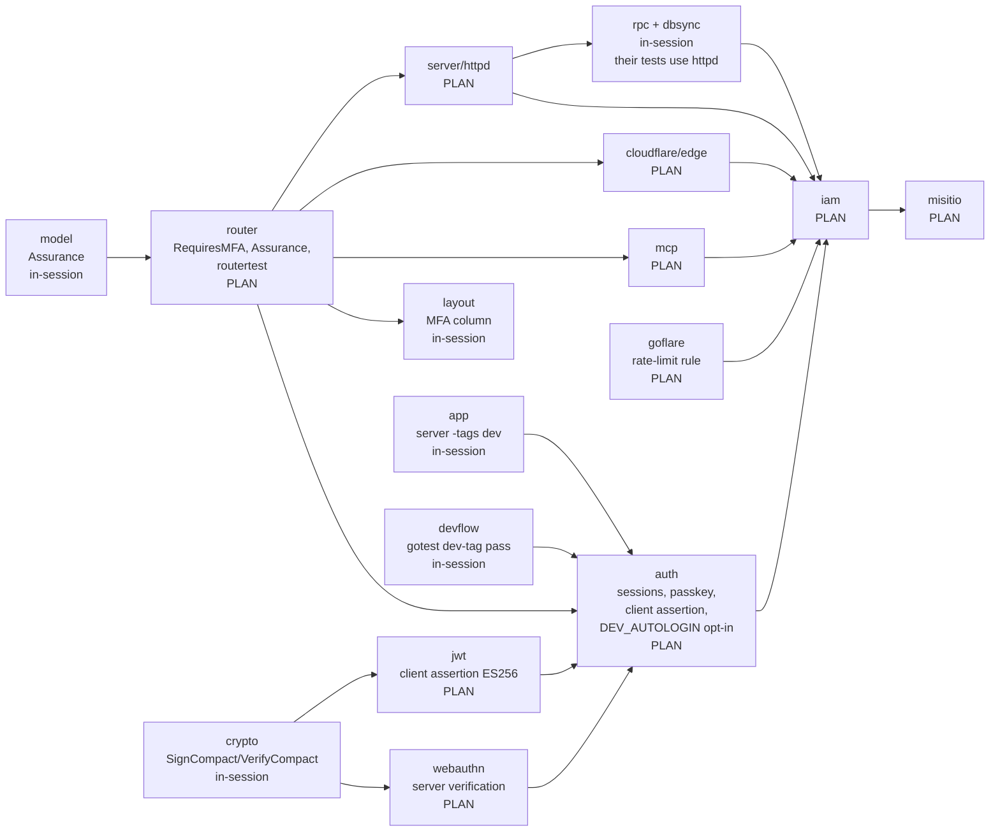
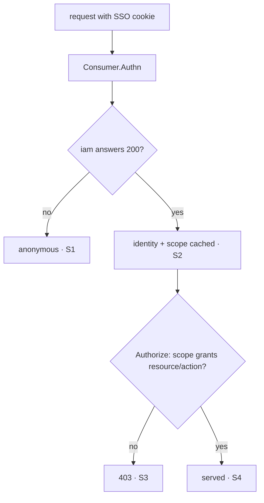

# Security by default — master plan

> **Status:** IN PROGRESS · 2026-10-20 · every framework piece shipped; `iam` closed v0.0.28; misitio: D1 schema sync closed (v0.0.10); **§9 despachada** (`docs/PLAN.md`, Jules, sesión 4525363837779143163) — ya no espera nada.

Trigger: the API explorer in `veltylabs/iam` reports 22 of 25 routes as
`public`. The framework's own rule (skill **api-design**, `webtyp/router`
`route.go`) is that an undeclared route is `AccessGuarded` and refuses to
start. iam is not insecure because the framework is permissive. It is at risk
because **it had to leave the framework's model to express what it needed**,
and every exit is hand-rolled protection that nothing checks.

Target: OWASP ASVS 4.0 **Level 3**, the level ASVS assigns to "applications
that perform high value transactions" such as banking. Concretely:
deny-by-default enforced by the framework, phishing-resistant MFA for
privileged access, revocable sessions with idle and absolute limits, machine
clients authenticated as principals, and an inventory of every unauthenticated
surface.

---

## 1. Audit — what was verified (2026-10-12)

Verified against the running dev server (`https://localhost:8080`, no
cookie) and the source code, not inferred.

### 1.1 Why the explorer says "public"

`veltylabs/iam/config/routes.go` registers **every** admin and machine route
with `.Public()` and protects it inside the handler instead:

```go
r.Get(PathAdminProjects, RequirePanelAdmin(db, ids, authMod, adminEmails, ListProjectsHandler(db))).Public()
r.Post(PathRolesAssign, AssignRole(db, rbacSvc)).Public() // checks client_secret in the body
```

The handlers do enforce something (`RequirePanelAdmin` → 401/403,
`VerifyProjectSecret` → 403). Without a cookie, POSTs return 403. So today
the API is **not** open to anyone, but:

- The framework gate is switched off for these routes. Protection depends on
  each handler remembering its wrapper. **One forgotten wrapper means an open
  endpoint, and no startup check, conformance test or introspection would
  notice**, because the route already says `public`.
- The route inventory, the one tool built to show the security posture
  (`/_routes`, the API explorer), reports the opposite of the truth. This is
  the exact failure `router/route.go` documents as unacceptable ("an endpoint
  whose whole job is to expose the security posture of a server must not
  invert it").

`GET /api/admin/me` answering `200 admin@iam.local` without a cookie is
`DEV_AUTOLOGIN` from `iam/.env`. It is expected in dev, but see F4.

### 1.2 Root cause: four places where iam left the framework

| Need | What the framework offers | What iam did |
|---|---|---|
| Panel admin authorization | `.Requires(resource, action)` + RBAC | email allow-list in a handler wrapper, route `.Public()` |
| Machine-to-machine (consumer apps) | nothing: no machine principal | `client_secret` in the JSON body, checked in each handler, route `.Public()` |
| Revocable session across subdomains | opaque cookie session (default in `auth/authority`, revocable) | `session/jwt`: stateless, 7 days, `Revoke` is a no-op |
| Route inventory | `MountIntrospection(...)` + caller-chosen access | `.Public()` in **production** too (`RegisterRoutes` is shared by `edge/main.go`) |

The first two are **framework gaps**. The framework has no vocabulary for
them, so the app opted out. The last two are **app choices** against
framework defaults that already exist.

### 1.3 Findings

Severity follows OWASP risk rating (likelihood × impact) for an identity
provider: compromising iam compromises every consumer project.

| # | Sev. | Finding | Evidence | Industry rule broken |
|---|---|---|---|---|
| F1 | **Critical** | **A compromised or malicious `*.velty.cl` app can take over the iam admin panel.** The session cookie is `Domain=.velty.cl`, so every subdomain's server receives the admin's cookie. `RequireSameOrigin` checks `Origin`/`Sec-Fetch-Site`, which only a *browser* guarantees. A server replaying the cookie sets those headers freely. | `config/auth.go` `strategy.WithDomain(SSOCookieDomain)`; `config/admin_origin.go` | ASVS V3.4.4 (`__Host-` prefix, host-only cookie for sensitive sessions); privileged sessions must not share scope with lower-trust apps (BeyondCorp, Google/AWS console use host-only admin cookies + re-auth) |
| F2 | **High** | **Authorization lives outside the framework.** 22 routes are `.Public()` and rely on wrappers. Deny-by-default exists but is bypassed. | `config/routes.go` | ASVS V4.1.3 and V1.4.4 (single, centralized access-control mechanism); OWASP API5:2023 (broken function-level authorization) |
| F3 | **High** | **Sessions cannot be revoked.** Stateless JWT, 7-day TTL, no idle timeout. Logout deletes the cookie client-side only. A stolen cookie stays valid for 7 days and there is no kill switch. | `auth/session/jwt/jwt.go:115` ("stateless: nothing to revoke"); `config/auth.go` `SSOSessionTTL = 86400*7` | ASVS V3.3.1 (logout invalidates server-side), V3.3.2 (re-auth period); NIST SP 800-63B §7.2 (AAL2: re-auth every 12 h and after 30 min idle; AAL3: 12 h / 15 min); PCI DSS 4.0 req. 8.2.8 (15 min idle) |
| F4 | **High** | **`DEV_AUTOLOGIN` is compiled into production.** It is disabled only by the `prod` build tag, and **no build in the ecosystem passes `-tags prod`**. Production safety rests on nobody setting an env var. That is opt-out, the inverse of secure by default. | `auth/authority/devlogin.go` (`//go:build !prod`); no `-tags prod` in `app`, `gobuild`, `goflare` (`app` passes `-tags dev` for the client only) | ASVS V14.1 (build/deploy hardening; debug features absent from production builds) |
| F5 | **High** | **Admin access is single-factor.** Google login + an email in `IAM_ADMIN_EMAILS`. No MFA, no step-up before destructive actions (rotate secret, delete role, assign roles). | `config/adminaccess.go`; `config/admin_handlers.go` | PCI DSS 4.0 req. 8.4.2 (MFA for all administrative access); NIST 800-63B AAL3 (phishing-resistant authenticator) for an IdP admin; ASVS V2 L3 |
| F6 | Medium | **No machine principal.** Consumers send `client_secret` in the JSON body on every call. Handlers verify it individually. No lockout or rate limit per client. (Secret strength is fine: 240 bits, HMAC-peppered, constant-time compare.) | `config/routes.go` `AssignRole`/`ResolveUser`; `client/consumer.go` | RFC 6749 §2.3.1 (client authenticates via `Authorization`, not the body); FAPI 2.0 Security Profile (`private_key_jwt` or mTLS for high-value APIs); service accounts as first-class principals (Google Cloud, AWS IAM roles) |
| F7 | Medium | **Route map is public in production.** `/_routes` hands an attacker every path, method and access level. | `config/routes.go` last line | OWASP API9:2023 (inventory must exist **and** be protected); ASVS V14.3 (no unintended information disclosure) |
| F8 | Medium | **No throttling anywhere.** No rate limit on login, `/api/token`, `/api/users/resolve`, `/api/roles/assign`. `resolve` creates global identities and confirms whether an email exists. | grep `ratelimit|throttle|lockout` in `iam`, `router/security`, `server` → empty | OWASP API4:2023 (unrestricted resource consumption); ASVS V2.2.1 (anti-automation) |
| F9 | Medium | **Machine mutations are not audited.** `AssignRole` (grants roles) and `ResolveUser` (creates users) write no audit entry. Panel actions do. | `config/routes.go` | PCI DSS 4.0 req. 10.2.1 (log all actions by any user, including changes to privileges); ASVS V7.1 |
| F10 | Low | `/api/health/db` is public and reveals database reachability. Industry splits public *liveness* from internal *readiness*. | `config/routes.go` | Kubernetes/Cloud Run probe convention; ASVS V14.3 |
| F11 | Low | Public `POST /logout` with no CSRF/origin check allows forced logout (nuisance, not escalation). | `auth` `MountAPI` | ASVS V4.2.2 |
| F12 | To verify | Audit log tamper-evidence (append-only, hash chain or external sink) is not verified. | `config/audit.go` | PCI DSS 4.0 req. 10.3.2 / 10.3.3 (protect audit logs from modification) |

### 1.4 What is already right (keep it)

- Framework deny-by-default: an undeclared route fails at startup (`router/conformance`).
- `client_secret` storage: 30-byte CSPRNG secret, HMAC-SHA256 with a separate pepper, constant-time compare.
- Open-redirect guard `isVeltyDomain` with an exhaustive host-terminator set.
- `auth/authority` default session is an **opaque, revocable** cookie with 256-bit IDs. iam only needs to stop opting out of it.
- Security headers middleware (`router/security.Policy`).
- Panel mutations are audited, and denials are audited with bounded attacker input.

---

## 2. Principles this wave applies (and why)

1. **Deny by default, enforced in one place.** Spring Security
   (`anyRequest().authenticated()`), ASP.NET Core (`FallbackPolicy =
   RequireAuthenticatedUser`) and Rails (`before_action :authenticate!` in
   `ApplicationController`) all make the framework, not the handler, the gate.
   Reason: a check that must be remembered per handler is eventually
   forgotten. ASVS V1.4.4 asks for exactly one access-control mechanism.
2. **Every caller is a principal.** Humans and machines alike authenticate
   to an identity and are authorized by the same `Requires`. Google Cloud
   service accounts, AWS IAM roles and Kubernetes ServiceAccounts all model
   machines as principals so one policy engine covers both. That removes the
   second, ad-hoc authorization path.
3. **Privilege has its own session.** Admin consoles (AWS, GCP, GitHub
   "sudo mode") use a host-scoped session, short idle timeout, and step-up
   re-authentication before sensitive actions. Reason: the blast radius of a
   stolen low-privilege SSO cookie must not include the admin plane.
4. **Phishing-resistant MFA for privileged access.** NIST 800-63B AAL3 and
   CISA guidance name FIDO2/WebAuthn (passkeys) as the phishing-resistant
   option. OTP and push can be phished. The ecosystem already has
   `webtyp/webauthn`.
5. **Revocable, time-boxed sessions.** Server-side session state so logout,
   compromise response and role revocation take effect immediately (ASVS
   V3.3, PCI 8.2.8).
6. **Inventory every unauthenticated surface.** OWASP API9:2023. A public
   route is a deliberate, reviewed exception, listed in one place and checked
   by a test. It is never what you get by default.
7. **Secure build by default.** Debug and dev features are **opt-in** at
   build time (`-tags dev`), so a forgotten flag yields the secure binary,
   not the insecure one.

---

## 3. Decisions (closed 2026-10-13)

| # | Decision | Chosen | Why |
|---|---|---|---|
| D1 | How machine clients authenticate | **`private_key_jwt` only, in this wave.** No interim `client_secret`-in-header step. The consumer signs a short-lived ES256 client assertion (RFC 7523) per request, bound to method and URL (`htm`/`htu`, as in DPoP RFC 9449), single-use `jti`. `client_secret` is deleted. | The user asked for no phases. Shipping both methods would be two ways to do one thing (api-design ledger). `private_key_jwt` is the FAPI 2.0 baseline: no shared secret exists, so a leaked iam database or a sniffed request does not let anyone impersonate a consumer. ES256 (P-256) instead of Ed25519 because `webtyp/crypto/asym` already ships P-256 and WebAuthn passkeys use the same curve, so one curve serves both. |
| D2 | MFA for panel admins | **Passkey mandatory for every admin session.** | PCI DSS 8.4.2 (MFA for all admin access); NIST AAL3 (phishing-resistant). |
| D3 | Rate limiting | **Cloudflare rate-limiting rule applied by `goflare` on every deploy with a custom domain.** **Per-client lockout dropped:** with `private_key_jwt` there is no guessable secret, and a lockout keyed on `client_id` would let anyone lock a legitimate consumer out by sending bad assertions with its id. That is a free DoS, which is why the industry does not lock out asymmetric clients. Replay is stopped by the single-use `jti` instead. | Workers isolates do not share memory. The edge rule is the industry norm and costs no hot-path code. |
| D4 | Panel admin model | **`iam_admin` RBAC role in iam's own project (`iam`), seeded from `IAM_ADMIN_EMAILS` at startup.** | Admin routes use `.Requires(...)`. Revocation becomes an audited role change. |
| D5 | Public route inventory | **`routertest.AssertPublicRoutes(t, r, "GET /api/health", ...)`.** No signature change. | Every new public route forces a visible diff in a reviewed test file (OWASP API9). |

### 3.1 Design that follows from the decisions

**MFA is a framework fact, not an app convention.** A new typed concept,
`model.Assurance` (`None` / `SingleFactor` / `MultiFactor`, NIST SP 800-63B
AAL), is set by the authentication middleware next to the user id
(`ctx.SetAssurance`). A route declares `.RequiresMFA()`. Every enforcer
answers a single-factor caller with **401** and
`WWW-Authenticate: Bearer error="insufficient_user_authentication"` (RFC 9470,
OAuth 2.0 Step-Up Authentication Challenge), which the panel uses to start
the passkey ceremony. A route that is `.Public()` **and** `.RequiresMFA()`
refuses to start.

Prior art: RFC 9470; OIDC `acr`/`amr` claims; ASP.NET Core policies
requiring `amr=mfa`; Spring Security 7 factor authorities; django-otp
`otp_required`. Alternatives rejected:
- An app-level check inside handlers is the F2 defect again.
- Encoding MFA as an RBAC role cannot work, because `model.Authorizer` sees
  only `(userID, resource, action)`, not how the user proved it.

**Two sessions, two scopes.** The `.velty.cl` SSO session stays
single-factor and serves consumers. The admin plane accepts only a
**host-only `__Host-` session issued after a passkey assertion**, with
assurance `MultiFactor`, 15 min idle and 8 h absolute. A sibling subdomain's
server never receives that cookie, and that closes F1. Both are **opaque,
server-side, revocable** sessions (`auth/session/cookie`). `auth/session/jwt`
is deleted: iam was its only consumer.

**Passkey enrollment cannot be hijacked.** The first passkey can be
registered only from a session created less than 5 minutes ago (a fresh
Google login). Every later registration requires `MultiFactor`. Without this
rule, a stolen SSO cookie could enroll the attacker's own passkey.

**Machines are principals.** The client-assertion authenticator sets
`ctx.UserID()` to the project id with assurance `SingleFactor`. iam grants
each project the `iam_client` role in project `iam`, so machine routes use
`.Requires(...)` like everything else. `/api/token` becomes a token exchange
(RFC 8693): the client authenticates itself and sends the user's SSO session
as `subject_token` in the body. The consumer no longer forwards the cookie
header.

**No CBOR parser.** Registration reads the SPKI public key from
`AuthenticatorAttestationResponse.getPublicKey()` (WebAuthn Level 2, which
exists so that relying parties need not parse CBOR). The browser package
sends it, and attestation is `none`. Assertion verification needs no CBOR at
all. Algorithm: ES256 only.

---

## 4. Order (one wave; order only where the build graph forces it)

There are no "phases" in the product sense: everything ships in this wave.
The arrows below exist only because Go modules compile against published
tags. A repo cannot import a symbol that is not tagged yet, and when the
`router.Route` interface gains a method, every implementer must be published
before any app bumps `router`.



**Gates:** `router` (every implementer and `auth` wait for its tag) and
`auth` (iam waits). **Parallel:** `jwt` ‖ `webauthn` ‖ `goflare` ‖ every
router implementer.

---

## 5. Work items

"In-session" items are small enough to do directly and publish with
`gopush` (feedback: codejob only for long tasks). "PLAN" items have a
self-contained `docs/PLAN.md` in that repo, ready for `codejob dispatch`.

| Repo | Kind | What | Plan |
|---|---|---|---|
| `webtyp/model` | in-session ✅ v0.2.3 | `model.Assurance` + `String()` + test | — |
| `webtyp/crypto` | in-session ✅ v0.0.28 | `asym.SignCompact` / `asym.VerifyCompact` (64-byte r‖s, the JWS ES256 format) + tests | — |
| `webtyp/app` | in-session ✅ v0.6.147 (+ v0.6.152: deps aligned to server v0.2.86 / router v0.4.3 / mcp v0.3.4 / webauthn v0.1.6 — it pinned server v0.2.80 against router v0.4.3 and did not compile) | Dev server compile args `-tags dev -p 1` | — |
| `webtyp/devflow` | in-session ✅ v0.4.132 | `gotest`: when the module (submodules included) has any `//go:build dev` file, one extra `go test -tags dev ./...` pass so dev-only code is still tested | — |
| `webtyp/router` | PLAN ✅ v0.4.3 | `Route.RequiresMFA()`, `RouteInfo.MFA`, `Context.SetAssurance/Assurance`, challenge constants, mock enforcement, conformance cases, `routertest.AssertPublicRoutes`, introspection `mfa` key | [router/docs/PLAN.md](https://github.com/webtyp/router/blob/main/docs/PLAN.md) |
| `webtyp/server` | PLAN ✅ v0.2.86 | httpd: implement + enforce + startup validation | [server/docs/PLAN.md](https://github.com/webtyp/server/blob/main/docs/PLAN.md) |
| `webtyp/cloudflare` | PLAN ✅ v0.0.39 | edge: implement + enforce + startup validation | [cloudflare/docs/PLAN.md](https://github.com/webtyp/cloudflare/blob/main/docs/PLAN.md) |
| `webtyp/mcp` | PLAN ✅ v0.3.4 | implement; an MFA route is never harvested as a tool (closed by default) | [mcp/docs/PLAN.md](https://github.com/webtyp/mcp/blob/main/docs/PLAN.md) |
| `webtyp/rpc`, `webtyp/dbsync` | in-session ✅ rpc v0.2.3, dbsync v0.3.1 | implement `RequiresMFA()`; dbsync never harvests an MFA route | — |
| `webtyp/layout` | in-session ✅ v0.3.48 | apiexplorer shows an `mfa` badge from `RouteRecord.MFA` | — |
| `webtyp/jwt` | PLAN ✅ v0.1.24 | `ClientAssertion`, `NewClientAssertion`, `SignClientAssertion`, `VerifyClientAssertion`, `UnverifiedAssertionIssuer` | [jwt/docs/PLAN.md](https://github.com/webtyp/jwt/blob/main/docs/PLAN.md) |
| `webtyp/webauthn` | PLAN ✅ v0.1.6 | browser: send `publicKey`/`publicKeyAlgorithm`/`authenticatorData`, ES256 only; new `webauthn/server`: `VerifyRegistration`, `VerifyAssertion` | [webauthn/docs/PLAN.md](https://github.com/webtyp/webauthn/blob/main/docs/PLAN.md) |
| `webtyp/auth` | PLAN ✅ v0.0.75 | DEV_AUTOLOGIN opt-in (`dev` tag); session policy (idle, absolute, domain, `__Host-`, assurance, revocation); `Identity`; step-up strategy; `auth/passkey`; `auth/clientassertion`; delete `session/jwt` | PR [#7](https://github.com/webtyp/auth/pull/7) |
| `webtyp/goflare` | PLAN ✅ v0.5.39 (+ v0.5.40: deps and routes file = routescan.DefaultFile) | `RATE_LIMIT_PER_10S` (default 100) → zone `http_ratelimit` rule per deploy; fail the deploy if the token lacks permission | [goflare/docs/PLAN.md](https://github.com/webtyp/goflare/blob/main/docs/PLAN.md) |
| `veltylabs/iam` | PLAN · **running** (session 12558430203965191498) | Back inside the framework: `RunServer` with `Authorize`; `.Requires` everywhere; `iam_admin`/`iam_client` roles; opaque sessions; admin step-up cookie; passkey panel UI; `private_key_jwt`; token exchange; protected `/_routes`; audit of machine mutations; public inventory test; e2e matrix | [iam/docs/PLAN.md](https://github.com/veltylabs/iam/blob/main/docs/PLAN.md) |
| `veltylabs/misitio` | migration ✅ v0.0.7; D6 ✅ v0.0.10; §9 `[Antigravity · 2026-10-21 02:05]` **en curso** (sesión 4525363837779143163) | `IAM_CLIENT_PRIVATE_KEY`; one `Consumer` (delete local `IAMAuthn`/`AuthzCache`/`authctx`); public inventory test | §9 below (ya copiado a `misitio/docs/PLAN.md`) |

Every plan carries: the repo's `AGENTS.md` constraints inline (TinyGo/WASM:
no maps, `webtyp/fmt`, tests in `tests/`, no API exported for tests); a
`## Design gate` when it changes public API; a branch diagram with one id per
branch and a branch→test table; failing tests first; 100% branch coverage on
access-control code.

---

## 6. Acceptance of the wave (verified end-to-end, not per repo)

Against the local dev server **and** a staging Worker:

| Request | Expected |
|---|---|
| Any `/api/admin/*` with no cookie | 403 (ecosystem contract for an anonymous caller on a protected route) |
| Any `/api/admin/*` with only the `.velty.cl` SSO cookie | 401 + `WWW-Authenticate: Bearer error="insufficient_user_authentication"` |
| Any `/api/admin/*` with the SSO cookie replayed server-side and a forged `Origin` | 401 + step-up challenge (the admin cookie never reached the sibling, so the SSO identity is only single-factor) |
| Admin with a valid passkey session, idle > 15 min | 401 step-up |
| Non-admin user with a valid passkey session | 403 |
| `POST /passkey/register` with a session older than 5 min and no MFA | 401 step-up |
| `POST /api/token` with no client assertion | 403 |
| Client assertion replayed (same `jti`) | 403 (the replay leaves the caller anonymous) |
| Client assertion for `POST /api/token` presented to `POST /api/roles/assign` | 403 (`htu` mismatch leaves the caller anonymous) |
| `GET /_routes` anonymous | 403 |
| A production build (`go build`, no tags) with `DEV_AUTOLOGIN` set | ignored: 403 |
| `routertest.AssertPublicRoutes` in iam and misitio | green, with the exact inventory |
| Burst > 100 req / 10 s from one IP to `iam.velty.cl` | blocked by Cloudflare for 10 s |

---

## 7. Out of scope (stated so it is not assumed)

- Asymmetric tokens for consumers (RFC 9068 + JWKS). Consumers ask iam per
  request and never verify offline, so the HMAC key never leaves iam.
- A CSRF/Origin middleware in `router/security`. iam keeps
  `RequireSameOrigin` as browser-side defense in depth on admin mutations.
  F1 is closed by the host-only cookie, not by that check.
- Attestation verification (`direct`/`enterprise`): `none` is the industry
  default for passkeys, and attestation adds privacy cost with no gain here.
- A formal pentest, WAF/bot management, secrets-rotation tooling. Recommended
  after this wave.

---

## 8. Follow-up (2026-10-14)

- **auth** test-suite plan (session 10131758498708849312): second question (K3 passkey enrollment answered 401): answered with how to tell the three 401 paths apart (WWW-Authenticate header vs `EventPasskeyRejected.Reason`) and the envelope checklist; Jules stopped to ask whether to age session rows with raw SQL. Answered: `db.Update(&row, orm.Eq(<Model>_.Id, row.Id))`, as `authority/sessions.go:179` does; asked to finish every Task 2 scenario and open the PR. Feedback attempts on failure: 0/2.
- **iam**: dispatch when auth publishes its tag. Before dispatch: refresh `iam/AGENTS.md` with the base block (skill **agents-md**) and change the plan header to "Read AGENTS.md at the repo root before any change."
- **misitio**: migration closed 2026-10-15 — PR #8 merged, tag v0.0.7. Attempt 2 by the agent added `//go:build !wasm` to `config/{app,backend,iamauth,store}.go`; since TinyGo builds both `client.wasm` and `edge.wasm` with `-target wasm`, that also removed the backend from the edge (`TestEdgeSize`: `undefined: config.NewProductionBackend`). Fixed locally: browser code (`web/client.go`, `modules/{app,support,admin}`) imports the leaf `api` instead of `config`, and the image rules moved `config/images*.go` → `api/`. `client.wasm` 682 → 313 KB gzip (budget 512 KB), edge green. The agent's `db.RawConn().(ddl.Compiler)` branch in `config.NewDomain` silently skipped schema sync on `mem` and ran DDL on every Worker start on `d1` (`cloudflare/d1/adapter.go:36` implements `CompileDDL`); it was deleted, so nothing synced D1 until D6. No harm reached production: every misitio deploy since v0.0.7 fails before upload with Cloudflare `403 No access` on `PUT workers/scripts/misitio` (account infra, `misitio/docs/PLAN_INFRA_BLOQUEADA.md`). The security plan, previously parked as `misitio/docs/PLAN_SECURITY_IAM_CONSUMER.md`, now lives in §9 only (file deleted).
- The 15-minute timer was stopped on 2026-10-14 at the user's request; in-flight plans (auth, misitio PR #8) are reviewed manually.

---

## 9. misitio — iam consumer (spec for `misitio/docs/PLAN.md`) — DESPACHADA 2026-10-20

`iam` publicó v0.0.28 (quita `client_secret`); D6 (sync de esquema D1) ya cerró v0.0.10 por su cuenta. Sin
más dependientes, se copió este texto a `misitio/docs/PLAN.md` y se despachó (sesión 4525363837779143163) —
resuelve de paso el bloqueo que TIME_UNITS tenía en `config/authzcache.go` (ese archivo lo borra esta
misma migración).

### Decisions

- **D6 (cierra P1)** — misitio's D1 schema is synced by `cmd/migrate/main.go`
  (`goflare.NewD1Migrator` + `sqlt.NewCompiler()` → `config.MigrateSchema`),
  run as the deploy action's `pre-deploy`, as `veltylabs/iam` does. The Worker
  never runs DDL. Dispatched on its own (`misitio/docs/PLAN.md`, 2026-10-15)
  instead of inside this plan, because this plan waits for iam and D1 must not
  stay without schema sync until then; it touches no file of the stages below
  except `config/backend.go` (env-name constants only).

### Why

`veltylabs/iam` (new tag) removes `client_secret`. Consumers authenticate with
**`private_key_jwt`** (RFC 7523, D1): misitio holds a P-256 private key
(`IAM_CLIENT_PRIVATE_KEY`, base64url SEC 1 DER) and the iam client signs a
short-lived assertion per request. iam keeps only the public key.

`client.Consumer` becomes iam's only public client API: `New(cfg)`,
`ConfigFromEnv(projectID)`, `Consumer.Authn()`, `Consumer.Scope(userID)`,
`Consumer.ResolveUser(email, name)`, `Consumer.AssignRole(userID, roleCode)`,
plus `client.FromContext(ctx)`. `FetchAuthzToken` and the package-level
`ResolveUser` are gone.

misitio re-implements that Consumer locally — three duplicates:
`config/iamauth.go` `IAMAuthn` (≙ `Consumer.Authn()`), `config/authzcache.go`
`AuthzCache` (≙ the Consumer's scope cache), `authctx/` (≙
`client.SetIdentity`/`client.FromContext`). It also builds
`iamclient.New(...)` inside handlers on every request (`routes/admin.go`).
This plan deletes all of that and builds one Consumer at startup.

### Stage 1 — bump and backend

1. `go get github.com/veltylabs/iam@latest`. If `client.Consumer` has no
   `ResolveUser` method or `client.Config` has no `PrivateKey`, **stop**.
2. `config/backend.go`: delete `EnvIAMClientSecret`, `Backend.ClientSecret`,
   `Backend.AuthzCache`; add `Backend.IAM *iamclient.Consumer`;
   `NewProductionBackend` does
   `iam, err := iamclient.New(iamclient.ConfigFromEnv(api.ProjectID))` and
   returns the error (fail fast); `Backend.Authorize` reads
   `b.IAM.Scope(userID)`; a missing scope still denies.
3. Delete `config/iamauth.go`, `config/authzcache.go`, `authctx/`.
4. `edge/main.go`, `web/server.go`: `Authn: backend.IAM.Authn()`.
5. `routes`: every reader of `authctx.FromContext` uses
   `iamclient.FromContext(ctx)`. `routes.Register` and the admin handlers take
   `iam *iamclient.Consumer` instead of `iamBaseURL, iamClientSecret string`;
   `iamclient.ResolveUser(...)` → `iam.ResolveUser(email, name)`;
   `iamclient.New(...)` inside handlers → deleted. `config/app.go` passes
   `backend.IAM`.
6. Browser code keeps importing `api`, never `config` (`client.wasm` budget,
   `tests/client_size_test.go`).

### Stage 2 — public inventory and tests

1. New `tests/public_routes_test.go`: build the router as
   `tests/setup_test.go` does, then
   `routertest.AssertPublicRoutes(t, r, "GET /api/health", "GET /api/me", <asset routes>)`.
   `<asset routes>` = the `PublicAsset`/`PublicDir` routes from `r.Routes()`;
   any other public entry is a finding to report in the PR, not to add.
2. Tests that set `IAM_CLIENT_SECRET` (`tests/auth_test.go`, grep for others)
   set `IAM_CLIENT_PRIVATE_KEY`, generated with `asym.GenerateKeyPair()` and
   base64url-encoded. The fail-fast test checks `IAM_CLIENT_PRIVATE_KEY`.
3. `tests/config_test.go` (`config.Backend{AuthzCache: ...}`): rewrite against
   a real `iamclient.Consumer` whose `BaseURL` is an `httptest` fake of iam's
   `/api/token`. Closed by default: no scope → deny.
4. `tests/access_test.go`, `tests/admin_test.go`: the fake iam **requires**
   `Authorization: Bearer <assertion>` and rejects a forwarded `Cookie`.



| Branch | Test |
|---|---|
| S1 | fake iam returns 401 → anonymous; guarded route → 403 |
| S2 | fake iam returns scope `["site_admin"]` → `iamclient.FromContext` has it |
| S3 | scope without the grant → 403 |
| S4 | scope with the grant → 200 |
| bearer contract | fake iam fails the test on a missing `Authorization: Bearer` or a `Cookie` header |
| inventory | `tests/public_routes_test.go` |

### Stage 3 — docs and deploy

1. `README.md`, `AGENTS.md` (`## This repo`): env table — `IAM_CLIENT_SECRET`
   gone; `IAM_CLIENT_PRIVATE_KEY` is a Worker secret from
   `go run github.com/veltylabs/iam/cmd/keygen`, whose `public_key` line is
   registered in the iam panel for project `misitio`.
2. `docs/DEPLOY.md`, in order: iam deployed → key generated → secret set →
   public key registered in iam → misitio deployed → old secret deleted.
   Calls to iam fail with 403 until the public key is registered.

| # | Files | Done when |
|---|---|---|
| 1 | `go.mod`, `go.sum`, `config/backend.go`, `config/app.go`, `edge/main.go`, `web/server.go`, `routes/routes.go`, `routes/admin.go`, every `routes` file importing `authctx`; delete `config/iamauth.go`, `config/authzcache.go`, `authctx/` | builds; one Consumer |
| 2 | `tests/public_routes_test.go`, `tests/auth_test.go`, `tests/config_test.go`, `tests/access_test.go`, `tests/admin_test.go`, any test touched by the removals | S1–S4 green |
| 3 | `README.md`, `AGENTS.md`, `docs/DEPLOY.md` | docs match |

Acceptance: `gotest` green including `tests/edge_size_test.go` and
`tests/client_size_test.go`;
`grep -rn "IAM_CLIENT_SECRET\|ClientSecret\|IAMAuthn\|AuthzCache\|authctx" --include=*.go .`
→ empty; `grep -rn "iamclient.New(" routes/` → empty; `git diff --stat main`
lists every file of the stages table and deletes nothing else.
