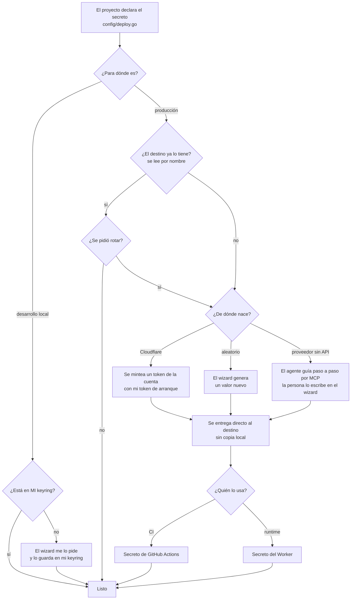

# Flujo de un secreto de despliegue

Pensado para un **equipo**: cualquier persona autorizada aprovisiona, rota y despliega sin recibir
nada de otra.

| Lugar | Qué guarda | Quién lo lee |
|---|---|---|
| **Destino** (nube) | Los secretos de **producción**: secretos de GitHub Actions (token de deploy, ID de cuenta) y secretos del Worker (secretos de runtime). Es el **único** lugar donde existen. | CI al desplegar; el Worker al ejecutarse |
| **Keyring de cada persona** (`webtyp/keyring`) | Solo **lo personal**: su token de arranque de Cloudflare y los secretos de **su** entorno de desarrollo. | el wizard de esa persona; el servidor de desarrollo local |
| **Origen** | Donde nace un valor de producción: Cloudflare lo mintea, el wizard lo genera, o la persona lo escribe en el wizard (proveedor sin API). Se entrega al destino y no se guarda en ninguna otra parte. | nadie después de entregarlo |

Nunca en `.env`, en el repo, en un plan ni en el chat.

**Los destinos son de solo escritura**: ni GitHub ni Cloudflare devuelven el valor. Por eso nadie
"recupera" un secreto de producción: **se rota** (se crea uno nuevo y reemplaza al anterior). Saber
si un secreto existe y cuándo cambió se lee de los metadatos del destino (nombres y `updated_at`),
nunca del valor.

Dar de baja a una persona no exige rotar nada: se la quita de la cuenta de Cloudflare y de la
organización de GitHub. Los tokens por proyecto pertenecen a la cuenta, no a quien los creó.
