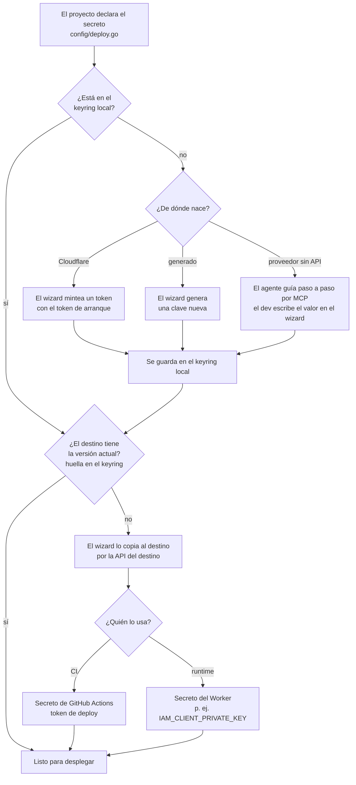

# Flujo de un secreto de despliegue

> STATUS (quitar esta nota al cerrar P21 de DEPLOY_WIZARD_MASTER_PLAN.md): este flujo supone un solo desarrollador. La propuesta para equipos elimina la copia local de los secretos de producción; si se acepta, este diagrama se reescribe.

Un secreto tiene **tres lugares**, cada uno con un papel distinto:

| Lugar | Qué es | Quién lo lee |
|---|---|---|
| **Origen** | Donde nace el valor: Cloudflare lo mintea, el wizard lo genera, o lo entrega un proveedor sin API (consola de Google). | nadie después de entregarlo |
| **Keyring local** (`webtyp/keyring`) | La copia del desarrollador en el almacén de credenciales del sistema operativo. Es la **fuente** desde la que el wizard alimenta los destinos. | el wizard, al aprovisionar |
| **Destino** (nube) | Donde vive en producción: secretos de GitHub Actions (token de deploy) o secretos del Worker (secretos de runtime). | CI al desplegar; el Worker al ejecutarse |

Nunca está en `.env`, en el repo, en un plan ni en el chat.

**Los destinos son de solo escritura**: ni GitHub ni Cloudflare devuelven el valor de un secreto.
Por eso el keyring **no puede traer** un secreto desde la nube. Si una máquina no lo tiene (máquina
nueva, keyring borrado), el wizard lo **vuelve a crear** (mintea o genera uno nuevo y reemplaza el
del destino) o, si viene de un proveedor sin API, **lo pide** al desarrollador.

En producción el keyring no participa: CI lee su secreto de GitHub Actions y el Worker lee los
suyos de sus bindings. El keyring solo interviene cuando alguien aprovisiona o cambia un secreto
desde su máquina.
