# Arquitectura de Transporte, Validación y RBAC (`webtyp/crud` vs `reg.Operation`)

Este diagrama muestra el recorrido exacto y el orden lógico de una operación desde la pantalla del navegador o cliente MCP hasta la base de datos (`webtyp/orm`), identificando dónde interviene cada pieza de transporte (`form`, `view`, `rpc`, `mcp`, `loopback`, `httpd`, `security`, `crud`, `appkit`) y evaluando con código de colores el nivel de riesgo actual: **Verde** (control seguro y enforzado por el framework), **Amarillo** (doble validación redundante o cobertura parcial) y **Rojo** (hueco en el contrato de interfaz actual que permite saltarse `crud` y abrir rutas `.Public()` o IDOR: `reg.Operation` y `MountAPI`). Las garantías del camino verde están verificadas en `webtyp/crud/tests/security_test.go`, `webtyp/crud/tests/mount_test.go` y `webtyp/server/httpd/enforce.go`.

```mermaid
flowchart TD
    UI["1. Cliente UI (WASM)<br/>webtyp/form + webtyp/view + crudview<br/>Validación UX en blur/submit (model.ValidateFields)<br/>Deriva nombre con crud.Op(sample, action) → _c/_r/_u/_d"] --> CALLER{"2. Canal de Transporte<br/>router.Caller / MCP"}

    CALLER -- "HTTP POST /api/<mod>/<op>" --> AUTHN["3A. Autenticación (httpd, capa más externa)<br/>authn extrae sesión/token → ctx.SetUserID + ctx.SetAssurance<br/>Luego baterías globales: log, gzip, no-cache"]
    CALLER -- "JSON-RPC tools/call" --> MCP_BOOT["3B. Arranque y Gate MCP (webtyp/mcp)<br/>AddTool exige Resource + Action si AccessGuarded<br/>handleToolCall verifica UserID + model.Allowed"]
    CALLER -- "En memoria (demos/tests)" --> LOOP["3C. Loopback (webtyp/router/loopback)<br/>Inyecta tenant_id en tests/demos<br/>⚠️ noopRoute descarta .Requires() (sin RBAC)"]

    AUTHN --> RBAC_BOOT["4. Gate RBAC en Arranque y Runtime (server/httpd)<br/>Arranque: validateRBAC() aborta si AccessGuarded sin Resource/Action<br/>Runtime: verifica UserID, MFA y model.Allowed(authorizer, user, res, act)"]
    RBAC_BOOT --> SEC["5. Middleware de la app (r.Use, detrás del gate)<br/>router/security.Policy: cabeceras CSP/XFO/nosniff/HSTS<br/>y tope de cuerpo 1 MiB (413), medido tras leer ctx.Body()<br/>⚠️ Opcional: solo lo monta veltylabs/iam/config/routes.go<br/>⚠️ Sin CSRF, CORS, rate-limit ni timeout en el framework"]

    SEC --> MOUNT{"6. Contrato de Montaje del Módulo<br/>Hoy: MountOperations(reg router.OperationRegistry) y MountAPI(r router.Router)<br/>Propuesta: crud.Module + App.Infra (P1, P2)"}
    MCP_BOOT --> MOUNT
    LOOP --> MOUNT

    MOUNT -- "Contrato Cerrado (webtyp/crud)" --> CRUD_MOUNT["7A. crud.Registry (Create | Read | Update | Delete)<br/>✅ Sin método Operation(name, HandlerFunc)<br/>✅ Nombre canónico crud.Op(m, action)<br/>✅ RBAC sellado .Requires(Resource(ModelName), action)<br/>✅ crud.Route sin .Public() ni .Authenticated()<br/>✅ crud.Caller con UserID de la sesión (P3)"]
    MOUNT -- "Hueco 1: router.OperationRegistry" --> RAW_OP["7B. reg.Operation(name, handler) Directo<br/>🚨 OperationRegistry expone Operation(name, h) Route<br/>🚨 patient_directory/ops.go:83,97,111 lee args.TenantId (IDOR)<br/>🚨 room_layout/ops.go:529 encadena .Public() sin permiso de la app"]
    MOUNT -- "Hueco 2: router.APIModule" --> RAW_API["7C. MountAPI(r router.Router)<br/>🚨 appkit/serve.go:58-62 entrega el Router completo<br/>a todo módulo que implemente MountAPI<br/>🚨 r.Post(...).Public() compila aunque se cierre 7B"]

    CRUD_MOUNT --> CRUD_VAL["8. Validación Centralizada de Cable (crud/validate.go)<br/>✅ Cap(Limit) ≤ 500 · validateIDs: sin vacíos ni lotes > 500<br/>✅ validateCreateBatch: model.ValidateFields + Validator<br/>✅ validateUpdateFields: bloquea PK/tenant_id y campos desconocidos<br/>⚠️ MountRead recorta en silencio Search/After/ID largos (D6)<br/>⚠️ No bloquea campos solo-servidor (P6)"]

    RAW_OP --> MOD_RAW["9B. Handler Manual en ops.go<br/>🚨 Recibe router.Context crudo y salta crud/validate.go<br/>🚨 Recibe router.Route con .Public() / .Authenticated()<br/>⚠️ Importa webtyp/view en servidor"]
    RAW_API --> MOD_RAW

    CRUD_VAL --> MOD_DOM["9A. Dominio del Módulo (crud.go / queries.go / module.go)<br/>⚠️ Doble validación manual hoy: repite if p.Name == '' / if p.Sex != ...<br/>✅ Lo que SÍ pertenece aquí: invariantes de negocio<br/>(ValidateRUT, unicidad por tenant, transiciones de estado)"]
    MOD_RAW --> MOD_DOM

    MOD_DOM --> ORM["10. Persistencia (webtyp/orm/db.go + validate.go)<br/>✅ validateQuery: comprueba ModelName y len(Schema)==len(Pointers)<br/>✅ UpdateFields: verifica columnas en Schema y sin duplicados<br/>✅ Create lote envuelto en m.db.Tx (atómico)"]

    style UI fill:#1e4620,stroke:#4caf50,color:#ffffff
    style AUTHN fill:#1e4620,stroke:#4caf50,color:#ffffff
    style MCP_BOOT fill:#1e4620,stroke:#4caf50,color:#ffffff
    style LOOP fill:#5c4813,stroke:#ffc107,color:#ffffff
    style RBAC_BOOT fill:#1e4620,stroke:#4caf50,color:#ffffff
    style SEC fill:#5c4813,stroke:#ffc107,color:#ffffff
    style CRUD_MOUNT fill:#1e4620,stroke:#4caf50,color:#ffffff
    style CRUD_VAL fill:#5c4813,stroke:#ffc107,color:#ffffff
    style RAW_OP fill:#5f1a1a,stroke:#f44336,color:#ffffff
    style RAW_API fill:#5f1a1a,stroke:#f44336,color:#ffffff
    style MOD_RAW fill:#5f1a1a,stroke:#f44336,color:#ffffff
    style MOD_DOM fill:#5c4813,stroke:#ffc107,color:#ffffff
    style ORM fill:#1e4620,stroke:#4caf50,color:#ffffff
```



## 1. Recorrido Paso a Paso del Orden Lógico

1. **Paso 1 — Cliente UI (`webtyp/form`, `webtyp/view`, `webtyp/layout/crudview`) [Verde]:** El formulario en el navegador ejecuta `model.ValidateFields` al perder foco (`blur`) y al enviar (`submit`) para dar respuesta visual inmediata al usuario sin esperar a la red. Cuando el formulario es válido, `view.CallerLister` invoca al transporte usando el nombre derivado por `crud.Op(sample, action)` (`"<ModelName>_c|_r|_u|_d"`, `crud/op.go:24`).
2. **Pasos 2 a 5 — Perímetro de Transporte y RBAC (`httpd`, `mcp`, `loopback`, `security`) [Verde en HTTP/MCP · Amarillo en Loopback y `security`]:**
   - En **HTTP (`server/httpd/adapter.go:438-519`)** el orden real, de fuera hacia dentro, es: `authn` (paso 3A, capa más externa: la identidad debe existir antes de que el gate decida), las baterías globales de la librería (log, gzip, no-cache, fuera del gate para que un rechazo quede registrado), el **Gate RBAC** (paso 4) y, detrás del gate, los middlewares que la app registra con `r.Use` (paso 5).
   - **`router/security.Policy` (paso 5)** solo pone cabeceras (CSP, X-Frame-Options, nosniff, Referrer/Permissions-Policy, HSTS) y un tope de cuerpo de 1 MiB que responde `413`; el tope se mide con `len(ctx.Body())`, es decir, después de leer el cuerpo. Es **opcional**: hoy solo lo monta `veltylabs/iam/config/routes.go:39`. El framework **no** trae CSRF por `Sec-Fetch`, CORS, comprobación de Host, rate-limit ni timeout (el rate-limit existe solo en `auth/limiter.go` para el login).
   - En **MCP (`webtyp/mcp`)**, `AddTool` exige en arranque que toda herramienta `AccessGuarded` tenga `Resource` y `Action`, y `handleToolCall` verifica identidad y `model.Allowed` en cada invocación (paso 3B).
   - En **Loopback (`router/loopback`)**, usado solo en demos WASM y tests en memoria (paso 3C), `noopRoute` descarta `.Requires(...)` porque corre en el mismo proceso sin `Authorizer`.
3. **Pasos 6 a 8 — Bifurcación Crítica en el Contrato de Interfaz (`crud.Registry` [Verde] vs `router.OperationRegistry` [Rojo]):**
   - Hoy `router.OperationModule` entrega al módulo un `router.OperationRegistry` que expone `Operation(name string, h HandlerFunc) router.Route`. Eso habilita el camino rojo (pasos 7B y 9B).
   - Además, `appkit/serve.go:58-62` detecta por tipo a todo módulo que implemente `MountAPI` y le entrega el `router.Router` completo (paso 7C). Cerrar solo `OperationRegistry` deja esta segunda puerta abierta (master P2).
   - Cerrando el contrato de interfaz para que el módulo reciba únicamente `crud.Registry` (pasos 7A y 8), el método `Operation(name, h)` y los métodos `.Public()` / `.Authenticated()` de `router.Route` **dejan de existir en el tipo que recibe el módulo**: saltarse `webtyp/crud` se convierte en un **error de compilación**, siempre que `appkit` deje de aceptar `MountAPI` desde módulos de dominio (P2).
4. **Pasos 9 y 10 — Dominio del Módulo y Base de Datos (`module.go` [Amarillo] → `webtyp/orm` [Verde]):**
   - El módulo aplica sus invariantes de negocio y delega en `orm.DB`, el cual valida la integridad estructural de la consulta (`validateQuery` en `orm/validate.go`) y ejecuta el SQL parametrizado (dentro de `m.db.Tx` para lotes).

---

## 2. Respuestas a las 4 Preguntas de Auditoría

### 2.1. ¿Se está realizando doble validación, o la están realizando los módulos?

**Sí: hoy existe doble validación (y triple contando el cliente) sobre las reglas de formato/esquema, mientras que las operaciones crudas carecen de validación de transporte.**

| Capa | Qué valida hoy | Diagnóstico | Qué debe validar (Regla Zero-Debt) |
|---|---|---|---|
| **1. UI (`webtyp/form`)** | `model.ValidateFields` (`NotNull`, `Permitted`, `Type.Validate`) en `blur`/`submit` | 🟢 **Correcto (UX)** | Mantener: evita viajes de red innecesarios, pero nunca reemplaza al servidor |
| **2. Transporte (`webtyp/crud/validate.go`)** | Límites de cable (`MaxPage=500`, `MaxSearch=256`, `MaxAfter=128`, `MaxID=128`; en `Read` hoy se **recortan** en silencio en vez de rechazarse, D6), `validateIDs`, inmutabilidad de PK/`tenant_id`, y **`model.ValidateFields` + `model.Validator`** sobre cada registro/campo entrante | 🟢 **Correcto (Frontera de Seguridad)** | Ser el **único lugar** del servidor donde se valida el esquema declarativo (`Schema()`) y las cotas del payload |
| **3. Módulo (`veltylabs/modules/*`)** | En módulos como `patient_directory/module.go:119-135` y `168-191`, el código **repite a mano** con `if` imperativos validaciones que ya están en `PatientModel.Fields` (`if p.Name == ""`, `if p.Sex != "m" && p.Sex != "f"`) | 🟡 **Doble validación redundante** | **Eliminar del módulo** los `if` que duplican `NotNull`/`Permitted`/`input.*` del `Schema()`, o delegar en `model.ValidateFields` en constructores internos (`ImportPatient`). El módulo **solo** debe validar **invariantes de dominio y estado** que requieren dependencias o BD (`checkDocument` con `ValidateRUT`, unicidad por tenant `findSameDocument`, idempotencia) |
| **4. ORM (`webtyp/orm/validate.go`)** | `validateQuery`: solo comprueba `m.ModelName() != ""`, `len(Schema()) == len(Pointers())` y en `UpdateFields` que las columnas existan en `Schema()` sin duplicarse | 🟢 **Correcto (Sin doble validación de campos)** | Mantener: `orm` valida la estructura del query SQL, no re-ejecuta `model.ValidateFields` |

### 2.2. ¿Actualmente quién impide a los módulos armar por su cuenta el registro (`reg.Operation`) para salir online?

**Nadie (Riesgo Rojo): el propio contrato `router.OperationModule` les entrega el método crudo, y `router.APIModule` les entrega el `Router` completo.**
- `appkit.BuildServer` (`appkit/serve.go:58-60`), `rpc.Mount` (`rpc/mount.go:136`) y `mcp.HarvestOps` (`mcp/harvest.go:31`) aceptan `router.OperationModule` (`MountOperations(reg router.OperationRegistry)`).
- La interfaz `router.OperationRegistry` (`router/router.go:192-197`) expone `Operation(name string, h HandlerFunc) Route`.
- **Evidencia real en el código actual de por qué este hueco es crítico:**
  1. **Vulnerabilidad IDOR Cross-Tenant (`veltylabs/modules/patient_directory/ops.go:83, 97, 111`):** Al usar `reg.Operation` con handlers propios, `opGetPatient`, `opFindPatientByRut` y `opDeactivatePatient` leen **`args.TenantId` directamente del JSON del cliente** (`m.getPatient(args.TenantId, args.Id)` y `m.deactivatePatient(args.TenantId, args.Id)`), permitiendo a cualquier usuario autenticado consultar o desactivar pacientes de otra clínica.
  2. **Exposición pública no autorizada (`veltylabs/modules/room_layout/ops.go:508-529`):** Como `reg.Operation` devuelve `router.Route`, el módulo encadenó `.Public()` por su cuenta (`reg.Operation(OpListPublicAvailability, ...).Public()`), abriendo un endpoint sin autenticación a internet desde dentro de un módulo de dominio sin que la aplicación lo autorizara en `config/`.
  3. **Salto de `crud/validate.go`:** Las operaciones registradas con `reg.Operation` no pasan por `validateIDs`, `validateCreateBatch`, `validateUpdateFields` ni `Cap`.
  4. **Suplantación de autor (`appointment_booking/model_orm.go:836`):** `CreateReservationArgs.CreatorUserId` llega desde el JSON del cliente en vez de salir de la sesión (master P3).
  5. **Segunda puerta (`appkit/serve.go:58-62`):** cualquier módulo que implemente `MountAPI(r router.Router)` recibe el router completo; hoy ningún módulo de `veltylabs` lo usa, pero es la salida obvia al cerrar `reg.Operation` (master P2).

### 2.3. ¿Se está realizando RBAC en el proceso?

**Sí en HTTP (`server/httpd`) y en MCP (`webtyp/mcp`), pero `router.Route` devuelto por `reg.Operation` permite que el módulo lo debilite con `.Public()`, `.Authenticated()` o una `model.Action` equivocada:**
1. **Cerrado por defecto (`model.AccessGuarded = 0`):** En `router/route.go:58-65`, el valor cero de `RouteInfo.Access` es `model.AccessGuarded`.
2. **Gate de Arranque (`httpd/enforce.go:10-32` y `mcp/server.go:74-97`):** Al construir el servidor, `validateRBAC()` aborta el arranque si una ruta `AccessGuarded` no declara `Resource` o `Action`.
3. **Gate de Runtime (`httpd/adapter.go:462-501` y `mcp/server.go:171-190`):** Verifica `ctx.UserID() != ""`, MFA y `model.Allowed(authorizer, userID, resource, action)` antes de ejecutar el handler.
4. **El hueco en `router.Route` (Rojo/Amarillo):** Como `router.Route` expone `.Public()`, `.Authenticated()` y `.Requires(res, act)`, un módulo que recibe `router.Route` puede sobrescribir el acceso a `.Public()` (como hizo `room_layout/ops.go:529`) o declarar `model.Read` en una operación de escritura, pasando `validateRBAC` sin error.

### 2.4. Contrato de Interfaz Propuesto (`crud.Registry` + `crud.Module` + `crud.Route`)

Para que el uso de `webtyp/crud` sea **obligatorio en tiempo de compilación** (sin depender de linters externos como `gocheck`), se reemplaza `router.OperationModule` por `crud.Module` y las 4 funciones sueltas `crud.Mount*` pasan a ser los 4 métodos de `crud.Registry`. Esta es la **forma base**: la firma final depende de master P3 (`crud.Caller` como primer argumento), P4 (filtro tipado en `Read`) y P7 (adaptadores generados por `ormc`), y el cierre total exige P2 (`App.Infra`).

```go
// En webtyp.com/crud:

// Route es el descriptor restringido devuelto al montar una operación CRUD.
// NO expone Public(), Authenticated() ni Requires(): crud fija internamente
// .Requires(model.Resource(m.ModelName()), action) y ningún módulo puede abrir
// una ruta al público ni cambiar el permiso en tiempo de compilación.
type Route interface {
	RequiresMFA() Route
	Describe(text string) Route
}

// Registry es el único contrato que recibe un módulo en MountOperations.
// NO tiene Operation(name, HandlerFunc): por contrato de interfaz, un módulo
// solo puede registrar Create, Read, Update y Delete pasando por validate.go.
type Registry interface {
	Create(newList func() model.ModelSlice, create func(list model.ModelSlice) error) Route
	Read(m model.ModuleNaming, read func(args ReadArgs) (model.ModelSlice, error)) Route
	Update(newRecord func() model.Model, update func(ids, fields []string, rec model.Model) error) Route
	Delete(m model.ModuleNaming, remove func(ids []string) error) Route
}

// Module reemplaza a router.OperationModule en appkit, rpc.Mount, mcp.HarvestOps y loopback.
type Module interface {
	model.ModuleNaming
	MountOperations(reg Registry)
}
```

---

## 3. Análisis de Pros, Contras y Mitigaciones de la Propuesta para el Framework

### 3.1. Pros (Ventajas Arquitectónicas para el Framework)

| # | Pro | Justificación técnica para el framework |
|---|---|---|
| **P1** | **Imposibilidad en tiempo de compilación de saltarse `crud/validate.go` (*Illegal states unrepresentable*)** | Al eliminar `router.OperationModule` y entregar al módulo únicamente `crud.Registry`, el método `Operation(name, HandlerFunc)` deja de existir en el alcance del módulo. Ningún desarrollador ni agente puede registrar un handler que omita `validateIDs`, `validateCreateBatch`, `validateUpdateFields` o `Cap(limit)`: cualquier intento no compila. |
| **P2** | **Erradicación por construcción de vulnerabilidades IDOR Cross-Tenant (`args.TenantId`)** | Un módulo nunca recibe `router.Context` ni puede llamar a `ctx.Decode(&customArgs)`. Los únicos datos que cruzan hacia el módulo son `model.ModelSlice` (en `Create`), `crud.ReadArgs` (que no tiene `TenantId`), `(ids, fields []string, rec model.Model)` (donde `validateUpdateFields` ya rechazó `"tenant_id"`) y, si P3 = A, `crud.Caller` con el `UserID` de la sesión. El módulo está forzado por firma a usar el `m.tenantID` inyectado en el servidor. Ojo: en `Create` el registro trae todos sus campos, así que un `tenant_id` enviado por el cliente debe sobrescribirse en el módulo o bloquearse con la marca de P6. |
| **P3** | **RBAC inmutable y sellado por operación (`crud.Route` sin `.Public()` ni `.Authenticated()`)** | `crud` asigna `.Requires(model.Resource(m.ModelName()), model.Create\|Read\|Update\|Delete)` y devuelve `crud.Route` (que solo expone `RequiresMFA()` y `Describe(string)`). Es imposible en compilación que un módulo abra por accidente un endpoint `.Public()` (como ocurrió en `room_layout/ops.go:529`) o asigne `model.Read` a una operación que muta datos (`Update`/`Delete`). |
| **P4** | **Superficie de transporte 100% predecible y uniforme para clientes (`view`, `mcp`, `dbsync`)** | Cada entidad expone como máximo 4 operaciones con nombres deterministas (`crud.Op(m, action)` → `<entity>_c`, `<entity>_r`, `<entity>_u`, `<entity>_d`) y esquemas `.Accepts(...)` fijos. `view.Ops` en el navegador, `mcp.HarvestOps` para agentes LLM y `dbsync` para sincronización offline pueden descubrir y operar cualquier módulo sin configuración manual ni constantes `Op*`. |
| **P5** | **Reducción del binario WASM y eliminación de código repetido en módulos (DRY extremo)** | Desaparecen de todos los módulos las constantes `Op*`, los structs `*Args` de transporte (`Get*Args`, `Deactivate*Args`, `Delete*Args`) y sus métodos generados en `model_orm.go`, además de los bloques repetidos `ctx.Decode` / `rpc.WriteError` / `ctx.Encode`. Los módulos dejan de importar `webtyp.com/rpc` y `webtyp.com/view` en el servidor. |

---

### 3.2. Contras (Riesgos y Limitaciones reales para el Framework), Justificación y Mitigación

#### Contra 1: Riesgo de ciclo de dependencias entre módulos Go (`webtyp/router` ↔ `webtyp/crud` ↔ `webtyp/rpc`)
- **Por qué es importante para el framework:**
  - Hoy `webtyp/router/loopback` vive dentro del repositorio `webtyp/router` (`webtyp.com/router/loopback`) y consume `router.OperationModule`.
  - A su vez, `webtyp/crud` importa `webtyp.com/router` y `webtyp.com/rpc` (mientras que `rpc` importa `router`).
  - Si `crud` define `crud.Module`, entonces:
    1. `rpc` necesita importar `crud` (para `rpc.Mount(r, prefix, log, modules ...crud.Module)`), lo cual choca si `crud` sigue importando `rpc` (`crud` ↔ `rpc`).
    2. `router/loopback` no puede importar `crud` si sigue viviendo dentro del módulo `webtyp.com/router`, porque `crud` ya importa `webtyp.com/router` (`router` ↔ `crud`).
- **Cómo se mitiga y por qué:**
  1. **Mover `WriteError` de `webtyp/rpc` a `webtyp/router` y quitar `rpc` de `crud/go.mod`:**
     - **Por qué:** `router/problem.go` ya es dueño de `router.Problem`, `router.StatusOf` y `router.KindOfStatus`. `rpc.WriteError` (`rpc/errors.go:52-71`) son 18 líneas que solo usan `model.KindOf`, `router.StatusOf`, `router.Problem` y `router.Context`. Al poner `router.WriteError(ctx, err)` en `webtyp/router`, `webtyp/crud` deja de importar `webtyp/rpc`. El grafo queda estrictamente unidireccional (DAG): `model` → `router` → `crud` → (`rpc`, `mcp`, `dbsync`, `view`, `appkit`).
  2. **Ubicar el constructor de loopback para módulos CRUD en `crud.Loopback`, delegando en `router/loopback`:**
     - **Por qué:** `router/loopback` sigue usando la primitiva interna `router.OperationRegistry` sin importar `crud`, y `crud.Loopback` adapta `crud.Module` encima, manteniendo a `webtyp/router` como librería base sin dependencias hacia arriba (master D5 y fase A1).

#### Contra 2: Pérdida de acceso a la identidad del llamador (`ctx.UserID()`) en operaciones que dependen del usuario en sesión (auditoría o perfil propio como `auth.OpMe`)
- **Por qué es importante para el framework:**
  - Al ocultar `router.Context` detrás de `crud.Registry`, los callbacks del módulo (`Create`, `Read`, `Update`, `Delete`) no ven `ctx.UserID()`.
  - Esto afecta dos casos reales del ecosistema:
    1. **Operaciones sobre el propio usuario autenticado (`auth.OpMe` en `webtyp/auth/authority/ops.go:13`):** usa `.Authenticated()` (no RBAC por recurso) y lee `ctx.UserID()` para devolver el `ProfileDTO` de la sesión actual.
    2. **Trazabilidad y auditoría por usuario en módulos de negocio (`cash_manager`, `clinical_encounter`, `access`, `chat_room`):** donde una creación o actualización debe registrar qué `user_id` autenticado realizó la acción (`created_by`, `author_id`, `cashier_id`), dato que jamás debe confiarse al JSON del cliente.
- **Cómo se mitiga y por qué (pendiente de master P2 y P3):**
  1. **Infraestructura de sesión fuera de `crud.Module`, declarada por la app (P2):**
     - **Por qué:** `auth.OpMe` (`/api/auth/me`), igual que `/api/auth/logout` y `/api/auth/passkey/*`, no es una tabla CRUD sino inspección de la sesión HTTP actual. Va en `App.Infra` (único lugar con `router.Router`), que escribe la app en `config/`; un módulo de dominio no puede llegar ahí por su cuenta.
  2. **`crud.Caller{UserID}` como primer argumento de las 4 funciones (P3):**
     - **Por qué:** `crud` lo rellena desde `ctx.UserID()` ya verificado por el gate; el módulo sabe quién opera sin ver `router.Context`, sin leer cabeceras ni escribir respuestas crudas. Cubre `payment_manager/ops.go:126` (`CreatedBy`), `chat_room/ops.go:96-238` (lecturas filtradas por usuario) y elimina `CreatorUserId` del JSON en `appointment_booking`.

#### Contra 3: Rigidez de `crud.ReadArgs` (`ID`, `Search`, `After`, `Limit`) frente a consultas de dominio con múltiples parámetros tipados (ej. agenda por rango de fechas, profesional y servicio)
- **Por qué es importante para el framework:**
  - Para el 90% de las entidades (catálogos, pacientes, personal, salas, insumos), `ID` (lectura puntual) + `Search` (búsqueda inteligente por RUT/teléfono/nombre) + `After`/`Limit` (paginación por cursor) cubre todas las lecturas.
  - Pero en módulos con consultas multidimensionales (ej. `appointment_booking` buscando bloques disponibles entre `from_unix` y `to_unix` para un `staff_id` y `service_id`, o `cash_manager` consultando movimientos de una sesión de caja y turno), meter 3 o 4 filtros dentro del string `Search` obligaría a concatenar y parsear strings (`"staff:1|from:170000"`), violando la regla 1 de **api-harness** (*Typed over stringly-typed*).
- **Cómo se mitiga y por qué (pendiente de master P4; recomendado: filtro tipado opcional en `reg.Read`):**
  1. **Modelar las proyecciones/consultas de dominio como modelos de lectura (`model.Definition` de solo lectura) o permitir un filtro `model.Fielder` tipado en `Read`:**
     - **Por qué:** Si una consulta compleja se registra en `reg.Read` declarando su propio `model.Definition` de consulta (o si `ReadArgs` / `reg.Read` permite un `Filter model.Fielder` opcional validado por `model.ValidateFields`), el transporte mantiene exactamente las mismas garantías: RBAC sellado en `model.Read`, límite de página `Cap(Limit) ≤ 500`, validación declarativa de cada campo del filtro en `crud/validate.go` y cero strings mágicos.

#### Contra 4: Semántica de acciones de negocio y máquinas de estado sobre `Update` (ej. desactivar paciente, cerrar turno de caja, completar consulta clínica, liquidar convenio)
- **Por qué es importante para el framework:**
  - En lugar de tener operaciones RPC dedicadas (`deactivate_patient`, `complete_visit`, `settle_accrual`), toda mutación de una entidad existente entra por `Update(ids, fields []string, rec model.Model)`.
  - Si un módulo implementa `Update` como un simple `m.db.UpdateFields(&rec, fields, ...)` genérico sin inspeccionar qué campos cambian:
    1. Un cliente podría enviar `fields: ["updated_at", "balance"]` intentando alterar columnas calculadas por el servidor.
    2. Una transición de estado (ej. `is_active: false` o `status: "completed"`) podría guardarse sin ejecutar los efectos laterales obligatorios (publicar `TopicPatientDeactivated` o validar que una visita cerrada no se vuelva a editar).
- **Cómo se mitiga y por qué:**
  1. **Bloquear campos calculados/de solo-servidor en `crud/validate.go` (master P6):**
     - **Por qué:** Así como `validateUpdateFields` ya rechaza `f.IsPK()` y `"tenant_id"`, un campo marcado `ServerOnly` en `model.Field` (`balance`, `created_by`, `updated_at`) se rechaza en `Create` y `Update` con `400` (`ErrInvalidField`) antes de llegar al módulo. Requiere la fase A0 en `webtyp/model`.
  2. **Transiciones de estado explícitas guiadas por `fields` dentro de `Update<Entity>` (en `m.db.Tx`):**
     - **Por qué:** En `crud.go`, `Update<Entity>(ids, fields []string, rec <Entity>)` corre dentro de `m.db.Tx`, verifica el estado actual de la fila en la BD cuando `fields` toca un campo de estado (`is_active`, `status`) y dispara la validación de transición y el evento de dominio exacto (`TopicPatientDeactivated` vs `TopicPatientUpdated`). Así se conserva una única puerta de transporte (`Update`) sin perder ninguna regla del dominio.

#### Contra 5: Aserciones de tipo manuales (`*list.(*PatientList)` y `*rec.(*Patient)`) en `ops.go` al no usar genéricos
- **Por qué es importante para el framework:**
  - Por decisión de diseño de `webtyp` (0 genéricos para mantener compilación rápida en TinyGo y lectura secuencial), `crud.Registry` usa `model.ModelSlice` y `model.Model` en las firmas de `Create` y `Update`.
  - Eso requiere que en `ops.go` el módulo haga `list.(*PatientList)` y `rec.(*Patient)`. Si alguien empareja por error `func() model.ModelSlice { return &FloorList{} }` con `list.(*RoomList)` en un módulo multi-entidad, compila y falla con `panic` al recibir la primera petición `Create`.
- **Cómo se mitiga y por qué:**
  1. **Generar adaptadores tipados en `ormc` (`model_crud.go`, `//go:build !browser`; master P7) y validar las 4 operaciones en arranque:**
     - **Por qué:** `ormc` ya conoce el tipo exacto `Patient` y `PatientList`; genera `MountPatientCreate(reg, m.CreatePatients)` y el módulo nunca escribe una conversión de tipo. Además, si `crud.Registry.Create` y `Update` llaman una vez a `newList()` / `newRecord()` en el momento de ejecutar `MountOperations(reg)` (en el arranque del servidor, antes de aceptar tráfico), se verifica en el boot que el tipo no sea nil y que su `ModelName()` y `Schema()` sean válidos, convirtiendo cualquier error de cableado en un fallo inmediato al arrancar el binario (regla 5 de **api-harness**: *Compile error → loud startup diagnostic → never a silent runtime failure*).

#### Contra 6: Lecturas públicas legítimas (disponibilidad para reserva online)
- **Por qué es importante para el framework:**
  - `room_layout/ops.go:508-529` muestra disponibilidad a visitantes sin sesión. Es una necesidad real del negocio, no solo un error: el defecto es que lo decide el módulo y no la app.
  - Si `crud.Route` prohíbe `.Public()` sin ofrecer otro camino, la presión empuja a usar la segunda puerta (`MountAPI`, paso 7C).
- **Cómo se mitiga y por qué (pendiente de master P5):**
  1. **La app declara en `config/` qué lecturas son públicas (`App.PublicReads`):**
     - **Por qué:** `crud` monta esa lectura como pública solo para `Read`, con la misma validación de `crud/validate.go` y `Cap`; la decisión de publicar algo queda en una línea visible de la composition root, nunca dentro de un módulo.
